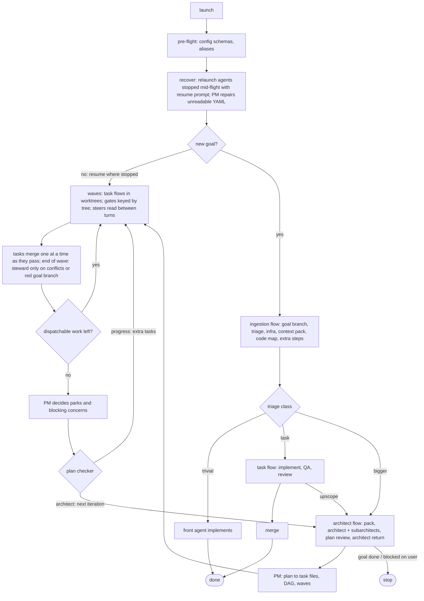

# Agentic software factory — INTENT

Everything above **Mechanics** is intent: built and tested. **Mechanics** are defaults, built as written; the architect may change one on evidence, recording why.

## High-level intent

- [[ctxOnly:HighLevelVision]] Modern harnesses deliver a decent story (several hundred lines of code). The agentic software factory is an orchestration framework on top of harnesses that delivers up to a saga (an entire product) or a major refactoring — token-efficient, slop-free, steerable, observable, autonomous, harness agnostic. One goal may span many epics and tens of tasks per iteration, across multiple resumable iterations; no size ceiling.
    - Stop in the middle, relaunch — it keeps going; avoid duplicate work and preserve token economics.
    - Automatically scales from "trivial" to "task" to "epic" to "saga".
- [[DomainAgnosticFlows]] Configurable for different flows and project types:
    - software delivery: stack, testing and build framework agnostic;
    - silicon and industrial design;
    - deep research;
    - loop-based optimization — e.g. the architect selects the most promising directions to try, the PM creates tasks to research and implement approaches; they are merged; the architect decides what to do next, including pruning unpromising tasks.
    - Every flow assumes committed artifacts, git worktrees and shell scripts for deterministic checks. The minimum common denominator for a check is a shell script — its exit code and log alone; no JUnit or runner-specific format required. Runner-specific parsers (pytest, jest, JUnit, …) may stay in the kernel as optional helpers. For project types other than software delivery this is a design constraint — nothing software-specific is required by the kernel — demonstrated by review; no presets or runs required.
- [[ScalabilityTiers]] The factory auto-scales:
    - trivial — the whole goal handled by one cheap model launch;
    - task — a configured flow (one of several) of implementer, reviewer, etc.;
    - epic — multiple interdependent tasks, each in its own branch, with review, etc.;
    - saga — high-level goals map to software layers; split into a hierarchy, with orchestration agents (architects, PMs, plan checkers) instantiated per epic. For now: only one level down, and all tasks merge to the goal branch (single steward), no per-epic branch.

### Model economics and focus

- [[ctxOnly:ModelEconomics]] The cost (or subscription use) gap between frontier models (Opus, Fable, Astra) and capable implementer models (DeepSeek/Qwen Flash, Haiku, Luna, Sol on Low) is ~40–80x; sometimes there are "free" up-to-limit models. Speed also varies dramatically, sometimes 10x. For humans, even with global pay differentials, the price delta is 30%–5x (sometimes with a 10x performance delta). The factory aggressively leverages cheaper models — focused tasks, context preparation for expensive models, etc. Per call, the architect may dominate the bill.
    - Eliminate any waste — tokens, time, infra. For example, building i1–i5 wasted 44% of turns (outcome-file repair, infra); that costs more than any model choice.
    - Reported costs vary (subscriptions, subsidies, provider reports). For analysis, assume relative cost per unit of work: cheapest 0.1–1x, decent task level 2x, task escalation 20x, architect 50x. Hence rare architect involvement and focused context for tasks, where Flash-class models are very capable.
    - Yardsticks: relative cost, tokens and wall time per merged task; wasted-turn share.
- [[ctxOnly:ModelTierTaxonomy]] For design purposes:
    - **Architect** (expensive) — frontier models (Opus, Fable, Astra, Kimi); see ConfigurableArchitectFlow.
    - **Sr. Implementer/Workhorse** — focused task, code review, debugging, research, etc. Task-level models include DeepSeek v41 1017, Muse/Ember, Luna, Haiku (of limited use since the 100k-context price increase), Gemini Flash/Hydrogen.
    - **Simple** — orchestration fix-ups, explorations, context preparation, schema repair, commits, running gates, etc.
    - **KERNEL** is not a model: it is the deterministic orchestration application ("the script", KernelCore).
- [[ctxOnly:ContextAndFocus]] Context and focus are as important as model tier/diversity.
    - It is a popular belief that improvement needs a smarter model and provider diversity, and that planning needs a very smart model. That is not entirely true.
    - Smaller models are more likely to make suboptimal decisions and degrade more quickly on contradictory and/or complex context and on tradeoffs, but work quite well on a well-defined, focused task, even one of an architecture or planning nature: a smaller model can perfectly plan or define an architecture; it degrades when it has to consider call graphs and edge cases at the same time.
    - Any model, small or large — including the author's own model — can perfectly review results, even those of a larger model. The job of the smarter actor is to make sure results AND motivation are understandable to small actors.
    - Consequence: well-defined planning and review work may go to task-tier models.
- [[ctxOnly:AvoidedPatterns]] Patterns we avoid:
    - "Smart orchestrator on top" swarms — sometimes work for medium-scoped tasks, but considerable research shows they are not always cheaper than a smart model doing end-to-end. In our experience, besides burning tokens on trivial orchestration mechanics, when something goes non-trivial the orchestrator tends to take over all the work.
    - "Smart planner" — the plan sometimes gets more detailed than the code, and it assumes a smart planner can think through everything perfectly. In reality all development must be experimental and test-driven.
    - "Smart reviewer" — beneficial, but a Flash-class model with focused context does decent reviews, and the context the reviewer has to build is no different from the planner's; the review result is no different from a plan.

## Actors

- [[KernelCore]] The **kernel** (the script) is the key orchestration player, deterministic: it invokes harnesses with agents, reads and validates the structured artifacts agents prepare, checks user steers, executes the commands infra defines (setup, compile, lint, tests), commits and merges, and sets up and cleans worktrees. Parallel operations and rollbacks use git, git worktrees or a compatible faster alternative. Compact code is a goal, tests included — both size and run time.
- [[ConfigurableArchitectFlow]] The **architect** (principal engineer) does only what a human architect does: turns intent into an actionable but directional plan — WHAT has to be done (subject to yet-unknowns) to bring the project to the state INTENT describes — building from scratch or evolving an existing codebase — without adding technical debt or quality issues, in roughly what order, with directional interfaces, key-algorithm direction, tradeoffs above task level, and how to act on concerns from engineers and steers from the user.
    - Called with a prepared context pack; works agentically and subagentically — launching scouts/tasks and waiting for them is fine, with no limits. Subagents are the architect harness's own mechanism; the prompt stays generic (e.g. "explore with cheap subagents").
    - Writes no code beyond key interfaces and no verbose documents: each architect produces one markdown plan, written for architect/reviewer friendliness and efficiency. Maintaining file schemas is not architect work.
    - Unlike a human architect, an agentic one must build context (expensive), so it doubles as the high-level project reviewer — interfaces, key tests, edge-case handling, code compaction and readability of the net change since project start, not implementation details — and uses that to define the plan.
    - The architect flow is launched once per iteration and is configurable: it depends on the reason for launch (initial, concerns, iteration done, steer, …) and covers context preparation, choosing the flow when several apply, the architect, subarchitects with their reviews, plan review, and extra agents (designer, security architect, functional safety, …). Code review is part of it (same context).
- [[AdvisoryPlanReview]] The architect's plan is reviewed for impracticality, lack of clarity and rule violations — real bugs are not unusual even for task-tier reviewers. The reviewer's model (task tier or frontier) is set by config; its context is fresh. Plan review is part of the architecture flow in the factory config — e.g. several separate reviewers, or more than one architect turn when concerns are raised — and completes before the PM derives tasks.
    - Findings: technical concerns and plan-and-dependencies notes. No last-call option (ship/park).
    - Advisory, not a veto: the author considers it across the full range — ignoring it on a factual judgement, clarifying or grounding the plan, or realizing "oops" and changing it. During self-improvement the architect samples whether the review was helpful (one issue caught earlier reduces work 10x).
    - Every review — plan or task — runs in a context different from the author's, even on a same-tier model.
- [[PlanCompletenessChecker]] Once the plan exists, the **plan checker** — a task-level gatekeeper for the architect — decides whether the plan is complete or can still progress with net positive gain within the architect's technical direction. It verifies the plan's status against the repo, reading recorded gate results instead of running gates; it makes simple technical decisions on concerns and emits follow-up tasks (see ConcernsFunnel), which go back to execution, up to a configured number of rounds. The script calls it before every architect consult, also when nothing is parked, blocked or pending.
- [[PmAgent]] The **PM** is the orchestration paper-pusher, not technical and not a peer: it converts the plan into tasks in a DAG (see PlanToTaskReconciliation), owns artifacts, the DAG and the dispatch sets, moves and splits tasks beyond what mechanical orchestration handles, adds environment notes to task files (infra facts, known flakes, workarounds), repairs artifacts and figures out status when the kernel cannot, and triages steers. There is no PM/architect disagreement to resolve: the architect's intent governs.
- [[GoalBranchAndSteward]] The goal branch `factory/<goal>` is cut from the repo's current branch at goal start into its own worktree; the user's checkout is never touched and the user keeps working. The goal branch may receive merges from outside the factory (user, operator); task branches are always cut from its tip. The **steward** is invoked when merges to it conflict or turn CI/CD red (see StewardMergeLadder). Self-build adds protection: the factory runs from the pinned build in a separate worktree (see BootstrapPinnedPromotion).
- [[InfraAgent]] The **infra** agent runs in the ingestion flow and on infra failures.
    - Ingestion: it outputs the commands the kernel runs for the goal (fast/slow tests, worktree preparation, compile, lint, …) — discovered from the repo or taken from config — and their status (yellow/red, specific failures, flakiness). Where needed it wraps commands so the kernel can execute them.
    - Infra failures never create a loop. When the kernel is blocked by an infra failure, or one persists (e.g. the same gate times out twice, a leg fails the same way on every turn), it resumes the infra agent with the evidence. The agent first decides whether the failure is infra at all or really red (e.g. a gate timeout caused by the task's own change), then, for infra, either fixes the cause — in any config layer (repo, factory or local run config), a setting or a script — or prescribes handling: retry, ignore, fall back, stop specific task types, stop altogether, escalate to the architect. Its output is structured either way: verdict (infra / really red), fix made, prescribed handling.
- [[IngestionFlow]] The configurable flow at goal start: create the goal branch and its worktree; front agent triage (trivial / task / bigger); infra agent (commands + status); context pack; scouts map existing code (bigger only); extra configured steps (e.g. a separate agent to retrieve requirements).

### Scope escalation

- [[TrivialGoalFastPath]] One cheap-but-capable **front** agent classifies the goal: trivial / task / bigger (epic, saga). It is not smart enough to decide how big "bigger" is — that is the architect's call.
    - Trivial: the same agent implements in the same session, reusing the context it built: after receiving the classification, the kernel sends a follow-up prompt with the location/branch. No loop.
    - Task or bigger: the same agent prepares the context pack — current status, relevant code facts; commands and their status come from the infra agent. Same context, same agent: no separate triage and context-pack steps.
- [[StandaloneTaskUpscope]] A standalone task does not reach the architect. If several task types are supported, a follow-up prompt asks the front agent for a YAML file naming the task type; then that type's mechanical orchestration runs. The last agent in the chain — the one producing the merge decision/concerns — receives in its prompt/schema the same task-scope definition that triage, architect, PM and architect reviewer have, and is asked whether the delivery is in scope. If not, the bigger flow is launched.
- [[SagaArchitectPlanning]] Part of the architect prompt is the option to define epics: write high-level intent per epic and the scope of each responsible subarchitect. The top architect is responsible for the intent as a whole and may hold individual tasks/spikes (not preferable); it may add subarchitects and define their intents at any iteration, and at each iteration decides which subarchitects are involved.
    - Epic intents form a DAG. Subarchitects are launched with their intents to plan.
    - The kernel launches a PM per top/sub architect, the task flows, plan checkers for the sub-intents applicable to the iteration, and the steward when needed. Steers propagate from the top PM to sub PMs (and sideways to their architects). Plan checkers run bottom-to-top.
    - Once pre-architect orchestration is exhausted, architects run in two passes: bottom-to-top finds what has been done and the gaps, follow-ups and debt; top-to-bottom defines what to do. The first iteration has only top-to-bottom, the last (done) only bottom-to-top, the ones in the middle both.
    - Architect and subarchitect prompts share their common portions — bounds, completeness check, plan format, granularity, debt and stop rules — as templating fragments. Each adds only what differs: its scope (goal or epic), whom it reports to, and launch-specific reminders.
- [[SagaDepthAndLiveProof]] Hierarchy depth is bounded by config: one architect level is the norm, two the expected maximum. A subarchitect is split off only when the size/complexity of architecture context demands focus; until then the architect owns all planning and review down to task level. Untouched levels are not invoked. The split is the architect's call, prompt-based; past a configured number of tasks the prompt reminds him to consider a saga. Saga is proven with a live multi-epic goal.
- [[SagaEscalationChain]] Strict chain: task-level concerns go to the architect responsible for that epic (epic→architect may be many-to-one). The subarchitect filters and consolidates escalations into one brief upward; implementers and reviewers never reach past their architect. The top architect (the goal's) is the root of the chain; at depth 1 it is the only architect.
    - Each subarchitect owns the status summary of its iteration. The architect register is maintained in the saga plan; the top architect may leave out an architect whose job is done.
    - One script owns everything down to task level, task dispatch included — through a harness abstraction that knows each harness's capabilities and orchestrates the chain of architects accordingly (see OmpRpcAndAddressableSubarchitects). It does not drive every harness directly and uniformly.

### Overall flow

- [[ctxOnly:OverallFlowDiagram]] Idempotent state is stored so the run can restart at any time.

- [[LaunchBoundsAndDrain]] A launch stops on: goal done | blocked on user | a launch bound — architect iterations, plan checker rounds, time, budget or subscription use | infra, unless launched to wait and retry | the stop file.
    - Launch bounds are launch arguments, with defaults in the local config. Optional per-iteration limits ($, subscription use, time) exist too.
    - When a bound is hit: drain — no new dispatch; in-flight work finishes within its own bound.
    - Graceful stop: once the stop file is created, no more agentic launches.
    - Both modes are supported: one iteration per launch with a human looking at each, or several iterations unattended (e.g. overnight).
- [[DagWaveDispatchPriority]] The architect and PM define which tasks can run in parallel (the DAG); dispatch is parallel within it, subject to ConfigSemaphores. Task branches are always cut from the tip of the goal branch. Started tasks/epics are prioritized to completion before others start, notwithstanding parallel execution where the DAG allows: the rest start from the already integrated branch, avoiding unnecessary conflicts and too many trees.

### Iteration

- [[IterationAndCheckerLoops]] An iteration is one architect plan and its implementation: the architect plans; the script orchestrates all tasks until they are exhausted or blocked. Each architect consult starts a new iteration. A trivial or standalone-task goal has no architect: its iteration is the front's classification and the task's implementation.
    - Two loops: the architect iteration and, inside it, the plan checker loop — the checker sends extra tasks back to execution, up to a configured N rounds. A launch may stop earlier (see LaunchBoundsAndDrain).
- [[ArchitectFullRoadEvaluation]] Every consult starts by evaluating the project against the intent — completeness, quality, correctness of the implementation so far — not merely the previous iteration's work: is the work truly blocked or does it make sense to continue; what is incomplete or must be redone. In a saga the architect defers to subarchitects for details in their domains; sub-epics get their own completeness check. Two in one: the same context serves evaluation and planning.
    - The architect plans the road to completion, not one iteration's slice: every task that can be specified now, arranged in a DAG/milestones (in a saga, down to the epics its subarchitects own).
    - Risk, uncertainty and complexity first. Where a detail cannot be settled yet he says so — a milestone may defer detail until a spike or foundational task lands ("XYZ details after spike") — and plans up to the resolution of those uncertainties, while unblocked work proceeds in parallel. E.g. "I need modules X, Y, Z; X is clear (T1, T2); Y needs a spike (research, PoC, a couple of interactions); Z depends on Y" → issue T1, T2 and the spike, then decide next steps. Orchestrate all.
- [[WaveScopeGuidance]] The architect predicts a reasonable scope per task — a prediction, not a fence. He does not prescribe which files to edit or LOC — a waste of his time, and the exact implementation may differ (upstream/downstream touch-ups). Specific references — a class, file, requirement, problem — are welcome in the plan. Within a wave, tasks have no logical dependencies and can reasonably run in parallel without likely substantial conflicts: adding to the same file is fine (the steward sorts it out); logical overlaps are undesirable. Between waves, tasks may depend on each other logically. Nothing enforces which files a task touches. Normal development.
- [[StewardMergeLadder]] The script merges each task as soon as it passes, one at a time. At wave end the steward (merge agent) is involved only when a merge conflicted or the goal branch is red. It leaves the wave clean: merge, resolve conflicts, run CI/CD, fix the obvious, record concerns for the non-obvious, decide what to hold. DoD: branch state ready for the next wave; task status revised if unmerged. Tasks that did not merge are relaunched to port onto the new branch state. Conflicts are normal during development, sometimes logical (test failures). The steward is compacted at the end and relaunched as needed.
    - Merge ladder: the task-tier steward resolves trivial conflicts → the unresolvable goes to the architect with a pointer to the overall status plus the worktree and branch of the problematic item.
- [[IdempotentCrashResume]] A launch after an interrupt (mid-iteration stop, quota, computer reboot) is a script relaunch: no architect, so no architect flow (no previous-run assessment); operator steers reach the PM as usual. If the resumed state is problematic, the script repairs it with an agentic PM turn and/or the plan checker, with a budget for extra retry.
    - Relaunch is idempotent by the script: no agentic work moves files around between restarts. Agents stopped mid-flight are relaunched in their worktree with an extra prompt: "you were working on the task below, we had an unrelated technical problem, finish the task". The PM repairs artifacts the script cannot read (e.g. broken YAML).
- [[DeliveryReminderEnforcement]] The kernel ensures every agent delivers. An agent that ends its turn without delivering is asked again, up to the configured number of reminders (default 1) — e.g. the architect: "You need to deliver. Specify actions, including spikes if needed to plan more, in the plan; or declare the goal done (if config allows it) or blocked, naming what must happen first." The ask is a prompt template from config; its shape depends on the agent.
    - A turn with no usage and no output is a technical glitch — retried or failed over; it spends no reminder and is never the task's failure.
- [[ctxOnly:IterationRationale]] Why: too-tight scopes, no end-of-wave merging with repeat, and no plan status check before the architect cause rework and conflicts.

### Concerns funnel

- [[ConcernsFunnel]] Concerns include discovered technical debt, issues with the plan, pre-existing test failures, and issues with the implementation and pre-existing code.
    - Funnel order: implementer → reviewer → PM / plan checker → architect → [top architect] → human. Each stage filters:
        - inside a task, per the configurable task flow: the reviewer adds concerns that go to the implementer, checks concerns raised by previous agents, and can gate them as immaterial;
        - the PM decides whether any concern blocks the rest (makes the remaining work wasteful);
        - the plan checker makes simple technical decisions to address concerns (emits extra tasks);
        - once those are exhausted, the concerns not filtered out, with their resolutions, go to the architect.
    - Each stage sees a different scope: the implementer one task, the reviewer its diff against the task, the architect the epic's interactions, layers and sequence. That perspective gap is the point — it holds even between same-class models (or humans), which is why the task flow uses separate steps rather than one agent doing everything. Sample and investigate whether it works as intended.
    - Implementers tend to over-report trivia; the reviewer decides what is different or additive to the plan and worth architecture attention. Even a same-model reviewer with a different focus adds a lot. In the default config the task reviewer is a task-level agent.
- [[ReviewerContextAndPromptReuse]] The reviewer's context differs from developer/QA: tailored to the focus of the review — not the implementer's edits, not its reasoning about what to edit. The reviewer's prompt is mostly the author's prompt, included whole through the templating engine, so the common part is the same text — the same assignment, bounds and standard — plus the review focus and verdict. This holds for every reviewer, the plan reviewer included.
- [[RemarkablesCalibration]] Concerns (technical debt, risks, uncertainties, design choices) and remarkables propagate up the chain; calibration lives in config prompts: FYI-only / blocked-by-architect / blocked-by-user. Not spam. The remarkable at each level always includes "what is achieved" and "what is of concern". Files stay on disk; the architect can scout/read instead of receiving pasted content.

### Task flow

- [[DefaultTaskFlow]] The exemplary flow, and the default in config for code-touching development:
    - Developer: must deliver the task plus a working test.
    - QA: accepts the work agentically — the spec is fulfilled and the work is tested well. QA is the test owner: adds, reorganizes and optimizes tests, and judges whether the implementation is correct from the interface/plan/grey-box testing perspective. Where a deterministic gate run exists, QA receives its result and log; it verifies no regressions, adds automated and smoke tests where logical coverage requires them, within the task's scope, and validates interfaces against the plan. QA may make minimum changes to enable testability; for substance it requests changes, and the implementer may push back. Prompt only, no kernel enforcement. Changing tests and scripts is normal during development; that is why QA is a separate agent.
    - Reviewer: assumes the tests work; reads code, tests and output; verifies correctness and adherence to the plan (or to noted concerns); filters concerns, decides on severity, summarizes the job done.
    - Review round-trip: review → concerns → author (change and/or reply, both in the outcome schema) → review. An empty r2 that replies without code change is valid, not a fault.
    - Self-improvement samples what QA catches that the gates and the reviewer miss; the default flow keeps the QA step on that evidence.
- [[SpikeVsDevTaskContract]] Task types, their agents and prompts come from config, never from the kernel; the kernel knows only spike (no code change expected) vs development. Examples:
    - spike: fact-finding — figure something out (universal, or split into library / codebase / web research / computer-use test / specialized review); PoC;
    - development: normal dev; documentation only; dev with computer use (a separate task type, e.g. for a dashboard: an extra QA agent in the flow tests the integration).
    - Schemas are the demarcation between tasks and kernel code: a task type names which kernel schema its output follows (see KernelSchemas); it never supplies its own.
- [[ReviewBoundsAndLaunchAccounting]] Change-request bounds are per agent, in config: every agent in a config-defined flow that can request changes has its own maximum. Task review defaults to three rounds — the reviewer may request changes on the first two (its bound is 2); the third is the last call, with a different prompt: ship with concerns recorded (net positive) or park.
    - Review retries are configurable, with follow-up options: same agent on compacted context, a different model, or de novo.
    - Counting: the kernel keeps, idempotently, a count of each agent's launches in the flow, and keeps three kinds apart — technical glitches (e.g. a fallback), bona fide change requests and bona fide failures.
- [[ReviewAdjudicationAgent]] Review is not gospel: a separate adjudication agent that re-reviews all findings and may discard them is supported as configuration — another agent takes the review input and produces review-schema output before the author sees it, on any review cycle or only the last one. Most practical only on the last one, since the developer prompt already says to consider findings, apply them if net positive and in scope, else explain why in the reply.
- [[AgenticParkAndKeptBranches]] Park is an agentic decision — never a kernel turn counter or a total-turn limit (e.g. 8). A mechanical signal — empty diff, red base, round limit, failed turn — means something is wrong, not a park: the kernel routes it through the funnel to an agent with structured output (e.g. the task's reviewer session reused), which fixes it, beyond the output if needed, or parks with concerns going up the funnel. If parked, the DAG continues until all unblocked items are done (the PM calls what is blocked/unblocked); the plan checker can emit a task/steer to run to completion.
    - The last round decides: negative value → park, keeping the branch, until architect feedback; or record concerns/technical debt and go ahead. What becomes of a parked task is an agentic decision within the decider's scope of ownership: the PM and the plan checker ensure the plan progresses, the architect that the project does. The decider normally either amends the task (same slug) or cancels, replaces or splits it (new slugs). A kept branch that is complete and green lands at the next boundary without a new task.
- [[CiCdFailureAdjudication]] Failures and flakiness on the current feature branch are traced. When a gate the kernel runs fails, it is retried and adjudicated agentically by a dedicated agent — broken by the task (trivial fix in place) or pre-existing. Noted failures go through the concerns funnel; the reviewer and steward adjudicate too. Pre-existing feature-branch concerns (CI/CD, etc.) are recorded by infra, steward and implementer.
    - Checks may be advisory rather than gating (specific checks, a specific failure, sometimes for a specific task); pre-existing failures are noted. The architect may temporarily create a failure (e.g. new lint rules, then plans tasks to fix them). End shape: all green unless explicitly noted in the intent.
    - A gate that times out or cannot start is never parked mechanically: the infra agent decides whether it is infra or really red (e.g. the task made the suite slower), fixes the infra cause where it applies, and returns structured output; really red is adjudicated as above.
- [[ModelDiversityRotation]] When several suitable models are available (there are many at task and mechanical level), different steps of the same flow are assigned to different models — config-driven, with aliases in the factory config. E.g. task implementer: switch model on retry, especially inside one multi-model harness that can reuse the compacted transcript.
- [[TaskEscalationAlias]] Escalation to an expensive implementer-tier model (Sonnet/Terra class) only when a task goes wrong or needs a highly non-trivial class/PoC; the architect calls it, in advance or on review. Minimize its use. Escalation is an alias mapped to a stronger model in the local config, not a separate tier.

### Schemas and plan

- [[KernelSchemas]] The kernel reads and validates a fixed set of agent outputs: task file (`tasks/*.md` front matter), step outcome (`outcome.yaml`; QA has its own outcome schema), steer hold (`mailbox/holds/*.yaml`), triage class (`class.yaml`), infra commands and prescriptions (`infra.yaml`). The plan is markdown, no schema. Strict schema (tool/yield) only for small, simple outputs (see StructuredOutputChannels).
- [[ArtifactValidationAndLsp]] Every agent that produces a schema-controlled file (PM, task reviewers, QA, …) has in its prompt a validation command (bun/npx, whatever) that checks what the kernel will check for that step, and LSP where the harness supports it. The kernel schemas are written out as JSON Schema, and one harness-agnostic LSP config for them is generated into the factory artifact folder — omp first, tested at least on omp. Every repair records its finding.
- [[PlanToTaskReconciliation]] Plans are the architect's markdown, edited in place — never in flight; the architect owns them and never maintains schema-consistent files. A cheap PM turns the plan into task files, the DAG and the dispatch sets, interpreting the architect's bullet-point vision into a more formal shape — splitting and merging tasks as formalization requires. Never force whole-plan re-issue through a strict schema.
    - A plan bullet carries what only the architect can say — what, why, done-when, plus interface or approach where he has a direction; the PM writes the rest.
    - Tasks are named by short immutable slugs. Reconcile is deterministic where it can be (done tasks frozen, rework as a new slug, pending tasks re-read at dispatch); the PM resolves what determinism cannot — missing branches, misplaced artifacts, ambiguous mappings. Diffing only informs the (compacted) PM of plan changes on later iterations; the diff library is the implementer's choice (id-keyed matching if arrays are compared; microdiff is index-based and fails that).
    - A task leaves only by an explicit decision of its owner (amend, cancel, replace, split); the plan carries open work; history stays in records and summaries.

### Configuration

- [[ConfigurableFlowsAndOptions]] Flows, aliases, commands, rules and prompt options are configuration:
    - Each task type has a configurable orchestration flow — a bounded, retriable DAG. E.g. "just implement"; implement/review; researchers → PoC agents; test/interface developer → developer → review; developer → computer-use QA → automated-test QA → review; TDD: ingest → record known problems → stubs → implement/QA/review/security review; for a dashboard, computer-use tests and design/usability review. Each task type has a short "use when" description, auto-inserted into the prompts of the agents that define tasks (architect, PM, plan checker).
    - Architect flows depend on project state (ingestion, return after uncertainty resolution, declared done by the plan checker, concerns to resolve); projects add steps — e.g. previous-run assessment (self-build), integration test as a user, visual review, design review. Templating serves the architect flow too.
    - Adding an agent to ingestion, a task flow or the PM flow is a config edit; agent types and task flows can be added or commented out.
    - Config also sets which harnesses/models (through aliases) run each element, CI/CD commands (or discovery by infra), generic or project-specific coding rules, and prompt options and harness arguments for all agents.
    - The script surface is the kernel's fixed set of schemas: agent produces, script reads. A new schema is a kernel change, not a config edit.
- [[PreserveRepoHarnessSetup]] Harnesses are already configured for the production project (skills, agents, LSPs, etc.): the factory uses the repo's harness setup as is; the kernel only adds what orchestration needs (JSON Schemas + LSP mapping for artifact files, transient agents like subarchitects) and never overwrites the repo's setup.
- [[ThreeLayerConfig]] Three config layers, separated by concern: each concern lives in exactly one layer, and no layer restates another's.
    - Repo config: locations, paths, gates — the repo's CI/CD, defined as commands; whether a red gate was already broken before the task may be judged agentically (by the reviewer).
    - Factory (process) config: bounded flows as DAGs (the architecture flow with its plan review included), task types, agents and prompts, which kernel schema each output follows, calibration, and model alternation — all expressed with aliases, never with models. It names the aliases it requires.
    - Local config (the run config): the one config that defines the available harnesses and models (or harness-level aliases), fallbacks with their own effort, and their mapping to aliases, plus extra opaque acpx-compatible options passed through to the harness untouched. Some aliases are mandatory for the kernel (e.g. architect); others are required by the factory config. For special harnesses such as omp it is rendered into a transient run config. It also holds what is specific to the machine and its subscriptions: harness and subscription semaphores, session and worktree paths with retention, and the price cache; launch limits and stop-or-retry on infra are launch arguments with defaults here. Binary resolution is config-only: rely on acpx unless a custom adapter is the default; binaries are expected on PATH; config override possible.
- [[ConfigSchemaValidation]] All three layers have a schema and pre-flight validation; the kernel has a validate option that checks all three not just for schema but for consistency — everything short of model calls.
- [[NoHardcodedModelsOrHarnesses]] Not a single model is hardcoded anywhere in code — neither in the kernel nor in a harness adapter — and no harness, except one with a justified custom adapter (omp). Harnesses, models and subscriptions evolve: real names appear only in the local config, and the factory stays completely model agnostic. Tests use fake names only and do not check run configs. No thinking/effort level is hardcoded in an adapter either: an alias names its level, the harness default, or auto, and pre-flight checks what it names.
- [[ConfigSemaphores]] Concurrency is named counting semaphores (name, max). Each config layer declares the ones it owns:
    - local: overall, harness, subscription — the quota pool a session draws on, whichever harness reaches it (e.g. 1 session on OpenCode free, 2 on OpenCode Go, 1 on Antigravity);
    - repo: gate / CI step — e.g. integration tests that cannot run in parallel get a semaphore of 1, or a per-worktree dir declared in the environment; test concurrency is limited the same way;
    - factory: flow step, agent — e.g. at most 1 browser QA, or at most 3 of an agent kind: one semaphore associated with each such agent.
    - Names are global, so any layer may reference another's. A turn or gate run may hold several semaphores; it takes one count from each, once, however many ways it references it (e.g. a turn whose step, subscription and harness point to the same semaphore still takes 1). Dispatch throttles per semaphore and falls back where a fallback exists.
    - Gates run in parallel, each task in its isolated worktree; merges land one at a time.
- [[AutonomyCalibration]] What the architect may decide alone vs what blocks on user input is config-driven: the factory config defines the criteria, and the templating engine assembles them into the prompt. Under the current calibration the architect records a reversible assumption, notes it as remarkable, and continues; the user steers/overrides. Human-involvement presets (autonomous / principal / detailed) select the calibration.

### Prompts

- [[PromptTemplatingEngine]] Prompts are assembled from shared fragments and single-definition templates — never copy-pasted — with a well-established templating engine, not DIY (LiquidJS, Eta or Nunjucks). Single definition extends to what prompts say about the kernel and config: output shapes, task-file fields, and flow and alias names are rendered from the kernel schemas and the factory config, never retyped in prompt text. Templating is documented with examples, and may be conditional on harness/agents.
- [[PromptOverlay]] Every prompt the kernel sends — main prompts and every follow-up: reminders, resume, repair, last-call and rescue asks — is built from template files; no prompt text is hardcoded in the kernel. Any of these files can be overlaid, per file, from any config layer (the most specific wins: local over repo over factory over shipped). A documented CLI renders all prompts for a given config, follow-ups and reminders included, so the user can inspect them.
- [[CiAntiDuplicateAndDeadPromptCheck]] Part of repo CI/CD runs a simple anti-duplicate check (find a reusable TypeScript lib/utility) to prevent duplicates. Deterministic checks prove no fragment or prompt is dead. Prefer existing tools.
- [[CleanCodeGuidelines]] Shipped as a default prompt fragment — output quality and build priorities:
    - Test real behavior.
    - These rules specify the result; the build approach is separate: bottom-up implementation, vertical slices, iterative. Build priorities: uncertainties, then layers handling edge cases, then tested slices of user-visible functionality; exact ordering is decided case by case.
    - Edge cases, security posture, failure propagation/containment, observability and performance are architectural direction from day one.
    - Comments: why, only for non-trivial code. Self-documenting code over docs.
    - Public interfaces separate from implementation, preferably in separate files; interface docs readable by humans and agents alike.
    - Where the target repo has its own conventions, the repo's win; these rules are defaults.
    - ADR is a high bar: a long-term decision shaping the project or a whole layer; concise decision/enablement-vs-limitation, tradeoff vs alternative. Not routine decisions, not normal consult outcomes.
- [[NoUselessCeremony]] All agents, especially the architect, focus on technical work.
- [[PromptDebloatCompliance]] All prompts follow the prompt-debloat principles (`/home/slava/aiexp/software-builder.dev/plugins/prompt-engineering/skills/prompt-debloat`).

### Context economy

- [[ctxOnly:ContextIdentityRule]] Same context: same agent. Different context: different agent.
- [[EndOfSessionCompaction]] The same agent's next turn — the architect's next consult or iteration, the implementer after review, the reviewer looking post-review, the PM on a later invocation for the same task — restarts from its session compacted at the end of the previous one, while the cache was still hot. That saves the turns spent rebuilding the same context and gives a fresher look — context, but no reasoning — so concerns/suggestions get decent consideration; on reuse the agent rereads what it needs.
    - Compaction is transcript trimming — even server-side — not a handoff summary; the two serve different reuses and must not be confused. No tree/branch summaries.
    - Cost rule: all providers cache prompts, and a compaction request is charged for the whole transcript — cached-read price while the cache is hot, full input price once cold, so compacting a cold session costs as much as the cold resume it was meant to avoid. Compact at the end of the session, inside the cache TTL; never at the start of a resumed session. No cache warming between separate calls: for implementer sessions, resuming the compacted session beats keeping the full session warm.
    - TTL is config (omp enum `auto|short|long|none`: set `short` explicitly; `auto` keeps 1-hour entries on subscriber sessions, doubling the cache-write price). Compaction is config per harness entry — on for agy and Claude Code, or the run config records why not. omp compacts Claude sessions server-side and stores portable summary text; Claude Code's `/compact` is client-side — same charging rule. On omp, subarchitect (subagent) context is compacted for the next launch too.
    - Compaction rules are cost- and capability-model dependent: learn the reuse behavior during bootstrapping; the target is config-driven rules for what to compress on which review iteration.
- [[SessionPortability]] Reuse stored agent sessions within one harness: ACP has `session/load` (replay) and `session/resume`, and acpx has session export/import. Across harnesses portability is directional and not always feasible: a graph records which way a session can move (e.g. one-way into omp from Claude Code and Codex). Portable → continue from the compacted session. Not portable → de novo, with the context pack and links to artifacts. Any session that cannot be resumed is logged as an error and started de novo.
- [[GatedWarmStarts]] Warm starts: when pending tasks touch roughly similar code areas (the PM's call; on a small project most areas are similar), build a pre-warmed starter per area — familiarize with the code, test structure and flows, then compact — and reuse it as the starter for many turns. Rollout is gated: a spike first researches (web search included) whether warm starters make sense, and cancels them if not; then the build runs warm vs cold starters at random and the measured verdict decides.
- [[ContextPackPreparer]] The script aggregates status idempotently from structured outputs/YAML artifacts; the context pack is prepared from it, then agentically.
    - The pack is an index: derived status, infra commands and code facts as paths — links, not content, by default: a one-line summary plus link; only the few items the architect must read anyway are pasted in full. The pack preparer, a secretary (the front agent on a new goal), decides what is worth including in full and what is a reference with a brief summary — an opinion on relevance, none on technical merit — so that expensive context goes to what is most remarkable. The architect can still search, read and scout himself. The pack shows the distance: what is open.
    - No artificial caps; if a size limit ever applies, the pointers to the files the architect needs to read agentically stay in.
- [[DelayedOrchestrationLaunch]] Launches of orchestration agents are delayed until non-blocked tasks are exhausted, a user steer arrives, or an agentic concern may render the task list moot. Expensive models are used after cheaper-model context prep and funnel concerns.

### Steering

- [[SteerMailboxPolling]] Mailbox, not an ACK protocol: the user drops files to steer; the user sees remarkable notes (iteration summary, concerns, open questions) — at least one remarkable entity per iteration (the iteration summary is the guaranteed one), never spam.
    - The kernel monitors the mailbox at startup and during a run, polling (single-digit seconds) or watching. Steers do not interrupt work: running tasks finish and pending work keeps dispatching; a steer is not blocked by pending tasks or deterministic orchestration.
    - Ingest launches the PM after a debounce (config, default 1 min); if the PM is running, the steer is injected into its session.
- [[SteerTriageAndUrgentDrain]] A cheap PM handles what needs no architect: a task-specific steer, or one that requires a redo or change; a small task or spike to report back to the owner is dispatched by the PM.
    - The PM is not launched before the first architect flow concludes with a plan. A steer dropped before launch goes to the first architect turn, who takes it into the whole plan rather than planning around a single task. A steer that arrives during the architect flow is held until the PM is launched with the ready plan. Before the architect turn of iteration 2+ the PM handles steers as usual.
    - The architect is involved when a steer needs an architecture decision. A steer that amends the intent is carried into the intent at once (see IntentChangeSteerAgent); the PM decides to what extent it precludes pending tasks from completing and marks those tasks blocked or mooted by the steer, which may end the iteration early. The architect sees the change at the next iteration. A steer that asks to wait for the next boundary (in its words, or `at: boundary`) is held unprocessed until the next architect consult.
    - An urgent steer ends the iteration early — dispatch stops, running tasks finish (drain) — and the consult that follows opens the next iteration. A steer may also stall the run when, given the steer, no pending task still has value, or the user asks for a priority that is not planned: tasks drain, then the architect is involved.
    - Every steer ends processed, with the response in the outbox. All these steer scenarios are built and tested during self-improvement.
- [[IntentChangeSteerAgent]] When a steer clearly adds or modifies intent, the goal's intent is updated — preferably by a dedicated cheap agent — preserving user instructions. The intent stays consolidated: the latest input wins and superseded text is removed. No interpretation, just carry over the edits. At the next iteration the architect sees what changed from the diff and the steer record.

### Stopping and debt

- [[DoneCriteriaAndDebtTracking]] The architect is incentivized to stop: goal met → done; no infinite continuation.
    - Stop criteria, stated in the prompt: the goal is met, or no more meaningful development is possible without owner feedback; no new technical debt, no slop, clean-code principles met. A goal's own formal acceptance criteria apply when it has them.
    - Done = shippable and tested: maintainable code satisfying repo rules; no new technical debt (clean code, coverage rules satisfied); no known bugs; comprehensive testing; workmanship aligned with intent. Debt about wording and structure may close with a sweep per milestone; behavior and test debt keep a task. Done detection sees open debt; the summary shows the distance (pending, parks, open debt), and that distance shrinks before new milestones open.
    - The architect owns debt and the done decision — agentically, as part of the intent-vs-repo assessment. The kernel shows open debt; it does not block done.
    - When a new iteration starts on an existing goal, the architect first reviews the implementation for technical debt and gaps (from compacted or de-novo context), then plans; a resume after an interrupt does not involve him (see IdempotentCrashResume). Historic debt may need addressing to enable the goal; the goal creates no new debt.
    - The architect may authorize temporary technical debt; it is removed by the end of the same goal.

### Observability

- [[StatusAndDashboard]] The user sees status — intent-wise what works / is not yet built / has friction, plus mechanical/technical concerns. Easily accessible, understandable, clickable. Status is mechanical (derived by the kernel) plus the PM's summary, written on his turns.
    - A high-quality HTML dashboard (reputable JS/CSS frameworks to minimize organic code) efficiently presents mechanical status, costs and intent completion: either html/json files updated by the kernel at least after each agent launch or finish, or an HTTP server on localhost that supports parallel builds (e.g. different ports). As much "use", not build, as possible. Library files are vendored next to the dashboard in the artifact folder and linked locally. The dashboard reports what is available — tokens, turns, $ where reported; relative weights (see ModelEconomics) are for analysis.
- [[UsageAndPriceTracking]] Measure work and usage where feasible and not burdensome: per-model token use (assume the prefix is cached when not reported separately), number of turns, and work done — edits, test runs, etc. Be realistic about what can be counted: ACP reports context used/size and an optional cumulative cost (`usage_update`); token splits stay harness-specific, and OpenCode Go does not report subscription costs. Exact cost accounting is not a goal beyond analysis during the self-improvement build, to make sure nothing is wasted; subscription subsidies, street pricing and local hosting alter the cost structure anyway. Where a price is needed, it comes from the harness or from OpenRouter, with a local cache; nothing is hardcoded. Reported cost misleads: the Claude subscription reports about list price while its real subsidy is ~30x, agy's is ~300x, and OpenCode Go sometimes reports 0, so a reported cost ratio is not a good indicator.
- [[WastedTurnTracking]] A turn whose change is implemented and then rebutted after review/QA is NOT wasted — that is the accepted tax for quality, compactness and readability; fully rebutted reviews are accounted separately. A turn IS wasted when the implementer completely fails (tokens spent, nothing lands), the agent does the job but the structure fails it (protocol, containment, outcome channel), or flaky tests cause an incorrect rejection. Wasted turns are investigated by spikes and their root causes addressed.
- [[TestRuntimeTracking]] All test runs by the kernel are timed, and runtimes of successful tests are tracked. Numbers (current vs start of goal) are on the architect's table; his prompt invites him to reduce test times while keeping tests on their merits.
- [[KernelRecordsSeparation]] Kernel records — what only the script writes and reads: journal, logs, usage, attempts, session handles — are stored apart from the artifacts factory agents read and write (plan, task files, outcomes, context pack, summaries, mailbox), so agents never read both. Agents do not see kernel records: they are outside the agents' tree and not mounted in the sandbox; only agents named in the factory config get them read-only (primarily the previous-run assessor during bootstrap). The format is free (YAML is fine) with a documented schema; the CLI queries them.
- [[KernelCliCommands]] The kernel CLI is self-documented and covers whatever efficient operation requires: project status with schema-defined output (JSON/YAML), queries over kernel records, artifact cleanup, stats and cost extraction, log level, etc. It re-reads factory configs frequently (on each launch, etc.).
- [[Traceability]] The intent given to the kernel is an `.md` file.
    - For bigger goals, each separately analyzable slice is marked with a unique slug — `[[SliceSlug]]`, or `[[ctxOnly:SliceSlug]]` for context — in a subsection heading or at the beginning of a paragraph. Missing annotation is noted during triage and the intent is edited in place (dedicated agent).
    - The architect flow — the architect, the reviewer or dedicated agents, supported by a deterministic check/reminder — reviews delivery against what is required and writes a "status footnote to the plan": for each slug, either key user-inspectable artifacts (front-facing interfaces, config files, test-case links with explanation), or telegraphically how/what tasks address it (intent slugs and tasks are many-to-many: foundational layers and platform code trace many requirements), or TBD (spikes, foundational layers).

### Harnesses, quota and fallback

- [[SupportedHarnesses]] Works through any ACP-compatible harness with opaque config passed at launch (command-line args, env, or config files depending on the harness). omp is a special case that simplifies things, not a dependency; extra tools are exposable through ACP. Supported and tested: omp, OpenCode, codex, pi, Claude Code, agy (Antigravity CLI), Command Code (cmdc, ACP via acpx) — with the operator rotating harnesses across launches so no harness-specific assumption survives untested. Pre-flight probes every configured leg (binary, effort, auth) before it carries a role. Tests use a fake acpx harness profile, test only.
- [[ctxOnly:HarnessRoleHypotheses]] Which harness does which role best is discovered during bootstrapping and recorded in run configs (default/exemplary config), never in code. Starting hypotheses: pi is the task-flow implementer (minimal, great at the single task); omp and OpenCode fit spikes better off the shelf, where subagent expansion matters.
- [[AcpxDefaultAndAdapterPolicy]] Everything without a justified custom adapter goes through ACP, with acpx (headless ACP client, persistent sessions, embeddable runtime) as the generic access layer; reaching Claude Code and Codex through ACP adapters is fine. A custom adapter only when the harness offers substantially more than ACP exposes — omp is that case (RPC, yield, compaction, overlays). Never a bespoke CLI wrapper for what the protocol already covers.
    - acpx is the enabler of agnosticism: an acpx-compatible harness is added by configuration alone (acpx naming and opaque config), with no code change. Where acpx already supports a harness through a built-in adapter, an existing custom adapter needs a solid recorded justification — what it provides that acpx does not — or the harness moves to the generic acpx path.
    - A direct layer for an acpx harness (e.g. for native structured output in Claude Code and Codex) is built only on measured evidence that ACP loses something needed.
- [[OmpRpcAndAddressableSubarchitects]] omp RPC (JSONL) is far more capable than ACP: compact, fork, subagent steering/IRC, host tools. Special-case it; with omp as the architecture harness, subarchitects can be subagents reachable through IRC — one strategy of the capability-aware layer, still owned by the script.
    - A subarchitect on omp must be an explicitly defined agent, not an anonymous subagent call — a transient plugin whose prompt is rendered by the templating engine, carrying the tools to spawn scouts and tasks. Being defined makes it addressable: the script reaches it over IRC by agent name, steers it, and records its turns and spawns like any other step. Anonymous one-shot subagents give no handle, no steering, no record.
- [[QuotaPoolExhaustion]] The factory is quota aware: a task bound to a subscription falls back to other providers per config, or is postponed. If the retry time can be extracted deterministically from the harness, it is used; if not, the pool stays exhausted for the retry interval set per subscription in the local config (e.g. 6h), then one probe.
    - Quota is a state of the subscription pool, not of an alias: once a pool answers "quota", every alias drawing on it treats it as exhausted until the configured retry. Subscriptions are named in the run configs; the exhausted state is kept per pool, across aliases and across launches.
- [[KernelRoutingAndAlternation]] Subscriptions and harness/model pairs (aliases included) are many-to-many. Kernel routing covers alternates (model diversity, switch on retry), fallbacks (quota, outage) and escalation; rotation across launches is operator work, by run config. Model switch on retry is tested both inside one harness and across harnesses.
    - Outage: when a subscription or provider is down the kernel falls back; the fallback agent is launched in the same worktree with a minimal extra prompt (keep implementing, assess status first).

### Gates

- [[TreeKeyedGateCache]] A tree is judged once: a gate result is keyed by the tree it ran on, and the result and log go to the agents that follow.
    - Gates use no API/model calls and are reasonably fast: the factory's full suite may take up to ~5 min run alone; slow gates run only case by case. Gates that cannot share the machine are limited with ConfigSemaphores rather than left to time out under load.
    - Skip the merge-check when the merged tree equals the checked tree; make the factory's suite safe in parallel worktrees (ports, caches, build dirs per worktree).
- [[CtrfSarifNormalizedFindings]] A gate reports its process result. Structured findings are optional and come from standard reports, never from a runner's console text:
    - tests: CTRF JSON (validated with the `ctrf` reference implementation); any JUnit XML producer is covered by the `junit-to-ctrf` converter, so the kernel has one test model;
    - static analysis and lint: SARIF 2.1.0, validated against the OASIS schema (ajv, or the Microsoft `sarif-multitool`), types from `@types/sarif`;
    - a repo may also declare error regexes over the log, for tools that emit neither;
    - maintained TypeScript libraries, no hand-rolled parsers. Per-runner wiring (a reporter flag) or a converter for the odd tool (cargo2junit, a Unity XML formatter) is repo config; no runner names in the kernel.
    - Findings normalize to one model: check, tool, file, line, rule, severity, message, fingerprint. A fingerprint already present on the base commit marks a pre-existing failure; the rest are new.

### Workspace, git and repos

- [[MechanicalCommitsAndHashContext]] Mechanical commit between agents (worktree); short hashes are passed so the next agent reads diffs. Agents get the relevant hashes (e.g. the architect gets the hash before the goal and the hash before the last iteration).
- [[WorkspaceCleanlinessHeuristic]] Cleanliness: a heuristic check for the unusual — large files, new file extensions, temp files/model weights/huge outputs — an extra check for an agent that forgot `.gitignore` while mechanical commits are allowed. On a hit the author gets a follow-up prompt: clean up, change `.gitignore`, or write an explicit `.yaml` with the file list (override). Not a constraint by script: no loop; the agent may clean up or override. Tasks have no file scope (no `task.scope` file list or fence). Prefer OSS; where nothing exists, something simple. Prompt reminder to clean scaffolds; `.gitignore` is the hard floor.
- [[IdempotentWorktreeCleanup]] Idempotently clean up all worktrees created by the kernel: at every launch and at goal end, remove worktrees of merged/cancelled tasks and finished spikes; parked/unmerged tasks keep their worktree.
- [[MultiRepoProjects]] The repo config may list several repos, through an existing manifest format and library (e.g. Google `repo` XML or git submodules; no own format, minimal own code). Then:
    - each repo gets its own goal branch `factory/<goal>`;
    - a task gets one worktree per repo, or one copy-on-write copy of the whole tree where the OS supports it (reflink, overlayfs/bwrap overlay);
    - gates run on the combined tree;
    - a task lands in every repo it changed or in none (merge all, gate, then advance all refs; roll back on failure);
    - prompts and schemas name repos only through templates.

### Sandbox and OS

- [[ProcessSandbox]] The sandbox is one predefined process-level wrapper for the whole run (e.g. bwrap, sandbox-runtime), shipped as config. A configured sandbox must be present on the machine. Configurations with and without sandbox are both tested. bwrap is used during bootstrap.
    - Per-flow or per-agent overrides only on evidence: each harness may need extra ro/rw folders configured separately, which is not trivial.
- [[MultiOS]] Linux and macOS are supported; Windows through WSL. OS-specific calls (process tree and liveness, sandbox wrapper, shell) live behind one small interface with one implementation per OS; nothing else checks the platform. The suite runs on Linux with and without bwrap, and on macOS (sandbox-exec / sandbox-runtime) when a Mac is available.

### Orchestration artifacts

- [[ArtifactStorageBackends]] Storage is an interface. Backends: plain folder (gitignored under the repo, or outside it), separate GitHub repo, same-repo folder — all built and tested.
- [[ArtifactRetentionAndCherryPick]] Never commit sessions/logs or raw agent inputs/outputs.
    - Code changes may sit on an unmerged branch; orchestration artifacts stored in the same repo are merged/cherry-picked ASAP. Artifacts stored separately need no cherry-pick.
    - One artifact, one canonical location: the file structure never copies the same file over and over into multiple dirs.

### Stack

- [[TypeScriptStackAndLint]] TypeScript (bun): linted, autoformatted. The factory applies CleanCodeGuidelines to itself: autoformat, lint, schema checks of all schema-enforced files and configs.
    - For the factory's own code, lint enforces code complexity, file size, function length and separation of interface from implementation, with thresholds in the lint config — e.g. functions up to ~120 lines in source and ~300 in tests, with complexity limits split the same way where the linter allows. For target repos, separate files stay a preference.
    - `.sh`: minimize; ZERO real logic in sh.

### Delivery

- [[FactoryPluginDelivery]] The factory is a plugin with a skill "run factory": where to put the intent, how to configure, what to launch, what to see, where the user sees the HTML; kernel and config are skill resources. Harness agnostic: Claude Code plugin manifest format and SKILL.md skills.
- [[PromptGuide]] The skill's config guide explains how to change prompts in config and overlay them (see PromptOverlay).
- [[RootReadme]] A root `README.md`, absolute minimum: what it is, how to install, pointers to the skill and docs. The factory's own reference docs live in the skill's resource files, not in a long plugin README.
- [[SelfImprovementPlugin]] The repo contains an extra self-improvement plugin: the bootstrap-specific, reusable part (flows) plus a skill for the self-improvement runner; machine-specific config (harnesses, subscriptions, folders, sandbox) only as an example.
- [[RepoFactoryConfig]] The repo has its own factory config — commented, as an example (repo-specific layer).
- [[ContributingDoc]] A minimum `CONTRIBUTING.md` — short, not bloated.
- [[PitchDocument]] A pitch document (written as a task by the escalation model), including an SVG diagram showing the key actors.

### How the factory is bootstrapped

- [[ctxOnly:BootstrapOperatorWorkflow]] CRITICAL — the factory is built by running itself, launch by launch:
    - The factory is run by an "operator" bootstrapping harness using the supplied skill; it assesses friction and switches config.
    - By default the factory is started with the goal "Review intent file and make sure that everything specified in intent is built, tested, and documented."
    - Merge to main after each launch; landing and promotion are operator work until the owner says otherwise. Code after each launch lands on `main` of the agentic-swarm repo.
    - Depending on how much waste/friction it sees, the operator can: emergency repair DIY, launch a separate repair goal through the factory, or just steer observed concerns and let the factory self-heal.
    - The operator session gives requirements — which subset of the intent is the current phase — operates, recovers from major issues, and reports bugs and incidents as steers. It does not prescribe milestones or plans.
    - During self-improvement the architect is concerned with both mechanical solidity and agentic behavior — e.g. how useful review feedback was — and may plan spikes that investigate previous sessions' behavior.
- [[BootstrapPreviousRunAssessor]] A separate configured agent in the architect flow, before the top architect, assesses the previous run — including kernel records and logs, read-only (see KernelRecordsSeparation) — for friction and waste, and prepares the context pack. Extra to operator steers, which the PM handles. Self-build config only (other projects add their own steps, ConfigurableFlowsAndOptions).
- [[BootstrapPinnedPromotion]] Always execute from a pinned last-good version, never from the tree being edited; promote after the no-model E2E suite ~passes. The operator promotes after each launch. In self-build mode the architect or PM may insert a `promote` task: the launch stops; the operator promotes, repairs, steers the issues.
- [[SelfBuildTaskFlowPresets]] Task flows configured during self-build. `nogit` — the task MIGHT be specified to produce files outside of git. `*` — escalation of the implementer is supported.
    - "fact finder" (`nogit`) → delivers md, documents behavior, researches libraries and best practices; single agent.
    - "PoC"\* (`nogit`) — develop something without production intent (one of many options); implementer → reviewer.
    - Normal\*: implementer (implement, automated test) → QA (may request changes up to 2x): ensure no regressions in automated tests, simplify/reduce code size of tests, add tests for edge cases as needed, ensure interfaces are separate and have the right amount of docs → reviewer (correctness, scope, plan adherence or reasons to diverge).
    - ComputerUse: same as Normal, with an extra agent for browser tests.
    - trivial — one-off assignment requiring no review, e.g. rollback.
    - noqa\* — implementer + reviewer (docs only, no functional changes).
- [[SelfBuildArchitectFlowRotation]] Rotate between architect flows: one where the architect owns overall status, and one where a separate dedicated agent (still architect-level) adversarially reviews status and the architect takes it as input and adjudicates.

## Mechanics

- [[ctxOnly:LoopCausesRationale]] Over-prescription and mechanical checks on agent output (e.g. which files changed) create loops and no value. A turn is judged by what the agent delivers, the gates and the review; a check on agent output stays only on evidence that it prevents real defects. What we do not want, e.g.: an early build required the architect to name every file and LOC change per task, and parked a task deterministically when its diff did not match.
- [[StructuredOutputChannels]] Start with prompts and validation commands: a complete working example of the output, with the alternative, in the prompt. If friction stays: the outcome as a YAML block in the final message, the harness's native structured output where available, or a tool/MCP exposed through ACP.

## Glossary [[ctxOnly:Glossary]]

- **Goal**: one intent, one directory; relaunching the same directory is "the same goal".
- **Launch**: one run of the script, within its bounds (see LaunchBoundsAndDrain).
- **Iteration**: one architect plan and its implementation (see IterationAndCheckerLoops).
- **Saga / epic / task**: a task is one implementer session's worth (a story) and the unit of worktree, review and merge; an epic is a coherent part owned by one architect — the unit of architecture context; a saga is a goal with several epics.
- **Milestone**: a demoable, checkable achievement; the logical flow of development.
- **Spike**: a task whose product is knowledge (a finding, optionally a PoC); not merged by default.
- **Wave**: a set of work items without logical dependencies, executable in parallel subject to limits.
- **Script / orchestrator / kernel**: deterministic code. **PM**: the paper-pusher that converts the architect's bullet-point vision into actual tasks. **Reviewer**: the per-task agent after the implementer, prompt and context tailored to the review focus. **Steward**: the merge agent, invoked at wave end on conflicts or a red goal branch.
- **Concern**: a recorded debt, risk, uncertainty or design choice with a calibration (FYI / blocked-by-architect / blocked-by-user). **Remarkable**: anything different from or additive to the plan that deserves the next stage's attention; concerns are one kind.
- **Context pack**: the architect's index of status, commands and code facts — links by default (see ContextPackPreparer).
- **Front agent**: the cheap triage agent; it classifies the goal, implements trivial goals and prepares the context pack.
- **Boundary**: the point between iterations where the architect is consulted (after the plan checker) and where kept branches land.
- **Park / kept branch**: a task stopped without merging; its branch is kept so the work can continue or land.
- **Operator**: the session that sets the phase, launches, lands and reports incidents as steers (bootstrap only).
- **Pin**: the last-good factory build that a run executes from.
- **Goal branch**: the branch a goal's tasks merge into (see GoalBranchAndSteward).
- **Kernel records / artifacts**: what only the script reads and writes, vs what agents read and write (see KernelRecordsSeparation).
- **Semaphore**: a named counting limit on concurrent turns or gate runs (see ConfigSemaphores).
