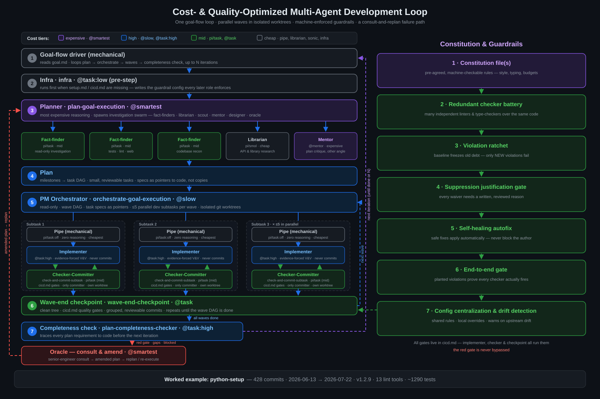

# How to build software with a cost- and quality-optimized multi-agent swarm



**TLDR** — A swarm of AI agents builds software through a repeating loop: a high-reasoning planner decomposes a goal into milestones and a DAG of small, reviewable tasks; a project-manager orchestrator fans those tasks out in waves to parallel implementers, each isolated in its own git worktree; every subtask is written by an implementer, then independently verified and committed by a separate checker agent that never trusts the implementer's claims; every wave ends in a checkpoint commit. Quality is enforced not by review-by-negotiation but by a constitution — pre-agreed, machine-checkable rules — backed by a guardrail pipeline that no agent can argue with. Expensive reasoning is spent once per iteration on planning and adversarial checking; everything downstream works from line-range pointers into the plan instead of re-reading the world. The proof that this works is a real project, built end-to-end by the loop ([worked example](#worked-example-python-setup)).

## The loop

A user goal lands in `{F}/goal.md`. A short driver command launches iterative execution for a fixed number of iterations. Each iteration is the same pipeline: plan → wave DAG → per-subtask dev pairs → wave-end checkpoint → replan. The harness defines two contracts every participant relies on: `{F}/setup.md` (how to run, test, and lint the project) and `{F}/cicd.md` (the quality gates, all of which must pass — a red gate is a real failure and is never bypassed).

### 1. Planner (expensive reasoning, spent once per iteration)

The planner is the highest-reasoning role in the system, and that is deliberate: it reads everything once so nothing else has to. It reads the goal, prior iteration summaries, and the setup/CI contracts, then spawns an investigation swarm — fact-finders, librarians, scouts — to map the codebase. Prior summaries are treated adversarially: "0 defects" is a hypothesis to falsify, not a claim to trust.

The planner consults specialists as needed (plan critique, UX design, a senior-engineer "oracle" on tradeoffs) and writes the plan: milestones → a DAG of focused tasks (1–3 files, 100–500 LOC of changes each), every task carrying its own verification spec.

This is the cost model in one act: a top-tier model reads everything once and produces line-addressable instructions; everything downstream references those lines by number instead of re-reading the world.

### 2. PM Orchestrator (cheap, zero code access)

The orchestrator is the project manager: read-only on project code — no shell, no edits, ever. It defines a wave DAG (a bounded number of subtasks per wave; each wave single-type: all dev, all verify, or all housekeeping), orders waves by dependency, and writes validated task specs. The spec format is deliberately minimal — pointers, not content:

```yaml
plan: /abs/path/to/planN.md   # REQUIRED: absolute path
lns:  ["25-35", "40"]         # REQUIRED: line ranges for the actual task
pre:  ["10-12"]               # optional: prerequisite plan lines
extra: |                      # optional: prose ONLY for knowledge not in plan
  ...                         #   (consultant guidance, relaunch learnings)
```

Task specs reference plan line ranges, never transcribe them. This keeps the orchestrator cheap (a pointer-writer cannot drift from the plan it doesn't rewrite) and keeps the plan the single source of truth. A hard constraint is validated before spawn: any subtask covering more than 3 files or ~300 LOC of estimated diff is split until each subtask is independently verifiable.

### 3. Per-subtask: mechanical pipe → implementer → independent checker

Each subtask enters through a pass-through pipe — deliberately low-reasoning — that loads and validates the spec, extracts the plan lines, and spawns the pair inline. The pipe interprets nothing; it routes.

- **Implementer** reads the setup doc, implements its assigned plan lines, applies the coding constitution, and runs multi-source verification — tests and CLIs, reading its own code, inspecting rendered output where visuals matter, structural checks (grep/AST/LSP). Its structured output schema **requires** `evidenceInspected`: one entry per verification personally performed (check, method, result). `status=implemented` with empty evidence is rejected by the schema — self-report is not evidence. The implementer never commits.
- **Checker-Committer** is the independent gate. It scrutinizes the work as a skeptical human reviewing an untrusted contractor: diff first, then run tests *and read what they assert* (passing tests ≠ done; tests can be tautological), run the `{F}/cicd.md` gates, confirm the code implements the spec — not a stub, not a plausible shim — and for visual output, actually look at the render. Committing requires a synthesis of ≥2 verification-method families (test/CLI + output inspection + code read + structural check); no single source is authoritative. It raises concerns rather than fixing them — and only commits genuinely correct work.

Dev subtasks run in isolated git worktrees; the harness auto-merges. The checker-committer is the only role that commits, so the mainline only ever receives twice-verified work.

### 4. Checkpoint

After every wave, a checkpoint role inspects the working tree, removes transient junk, runs the gates, commits completed work grouped by plan subtask, and reports structured status (`clean`/`committed`/`concerns`/`blocked`, with test and lint evidence). Broken worktree state from a glitch surfaces here rather than corrupting the next wave.

### 5. Iteration and adversarial replan

The orchestrator harvests results, keeps running independent waves despite partial failures, and accumulates concerns. When concerns accumulate or work blocks, it consults the oracle, which forensically investigates failures and amends the plan; amended plan lines flow back to implementers via new task specs. The planner's next iteration reads prior summaries adversarially for the same reason — recovery is planned, not improvised. In git history this shows up as `recovery:` commits and wave-merge-resolution commits.

**Why this shape is cheap:** mechanical roles (housekeeping, the pass-through pipe, diligent fact-finders) run on small models; expensive reasoning is spent only where it pays — planning, adversarial checking, forensic analysis. Waves parallelize independent subtasks. Verification is evidence-based, not narrative-based: both implementer and checker must record what they personally inspected, and the checker is structurally forbidden from trusting the implementer.

## The constitution

One or more constitution files, written once, enforced automatically. In the harness itself these are `{F}/AGENTS.md` (context entry point: quick commands, tool scope, key files, testing strategy — an agent that reads one file knows how to run, test, and lint the project and where the boundaries are) and the coding-rules file (the law: typing requirements, privacy conventions, complexity budgets, logging and async rules, no fallbacks for hard-declared dependencies).

The point is not that any particular rule is brilliant — it is that the rules are **machine-checkable and pre-agreed**. An agent cannot argue with a numeric complexity budget; the rules file already says what to do when code hits it (split into single-purpose units, with a worked before/after example). Humans negotiating style in review is replaced by a config file. The rules also pre-resolve the escalation paths agents are tempted to invent: suppress-without-justification, raise-a-threshold, add-a-fallback — each is a named non-option.

## Guardrail patterns

A constitution is paper; enforcement is what makes it real. The guardrail stack is a set of reusable patterns, implemented in `{F}/cicd.md` and run by implementer, checker, and checkpoint alike:

- **Redundant checkers.** Multiple independent linters and type checkers over the same code — four type checkers catch what one misses. Redundancy is the point, not waste.
- **Ratchet (baseline diffing).** A baseline file freezes pre-existing violations; only *new* violations fail. Code can never get worse, and legacy debt never blocks progress. Regeneration is deliberate and loud: an explicit `--overwrite-baseline` flag whose result is committed alongside the change — so "I'll just widen the rules" leaves a reviewable commit.
- **Autofix with canary.** On commit, formatters and safe fixes run automatically; autofix is courtesy and never blocks. It skips files where staged and unstaged changes overlap, and reverts any file whose fix breaks parseability (the canary). Only regressions fail the hook.
- **Semantic suppression gate.** Suppressed violations (`# type: ignore`, `# noqa`, `# pylint: disable`) are scored by a semantic checker backed by a reranker model; scores are cached. A suppression must be *meaningful* — "because" is not a justification. This kills the cheapest agent escape hatch: writing the code anyway and silencing the linter.
- **Self-test of the test infrastructure.** An integration gate plants violations in a sample project and asserts every checker actually fires on them. A tautological checker that silently passes everything fails the gate. The CI is tested like the code it guards.
- **Config overlays + drift detection.** Shared configs ship centrally; consumers override locally; the runner composes the final config at runtime and warns when upstream shared configs drift. Rules stay centralized instead of forking per project.
- **Adversarial review.** The checker role is a standing adversarial reviewer: no-trust, evidence-synthesizing, concern-raising. Its structural independence — a different agent with a different mandate — is what makes it a gate rather than a formality.
- **Evidence schema.** Every agent output is schema-validated, and the schema demands per-check evidence (check, method, result). `implemented` with empty evidence is rejected at the parse boundary, not by a polite request.

Each pattern answers a specific agent failure mode:

| Agent failure mode | Guardrail that catches it |
|---|---|
| Writes a tautological test ("test" asserts nothing) | Self-test gate (planted violations must fire) + checker synthesis ≥2 method families |
| Suppresses lint instead of fixing | Semantic suppression gate + trailing-justification rule |
| Re-raises complexity threshold to pass lint | Constitution: budgets enforced on purpose — split, never raise thresholds |
| Self-reports "done" without checking | Schema-required `evidenceInspected`; `implemented` rejected when empty |
| Trusts a peer's summary | No-trust checker: own observation only, ≥2 method families synthesized |
| Scope drift beyond assignment | Task-spec line-range pointers; shared-infra changes require plan sanction |
| Leaves broken worktree state after a glitch | Checkpoint: clean tree, grouped commits, stash conflicts resolved |
| Substitutes a degraded workaround for a real fix | No-workarounds directive; `blocked` status with 2 distinct unblock attempts required |

## Worked example: python-setup

python-setup — a reusable lint-runner project whose pipeline exemplifies every pattern above — was built end-to-end by this loop. Its git history is the audit trail:

- **428 commits** from 2026-06-13 (initial) to 2026-07-22 — roughly six weeks, with weekly cadence 26 → 139 → 246 commits during the buildout, tapering as the project stabilized.
- **Commit subjects carry plan-DAG task IDs**: `T18: ...`, `T9-2: ...`, and review-wave items `M2:`/`M3:`/`M4:`. 98 commits match task/wave/milestone prefixes (counted: M1 ×12, M4 ×11, M2 ×9, T9 ×8, M3 ×8, T2 ×5, T6 ×4, T18 ×4...). The plan DAG is literally readable in `git log`.
- **Loop artifacts visible in history**: baseline-stabilization follow-ups (`T18 follow-up: stabilize baseline diff...`), `recovery:` commits after glitch relaunches (the recovery path works), `Wave2:` merge-resolution commits.
- **Verification hardening from review waves**: M1/M2/M3 are regression guards born of concerns the checker raised — `M2: Harden assertions in test_setup_new_and_lint`, `M3: Add pyright-noise-filter regression guard`, `M1: add generic-return-requires-returns to violations.txt`. Review found gaps; the plan absorbed them as new tasks.
- **Release discipline**: `v1.2.4` → `v1.2.9`, each with CHANGELOG, lockfile sync, and a tag; `v1.2.9: close the loop — regression guards, --fix docs, redeploy-prep`.
- The system outgrew its own product: `56ffddb moved builder system to separate repo` — the dev process was extracted from the repo it built into a plugin.

**Current state numbers**: 13 lint tools, ~1290 unit tests (1290 pass/4 skip/15 deselected), a 7-test integration gate validating all 13 tools fire on planted violations, self-lint (all 13 tools run on python-setup itself), and the baseline-ratchet file — all produced and maintained by agent work under the gates the project ships to consumers.

## Lessons

The guardrails were not designed up front; most exist because a failure mode was observed, then answered structurally:

1. **Summary self-report is worthless.** Every agent's schema demands per-check evidence (check/method/result); empty evidence rejects "implemented". What was *personally inspected* is the only currency.
2. **Tests can lie.** Passing tests ≠ work done — the checker must read assertions against the spec and synthesize ≥2 verification-method families; the self-test gate proves the test infrastructure itself detects real violations.
3. **Suppression is the path of least resistance.** If silencing a checker is easier than fixing code, agents will silence it. Justification rules plus a reranker-scored semantic gate make the cheap path expensive.
4. **Instructions drift.** Prose task briefs get reinterpreted; line-range pointers (`lns: ["25-35"]`) bind subtasks to the plan textually, and scope beyond them needs explicit sanction.
5. **State corrupts across glitches.** Relaunches and stash conflicts are handled at wave boundaries by checkpoint, never patched ad hoc mid-wave — hence `recovery:` commits in the worked example's history.
6. **Degraded workarounds compound.** A "working" fallback on a broken foundation hides the break. The no-workarounds directive forces `blocked` + escalation to the oracle instead of a weaker substitute.
7. **Cheap roles stay cheap by being constrained.** The orchestrator cannot edit code; the pipe cannot interpret; the checker raises concerns instead of fixing. Role narrowness is what makes small models sufficient — and the expensive models affordable where they matter.

The result: a loop where correctness comes from structure — independent verification, schema-forced evidence, machine-enforced rules, and a git history that doubles as the process's own audit log.