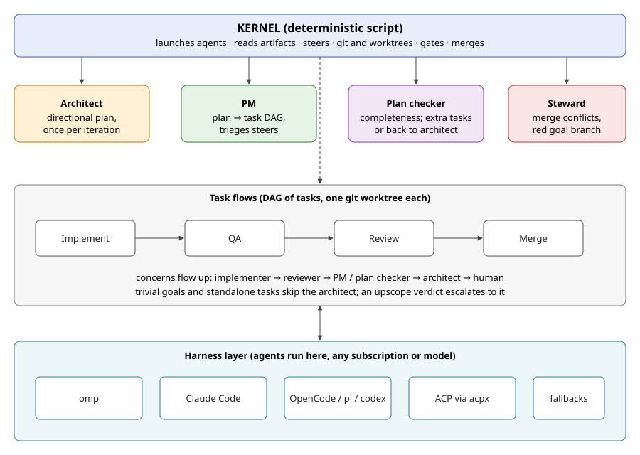

# Agentic software factory — pitch

Modern coding harnesses deliver a story: a few hundred lines of code. The factory is an orchestration layer on top of them that delivers a saga — a whole product or a major refactoring — while staying token-efficient, steerable, observable and restartable. Stop it in the middle, relaunch, and it keeps going without repeating work.

## The problem

Frontier models cost roughly 40–80x what capable implementer models do, and speed varies about 10x. A "smart orchestrator" that swarms agents burns tokens on mechanics and takes over when work gets hard. A "smart planner" writes plans more detailed than the code. The factory spends expensive attention only where a human architect would.

## The actors

- **Kernel** — a deterministic script, not a model. It launches agents through harnesses, reads and validates their artifacts, checks user steers, runs the gate commands, and handles git, worktrees and merges. All state is on disk, so any stop is resumable.
- **Architect** — the expensive model. Once per iteration it turns intent into a directional plan: order, interfaces, tradeoffs. For a saga it delegates to subarchitects. It is the only actor that decides how big "bigger" is.
- **PM** — converts the plan into task files and a DAG, repairs artifacts the kernel cannot, and triages steers.
- **Plan checker** — decides whether the plan is complete. It makes simple technical decisions by emitting extra tasks, and sends the rest back to the architect.
- **Steward** — invoked only when a merge to the goal branch conflicts or leaves the goal branch red.
- **Task flows** — tasks arranged in a DAG, each in its own git worktree: implement, QA, review, merge. Cheap models do most of this work; an escalation model takes tasks that go wrong.
- **Harness layer** — the factory does not replace harnesses. It runs agents on omp, Claude Code, OpenCode, pi, codex and ACP clients, with fallbacks across subscriptions.

## How it scales

A cheap front agent classifies the goal as trivial, task or bigger. Trivial goals are implemented by that same agent. A task runs its flow without the architect, and a review that finds larger scope escalates it. Only bigger work reaches the architect.

## How concerns travel

Each stage sees a different scope, and each filters what it passes on: implementer → reviewer → PM / plan checker → architect → human. The human sees only what no earlier stage could settle.

See [ideology.md](ideology.md) for the principles behind these choices.
