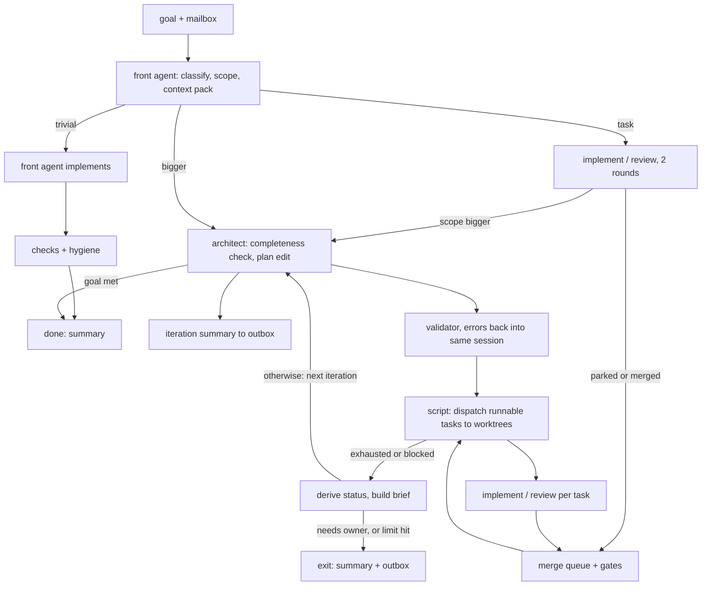

# Manifesto — advisor notes

For the agent that builds the factory and for the architect role inside it. Advice, not authority: `manifesto.md` Intent wins. All review items are decided; the decision log in the manifesto records them.

Two kinds of value are offered, per the manifesto's rule for architects: **knowledge** (packages, patterns and anti-patterns concrete enough to change code, §6) and **reasoning** (interface shapes §4, edge cases and ordering §5). Everything else is yours to choose. Sketches are shapes, not specs: keep the properties the comments name, change the rest freely.

Markers: repo facts carry file pointers under `plugins/software-factory/src` (`core/`, `core/flows/`, `core/plan/`, `harness/omp/`); line numbers are as of 2026-11-12. Unmarked design statements are the author's recommendations, tagged with an N-item where the owner has not decided. `[VENDOR]` = vendor documentation, `[INFERENCE]` = reasoned from vendor facts, not stated in them, `[RECALL]` = from the advisor's knowledge, not re-verified.

## 1. Evidence to design from

Last run, goal "modernize": 50 items (33 merged), 261 launches, 37.6M input tokens, $11.01 (`docs/inspection.md`, `docs/runs/modernize/`). The old headline (158 launches, 25.6M, $6.44) counted only task-level `runs/` steps and missed the 103 item-level launches under `items/*/steps/` — 12.0M tokens, $4.57. The manifesto's "81 of 158" note has the same partial scope.

| Role | Launches | Input tokens | Cost |
|---|---|---|---|
| Architect role (Opus 5.5, 2 launches) | 2 of 81 | 66 + unmetered cache | $2.86 |
| Architect role (muse-spark) | 79 of 81 | 21.7M | $2.36 |
| Implementers: developer / reviewer / qa | 37 / 41 / 11 | 4.6M / 4.4M / 0.7M | $2.31 / $0.97 / $0.26 |
| Other cheap-tier steps (pm, close-ups, fact-finder, plan-reviewer, infra, triage) | 90 | 5.6M | $1.22 |

- Architect launches are the biggest single cost ($5.22, 47%) but not the runaway the partial scope suggested: developers cost $2.31 on their own. What the census below shows is that most architect spend is ceremony — wave reports and consults — while one $2.86 Opus plan call is more than the entire developer bill.
- Architect-role census by launch kind (all 81, from run metas): plans 5 ($2.99, one Opus at $2.86 with only 66 input tokens recorded — cache unmetered), wave reports ~34 (~8.7M input), revises ~10, close-ups 4, consults ~25 (~7M, one item alone took 12). B1 deletes the wave reports, revises and close-ups as launches; consults become queue items. Reminder for B1: this table is `runs/` only; item-step launches never reached the architect role.
- Token counts are the uncached portion: the parser sums `u.input` only (`harness/omp/ndjson.ts:88`) while raw usage carries `cacheRead`/`cacheWrite` separately. So 21.7M at Opus input price (≈$87) is a floor for the uncached part alone; total prompt volume and hit rate are unmeasured until A1. Five runs recorded zero usage, including an interrupted 5-hour Opus revise — persist partial usage on timeout and SIGTERM, or every total stays a lower bound.
- Dollar totals already include cache charges (`u.cost.total`); what is missing is the token-level efficiency — hit rate, context growth. Cost-per-iteration comparison works today; architect-context comparison does not.
- Implementer medians check out from state.yaml: 1 attempt, 1 fix round.

## 2. Target loop



One architect launch per iteration. Between two architect launches: deterministic script, cheap tier, or a `sonnet`-tier implementer the architect assigned in the plan.

## 3. Minimum new version on v2 (iteration 0)

v2 is a resumable file-artifact pipeline: ingest → architect plan → PM edits → waves of items → close-up; `derive/*` rebuilds state from disk; `step-runner` enforces JSON schemas. Already true and not to be rebuilt: templated prompts with partials (`prompts.ts`), slug ids, execution state stored apart from the plan, derived status, involvement presets (`config/pipeline.default.yaml`, `agents/criteria/human-involvement.md`), `gc.auto=0` on every git call (`git/exec.ts:82,98`), serialized git writes (`repo.writeLock`), the steer taken-move with journal dedup (`core/steer.ts:52-63,313,397`), the no-model journal (`core/journal.ts`).

Launch: edit `plugins/software-factory` in place on a branch, copy the last green build to a pinned directory, and run iteration 0 only from there — never from the tree being edited. Goal: one fixed benchmark goal, re-run each iteration (baselines in `docs/runs`); run config: the bootstrap list (manifesto §Bootstrap) — OpenCode with the free models first for the front agent, review, PM structuring and evidence digests, paid tiers only on measured failure; record the bootstrap metrics (architect launches, architect cost share, cost per merged task, loop incidents, human interventions) from the first launch.

Suggested order. The cut line for a first measurable launch is after step D1 plus the D2 session-ref piece.

| Step | Change | Where today | Size |
|---|---|---|---|
| A1 | Record cache read/write AND the model/provider actually used per turn; persist partial usage on timeout/SIGTERM | `harness/omp/ndjson.ts:86-90`, `budget.ts` | S |
| A2 | Sessions and transcripts outside the worktree root, last N runs kept | `harness/omp/harness.ts:264,302-321` | M |
| A3 | Keep the goal checkout and sessions outside the disposable worktree root — today they live under it (`cli/lock.ts:21-38`), which is why the last run's transcripts are gone. The architect already runs in the stable goal checkout (`cwd: taskWt`), not a task worktree | `core/sessions.ts`, `harness.ts:334-391` | M |
| B0 | `parked/awaiting-architect` status in derive + `isIterationTerminal` + scheduler + brief root causes, with a no-model E2E test. v2 has no parked state; without this every "park the work" below re-enters the item machine or stalls the iteration | `derive/item.ts:41`, `derive/wave.ts:161-162` | S |
| B1 | Architect only at the iteration boundary | 12 sites, below | M |
| B2 | `checkStepAttempts` against full history (the other counters already scan it) + one turn-count budget per item replacing the nested caps | `loops.ts:55`, `item-machine.ts:339-626` | S |
| B3 | Review: 2 rounds, last round decides park or merge-with-debt | `loops.ts:8`, `item-machine.ts:484-546` | M |
| B4 | Waves as PM-owned dispatch sets: keep the wave as "items without logical dependencies, executable in parallel", derived by the PM from the architect's markdown plan — not retired, re-owned | `plan/scheduler.ts`, `derive/wave.ts`, `iteration.ts:2513-2520,3092-3128` | M |
| B5 | Rewrite `agents/steps/architect-plan.md`: one turn = completeness check (§7) + markdown plan edit; stop criteria; debt review; direction contents. The architect writes prose for human/reviewer friendliness, never schema-consistent files. Delete the architect-revise, -wave-report, -closeup and -consult-* fragments with their call sites | `agents/steps/architect-plan.md` | M |
| B6 | PM (paper-pusher, not peer) converts the architect's bullet vision into actual tasks: derives task files, DAG and dispatch sets from the markdown plan, splitting and merging tasks as the formalization requires; resolves what determinism cannot (missing branches, misplaced artifacts, ambiguous mappings). Deterministic reconcile where possible: done frozen, rework as new slug, pending re-read at dispatch | `plan/apply.ts`, new PM step | M |
| C1 | "Task" path: implement/review with no architect | only `simple` bypasses today, `ingest.ts:568-697` | S |
| C2 | One front agent for classify + scope + context pack + infra | `engine.ts:549-579`, `ingest.ts` | M |
| D1 | Drop schema-forced plan output: the boundary turn writes markdown, the PM derives files (B6). A light validator checks what is checkable without understanding prose (slugs referenced exist, no cycles in the derived DAG); anything deeper goes back to the architect through the PM as advisory review. Required before the cut: until this lands, the boundary turn still emits the whole plan through `plan.schema.json` — the re-issue the manifesto rejects | `step-runner.ts:154-182`, `plan/apply.ts`, `plan/limits.ts` | M |
| D2 | Re-derive the architect session ref from the latest ok architect record's `meta.session` at startup (`engine.ts:389` keeps it in memory only); brief reads debt from records, not state.yaml (already a view, never read for decisions) | `derive/*`, `step-runner.ts:860-861` | M |
| E1 | Absolute and per-harness concurrency limits | `engine.ts:365-367`, `iteration.ts:1103` | S |
| E2 | Mailbox lifecycle: PM structures → architect processes → outbox. The taken-move and crash-safe dedup already exist; the size covers structuring + outbox only | `core/steer.ts`, `cli/steer.ts` | M |
B1 is the core change. Do not delete the twelve call sites one at a time. Introduce one file-backed architect queue and replace each site with "enqueue a brief item, park the work" — parkable only after B0. The boundary drains the queue into one brief. Keep one measured exception: config `earlyBoundary` (off by default) ends the iteration before exhaustion when a queued trigger fires — a steer the PM judged global, or a landed spike whose dependents idle. Record the idle task-minutes spent waiting on the queue as a bootstrap metric, so the threshold can be tuned instead of guessed.

| v2 architect launch | Becomes |
|---|---|
| plan (`iteration.ts:1309`) | the boundary turn |
| plan repair (`:1392`), PM-edits bounce (`:1723`) | light-validator errors returned into the same session (needs D1; until then: keep the site) |
| plan-review revise (`:1630`) | replaced by advisory review: a weaker model reads the markdown plan for impracticality, unclarity, rule violations — advisory, not a veto; the architect considers it while editing, from ignoring on fact judgement through clarifying to changing the plan |
| wave report (`:3215`) | derived-status section of the brief |
| close-up (`:4003`) | completeness check of the next boundary turn — and the boundary turn still writes `closeup-N.yaml` plus its ok record, because v2 counts iterations from them (`iteration.ts:1097-1099`); derive keeps counting |
| item consult (`consults.ts:158`), concern consult (`consults.ts:459`, called from `iteration.ts:1051`), review-disposition consult (`item-machine.ts:1045`, fires when review notes are architect-only) | park item (B0), enqueue |
| empty-waves consult (`iteration.ts:2948` via `consults.ts:313`) | deterministic end-iteration → boundary turn. Blanket "enqueue" would delete the loop's exit. |
| merge failure (`redriveMergeAfterConsult`, `:541-610` — consults on every merge-path failure, decision applied inline) | deterministic gate-target remap (`checks/gate-target.ts`) + bounded re-merge; park only when unresolvable (B0) |
| review disposition (`item-machine.ts:1045`) | reviewer's last-round decision |

## 4. Key interface shapes

### Harness
```ts
type Caps = {
  resume: boolean
  compact: 'none' | 'local' | 'server'
  fork: boolean
  subagents: 'none' | 'spawn' | 'steer'
  structuredOutput: 'none' | 'native'
  effort: string[]                       // levels this model accepts on this harness
  usage: { cache: boolean; cost: boolean }
}
interface Harness {
  id: string
  caps(model: ModelRef): Caps            // probed at pre-flight, per model
  run(turn: Turn): TurnHandle            // one shape for de novo and resume
  ops(model: ModelRef): Opts             // optional operations; absent member = missing capability
}
type Opts = {
  compact?(s: SessionRef): Promise<SessionRef>
  fork?(s: SessionRef): Promise<SessionRef>
  import?(s: SessionRef, via: string): Promise<SessionRef>   // an edge of the portability graph
}
type Turn = {
  session?: SessionRef
  cwd: string
  model: ModelRef
  prompt: string
  produces: { path: string; schema?: string }[]   // "agent produces, script reads"
  opaque?: unknown                       // harness config passed through untouched
  limits: { idleMs: number; wallMs: number }
}
interface TurnHandle {
  events: AsyncIterable<Ev>              // normalised; raw stream goes to the transcript store
  done: Promise<TurnResult>
  steer?(msg: string): Promise<void>
  cancel(): Promise<void>                // protocol abort first, grace period, then kill the process group
}
type TurnResult = { session: SessionRef; stop: Stop; usage: Usage; text: string }
type Stop =
  | { kind: 'done' }
  | { kind: 'cancelled' }
  | { kind: 'refusal'; details?: string }                 // task-side: the model declined
  | { kind: 'truncated'; cause: 'max-tokens' | 'turn-limit' }  // task-side: turn cut short
  | { kind: 'infra'; cause: 'quota' | 'rate' | 'auth' | 'crash' | 'overflow' | 'timeout' }
type Usage = { in: number; cacheRead: number; cacheWrite5m: number; cacheWrite1h: number;
                out: number; reasoningOut: number; costUsd?: number }
type SessionRef = { harness: string; id: string; cwd: string; model: ModelRef;
                    lastRequestStartedAt: string; retentionTier: 'short' | 'long';
                    compacted: boolean }
```
Properties that matter:
- Flows branch on `Caps`, never on harness id. That is the owner's "capability-aware, not uniform" rule in code.
- `Stop.infra` is a different type from task failure, so infrastructure trouble cannot consume review rounds or item budget. `refusal` and `truncated` are task-side for the same reason: a declined or cut-short turn must not read as a completed step with a half-written artifact.
- `SessionRef` carries `cwd` (resume is cwd-bound), `lastRequestStartedAt` (hot or cold decision — the cache lifetime runs from the start of the last request, not from turn end) and `harness` (portability graph lookup).
- Gaps to close before the sketch is real: today `Stop` causes are not distinguishable (quota/rate/overload share one transient bucket in `harness/omp/classify.ts:3-22`; overflow has no pattern; the classifier tests `stopReason === "abort"` while real streams emit `"aborted"`); request start times are dropped by the parser though `message.timestamp` carries them; `compacted` must be read from session-file `compaction` entries; `Caps.effort` has no per-model probe. `cancel()` today kills without a protocol abort. All S1/classifier work, not reasons to change the shapes.
- Optional operations (`compact`, `fork`, `import`) belong on a separate object obtained through `Caps`, so a missing capability is a type error at the call site, not a runtime surprise.

### Continuity and the architect chain
```ts
type Continuity =
  | { how: 'resume' }                    // same harness, cache likely hot
  | { how: 'resume-compacted' }
  | { how: 'import'; via: string }       // an edge of the portability graph
  | { how: 'de-novo'; links: string[] }  // context pack + artifact paths
function continuity(prev: SessionRef | undefined, next: { harness: string; model: ModelRef },
                    graph: PortabilityGraph, now: Date): Continuity

interface ArchitectChain {               // strategy chosen from Caps.subagents
  consult(level: Level, brief: Brief): Promise<void>   // result is the edited plan on disk
}
```
Two strategies are enough: session-per-architect (any harness), and omp subagent chain. One decision function for continuity keeps the portability graph out of the flows.

### PM-derived task file (from the architect's markdown plan)
```yaml
slug: auth.token-refresh           # immutable, never reused, `epic.name[-rN]`, safe as branch and file name
kind: task                      # task | spike
after: [auth.session-store]     # readiness = these are merged
scope: [src/auth/**]            # advisory: hygiene check and conflict-avoiding dispatch
flow: implement-review          # a flow name from process config
tier: default                   # default | sonnet (Sonnet-class implementer; the architect assigns it in the plan)
reworks: auth.token-refresh      # optional; this slug is then auth.token-refresh-r2
---
Direction: what and why; interface shape other tasks rely on; edge cases; ordering; approach worth trying.
Done when: observable behaviour or command.
```
This file is the shape the **PM** produces from the architect's markdown (B6) — the architect never writes or maintains it. Position carries no meaning; `after` does. The material hash is the normalised frontmatter (slug, kind, after, scope, flow, tier, reworks) plus the `Done when:` line; the Direction prose is advisory and hashed separately for reporting only. A change to `Done when:` on a done slug is the rework trigger. Epics and milestones live in an index:
```yaml
epics:
  auth: { milestones: [{ id: m2, awaits: auth.cache-spike }] }
```

### Functional core
```ts
derive(plan: Plan, records: Records): State     // pure and idempotent; there is no state file to corrupt
next(state: State, limits: Limits): Action[]    // pure; dispatch | merge | park | endIteration
```
The shell executes actions and appends records. Crash recovery, resume and the no-model E2E tests all reduce to "call `derive` again".

### Step outcome — one schema for every step
```yaml
status: done            # done | blocked | failed | upscope (task path only: scope exceeds the defined task)
summary: one paragraph
concerns:
  - id: c3
    kind: debt          # debt | risk | uncertainty | design-choice
    calibration: fyi    # fyi | blocked-by-architect | blocked-by-user
    text: ...
    evidence: [src/x.ts:41, check:unit]
forward: [c3]           # reviewer only: concern ids worth architecture attention
commit: a1b2c3d         # shell-set: the mechanical commit this outcome describes
artifacts: [path]      # shell-set: findings, PoCs — what spikes deliver
checks: [{ id: unit, status: pass }]   # shell-set: recorded check results
```
Small enough for strict output where the harness has it and for a written file where it does not. This replaces most of v2's 21 schemas. The brief takes only forwarded concerns and blocked-by-* ones; everything else stays on the task's record. That is the reviewer's filter from the funnel — implementer trivia must not reach the brief.

### Run config
```yaml
aliases:
  implementer: { harness: omp, model: deepseek-v4.1-flash, effort: highest, fallback: [implementer-b] }
limits: { total: 6, perHarness: { omp: 4, opencode: 2 } }
portability: { claude-code: [omp], codex: [omp] }
```
`effort: highest` resolves against `Caps.effort` at pre-flight.

### Brief and iteration summary
```yaml
brief:                       # the boundary turn's input; extend core/brief.ts
  status: derived            # merged / blocked with root causes only / pending with after-states
  forwarded: [concerns]      # reviewer-forwarded + blocked-by-*; facts, guesses and plan kept apart
  hashes: [short commits]    # diffs by hash; architect reads them itself through cheap scouts
  queue: [enqueued items]    # what each parked site asked
summary:                    # the guaranteed remarkable; written after every architect turn
  assumed: [reversible assumptions taken]
  remarkable: [what is different/additive to the plan]
  debt: { opened: [], closed: [] }
  status: goal-met | in-progress | blocked-by-user | stopped-with-debt
```

## 5. Edge cases and ordering

### Iteration boundary
- Order: stop dispatching → let in-flight turns finish → merge what is mergeable (v2 `flows/merge-path.ts` already runs gates before `mergeChildIntoParent`) → run gates on the merged head → `derive` → build the brief → architect → write the iteration summary to the outbox. An architect called before merges settle reviews stale code and plans against it.
- The architect's launch is one turn: completeness check and markdown plan edit together. Then the light validator checks the PM-derived files (slugs exist, DAG acyclic) and errors go back into the same session (two rounds at most; still invalid after round 2 → exit for the owner with the validator output); the advisory plan review lands the same way. Then the session ref is stored.
- Blocked is transitive (v2 `plan/scheduler.ts` already derives this; it cascades). The brief names root causes only, or the architect reads the same problem ten times.
- Two consecutive iterations with no merge, no landed spike finding and no material plan change: exit for the owner. Anything else aborts a legitimately spike-led start, where spikes are first by design but merge nothing.
- The brief is derived status plus forwarded concerns plus short hashes. Reuse v2 `core/brief.ts` (deterministic skeleton plus cheap relevance pass); add status, root causes, forwarded concerns and queue items. The architect reads diffs itself through cheap scouts; pin the scout model, because inline subagents inherit the parent's.
- First architect turn of a relaunch carries the debt-review instruction; detect "same goal" by goal directory.

### Plan
- Done tasks are frozen. The validator compares the material hash recorded at dispatch; a mismatch on a done slug is an error that says "add a rework task". Pending tasks may change freely and are re-read at dispatch.
- Slugs: unique across the goal including dropped ones, never reused, namespaced by epic so two subarchitects cannot collide.
- Validate: every `after` exists, no cycles, each deferred milestone names an existing spike, no execution state in the plan.
- Normalise before hashing (line endings, trailing space), or cosmetic edits look like rework.
- A deferred milestone is a placeholder with `awaits: <spike-slug>` and no tasks. It makes "details after the spike" visible to the script without inventing tasks.

### Dispatch and worktrees
- Branch from the integration head at dispatch time, not at plan time. A task whose `after` is not merged does not start; do not stack branches.
- Do not run tasks with overlapping `scope` concurrently. It is advisory and cheap; merge-time handling remains the backstop.
- Parallel checks collide on ports, databases and caches. The context pack's infra facts must say whether checks are parallel-safe; if not, serialise check runs while implementation stays parallel.
- Git safety is already there: every git call carries `gc.auto=0` and worktree/merge writes go through `repo.writeLock`. Know what the lock protects: each worktree has its own index; the shared state is refs/packed-refs and the admin dir. Auto-gc's pack-refs/repack is what races concurrent ref updates — that is why `gc.auto=0` matters. Agent commits in separate worktrees need no lock. New work is only the `git merge-tree` pre-check before spending gate time.
- Idle timeout (no events) is separate from wall timeout. A harness waiting on a permission prompt looks idle: always launch non-interactive.
- On startup reconcile orphan worktrees and branches against records — new work; v2's startup repair (`engine.ts:278-339`, dirty-worktree repair plus interrupted-record repair) is the hook point, not the implementation.

### Implement and review
- Commit mechanically after every agent turn, including failing states; the hash is the next agent's input. For `kind: task`, an empty diff after an implement turn is a no-progress signal — skip the reviewer. Spikes are exempt: their product is the finding artifact, not a diff.
- Agents commit, amend and switch branches on their own. After each turn: accept extra commits, reject a branch switch or changes outside the worktree.
- Squash-merge per task. Work-in-progress commits and hygiene problems fixed later never reach integration history.
- The last-round decision needs evidence: "negative value" cites a failing check or a specific defect. Parking keeps the branch; it deletes nothing.
- Follow-up choice: the compacted session if one was stored, otherwise de novo with the diff hash and findings — never wait on a warm cache. A fix round is a separate call; either the previous turn's cache is still hot and the compacted resume reads it, or it is cold and the summary is small anyway. De novo also breaks anchoring on a failed approach, which is why it stays a configured option for the last round.
- The reviewer gets its task file and the diff hash, not the plan. It never sees the implementer's session — its value is the fresh perspective, not the shared context. A same-model reviewer with a different focus is a legitimate pairing, not a weak one; pairing and focus prompts live per task-type flow in config. The reviewer's prompt and context are tailored to the review focus, not the implementation context — neither the implementer's edits nor its reasoning about what to edit.
- `upscope` or last-round discard on the task path: park the branch, write the evidence, mark the goal bigger. Autonomous preset → continue into an architect iteration with the evidence as the brief; otherwise exit to the owner. Route the path through the merge queue; nothing merges itself. Do not confuse this with `tier: sonnet` — one moves the goal up the ladder, the other moves the task up the model tiers.
- `Stop.infra` never consumes a round. `overflow` goes to de novo with a summary, not to retry.

### Merge
- Gate the merge result, not the branch: integrate onto the current head in a scratch worktree, run gates there, move the integration ref with `git update-ref` when green. `branch -f` and `push .` are refused while the branch is checked out elsewhere, and a merge from the scratch worktree cannot move another worktree's branch — verified. After the move, sync the checkout that holds the branch (a clean `reset --hard`, or keep the integration branch in a dedicated worktree the queue owns so the architect's checkout never goes stale). One serial queue; batch when gates are slow and bisect on failure.
- `git merge-tree --write-tree` predicts conflicts without touching a worktree; use it before spending gate time.
- On conflict: one attempt by the task's own implementer session to merge the integration head into the task branch (`git merge`, resolve once, commit), then park if still red. Never rebase: the branch carries many mechanical commits touching the same lines, so a rebase replays the same conflict commit by commit — and the WIP history is squashed away at merge anyway.
- Record failing checks at iteration start, but judge each task against the current integration head: refresh the baseline after every accepted merge (a task that introduces failure F must not make every later task look like it introduced F). Keep the iteration-start set for reporting.

### Mailbox
- Maildir discipline is a writer-side contract: write into a private tmp directory on the same filesystem, then `rename()` into the inbox. Nothing on the filesystem tells a reader a writer has finished, so any file appearing directly in the inbox needs a size-stability check before it is claimed. Applies to the PM's own writes too. Key by content hash so a crash between move and PM turn replays safely.
- PM output is small and structured: steer id, targets (slug, gate or goal), effect (info, hold, invalidate), summary. The raw file is always linked; the architect can read it.
- Lifecycle: new → structured → processed; the outbox entry carries the steer id.

### Accounting, budget, fallback
- Record usage per turn with cache fields and the alias actually used. Keep the four token counts disjoint: sources disagree on whether "input" includes cached reads (the Anthropic API excludes them; the OpenTelemetry GenAI convention includes them) `[VENDOR]`. When a harness reports no cost (subscription), compute it from a price table and keep the tokens.
- Check the iteration budget at dispatch, before admission. On a hit: drain.
- The item budget counts turns across implement, review and follow-up. Infra stops are excluded.
- No-progress fingerprint for tasks: worktree tree hash plus the sorted set of failing check ids, compared against the item's whole history. For spikes: the hash of the finding artifact instead of the tree hash.
- Fallback chain with a circuit breaker per alias: after repeated infra stops, stay off that alias for a cool-down instead of probing an exhausted quota at every launch.
- A fallback that crosses harnesses loses the session unless the graph has that edge: restart the step de novo from the last mechanical commit.

### Sessions, compaction and cache
Ownership of the cache rule is the manifesto (compact at the end of the turn, inside the TTL; never at the start of a resumed session). What the implementer adds:
- Timing: validator loop first, then compact, then store the session ref — all before the process exits, because the TTL runs from the last request.
- The TTL is config: omp `providers.cacheRetention` is the enum `auto|short|long|none` — set `short` explicitly. The default `auto` keeps provider defaults, which means 1-hour entries on Anthropic OAuth subscriber sessions (different write price, different window). `none` disables caching and warming entirely. Hot or cold is `now − lastRequestStartedAt < ttl` with the effective tier; the adapter must read it per session, never assume.
- Where the summary can live: omp compacts Claude sessions server-side and stores portable summary text. For OpenAI models it stores an opaque placeholder usable only on the same provider. Claude Code's `/compact` is client-side summarisation. Compact-then-consult-elsewhere is therefore cheap only for Claude sessions.
- Between two separate calls there is no warming: `streaming` stops when the run settles, and `idle` warming is rejected — over 4–5 turns the saving versus cold is small, and a compacted fresh context beats a preserved one. Cover the implement→fix gap by compacting at the end of the implement turn: the fix round resumes the compacted session hot if the TTL holds, cold-small if it does not.
- Compaction is transcript trimming, not a handoff summary: it shortens the same session for its own next turn; it does not write the brief the next agent reads. Keep the two artifacts separate — a trimmed session plus an explicit handoff (outcome record, digest) — and never present a compaction summary as the handoff.
- Compact where reuse is likely: architect and subarchitect always; implementer and reviewer sessions only when the task ends parked or blocked. Learn the reuse behavior during bootstrap and watch its variability; the expected result is config-driven rules for what to compress on which review iteration. Compaction rules stay cost- and capability-model dependent — recheck them when the model mix changes. The whole topic is worth about half a dollar per architect consult — second-order next to the number of architect launches.
- Resume is bound to the working directory, differently per harness. omp asks to re-root when the session's directory is missing and fails without a TTY. Claude Code resumes by id from any directory. Codex needs `--cd`. OpenCode sessions belong to a location. So: the architect runs in a stable checkout, and a task's worktree lives until the task is terminal.
- The plan and the context pack live on disk, so a compacted or de novo architect loses little. That is what makes the non-portable edges of the graph acceptable.

### Prompts
- Stable text first (role, rules, flow), volatile text last (task, hashes). Providers cache by prefix, so every launch of a role shares the expensive part `[VENDOR]`.
- Fail on an undefined template variable. Snapshot rendered prompts in the no-model tests.

## 6. Practical knowledge

Rows are packages with the API to use, patterns with the failure they prevent, or anti-patterns with the symptom — checked for currency on 2026-11-12, versions as of that date.

Orchestration mechanics — packages and patterns that set the shape:
| Knowledge | What changes in the build |
|---|---|
| `cockatiel` 4: `Policy.wrap(retry, circuitBreaker, timeout, bulkhead)` with a cool-down per alias | Fallback chains and quota handling become composable policies instead of nested ifs; one bulkhead per harness plus a global one expresses the E1 limits. A semaphore cannot do cool-down — that is the gap `cockatiel` fills. |
| `zod` 4 `z.toJSONSchema` as the single source for the step-outcome types and their JSON Schemas | Types and schemas cannot drift; emits draft 2020-12, so validation runs through `Ajv2020`. |
| `yaml` 2 document API (`parseDocument`, `doc.set`) | The validator can point at a node and the PM can patch one field; comment-preserving edits when the architect rewrites part of the plan. |
| Memoised steps keyed by (slug, step, round) — the durable-execution idea, without the framework | Resume is "skip what is recorded"; v2 already journals (`core/journal.ts`), so extend the journal rather than adding Temporal/Restate/DBOS/Inngest, each of which needs a server or a database. |
| Maildir writer contract: private tmp dir, then `rename()` into the inbox | Mailbox delivery without locks and without half-written steers; the same contract covers the PM's own writes. |
| Local merge queue on `git merge-tree --write-tree`: gate the merge result in a scratch worktree, move the ref with `update-ref`, batch and bisect | The merge path of §5; v2's per-parent merge lock is the seed. GitHub's merge queue is org-repos-only and bors is archived, so this is built, not bought. |
| Hash ids and discovered-from links (as in Beads' issue graph) | Concern-store entries survive renames and merges; study Beads' ready-queue query for the "what is runnable" question, but do not adopt the tool. |
| models.dev (per-model price, cache price, context table) | The price table in §5 is read, not hand-kept; it is what OpenCode itself uses. |
| OpenTelemetry GenAI conventions (github.com/open-telemetry/semantic-conventions-genai) for usage field names | Records export to any trace backend later without renaming. |
| OpenHands StuckDetector patterns: repeated action/observation, repeated error, monologue, alternation | The no-progress vocabulary for B2; Magentic-One's stall counter (re-plan after N stalls) is the response. |

Anti-patterns — shapes to refuse, with the symptom:
| Anti-pattern | Symptom in this factory |
|---|---|
| Schema-per-output sprawl (v2 reached 21) | A new JSON schema file for an output the script could read from a fixed shape (§4 outcome). Refuse: one step schema, fields optional. |
| Ceremony launches (v2's wave report, close-up, plan review) | An architect call whose result could have been derived from records. Refuse: §2 allows one architect launch per iteration plus a configured early boundary. |
| Nested retry budgets (v2's six counters of ~3) | A retry configured at more than one level for the same item. Refuse: one turn-count budget per item (B2). |
| Raw transcripts as architect input | A prompt that pastes a previous run's output. Refuse: digest plus paths. |
| Resuming a cold session to compact it | A compaction call at the start of a resumed session. Refuse: compact at the end or not at all. |
| `p-queue` for harness concurrency | A single-number limit pretending to be per-harness, with slots that free on abort while the process keeps running. Refuse: keyed mutex or bulkheads. |

For target projects — names an architect puts in a direction because they change the implementer's plan:
| Situation | Approach |
|---|---|
| First iteration of a product | Walking skeleton / tracer bullet: thinnest end-to-end slice first. |
| Major refactoring | Mikado method (try, record what breaks as prerequisites, revert, do leaves first) — a spike in this factory's terms. Strangler fig; branch by abstraction. |
| Changing an interface others use | Expand–contract (parallel change). |
| Refactoring untested code | Characterization / approval tests before the change. |
| Parallel epics that must integrate | Contract tests at the seam; interface file agreed first. |
| Edge-case layers | Property-based tests (`fast-check`). |
| Suspected tautological tests (slop) | Mutation testing on changed code (StrykerJS incremental mode). Use `@hughescr/stryker-bun-runner` (community, per-test coverage, incremental-compatible) rather than the command runner, which re-runs every test per mutant; still scope to changed modules. |
| Unfinished slice on the integration branch | Feature flag instead of a long-lived branch. |

Remaining tooling, verified on Bun 1.4.4: v2 already has `Semaphore`/`KeyedMutex` (`core/mutex.ts`), model fallbacks and ajv — keep them. For atomic writes use `write-file-atomic` (named imports work on Bun) or a hand-rolled tmp+rename; avoid `proper-lockfile` (unmaintained). For hygiene: `gitleaks` and `pre-commit`'s `check-added-large-files`. For the sandbox assumption: bubblewrap, or `@anthropic-ai/sandbox-runtime` (bubblewrap plus a network allowlist proxy; research preview). acpx reaches omp as `acpx --agent 'omp acp'` and has no session fork. Not recommended: `liquidjs` (the partial resolver already exists).

## 7. In the architect's shoes

A direction for a task is worth its tokens when a capable implementer would otherwise get something wrong or choose blindly. Contents, in this order:
1. Intent and why, in two lines.
2. Done when: observable behaviour or a command.
3. Shape of an interface — only where another task depends on it. Signature level.
4. Edge cases that must hold and are not obvious from the code.
5. Ordering constraints and what must not be touched.
6. An approach worth trying, by name, with the exit: "if it fights the codebase, choose otherwise and report it as a remarkable".
7. What is unknown — and whether that is a spike.

Write from the project's perspective, not the task's. You hold the epic's interactions, layers and sequence; the implementer holds one task's code and the reviewer its diff. That is what makes the direction worth writing even when all three roles run on same-class models: each step sees a scope the others cannot. Concretely: name the other tasks this one touches and the order they must land in; name the layer boundary it must not cross; never restate what the task's own files already say.

Over-constrained: "Create `src/auth/refresh.ts` with `refreshToken()`, add 6 tests listed below, use a Map for the cache…". Useful: "Refresh must be single-flight per session: concurrent callers share one in-flight request, and a failed refresh must not poison the cache (easy to miss). `SessionStore.refresh(id): Promise<Token>` is what `api-client` will call. Done when two parallel calls produce one upstream request."

The real v2 failure was denser than that strawman. From `docs/runs/modernize/items/checkers-factories-split/assignment.yaml`: "Split _factories.py 1393 (disable :15) by checker domain into modules each <=500, no too-many-lines … migrate all importers; delete unused helpers … Verify: … golden hash-equal … grep zero too-many-lines in split." What went wrong: it names solution details (module size cap, disable counts, exact verification commands) and none of the things §7 asks for — no why, no interface the importers must keep, no ordering between split and migration, no exit. The §7 rewrite: intent ("split the 1393-line checker factory by domain so each module is reviewable; no behaviour change"); interface ("the import sites listed by the recount keep their names; re-export through the old module during migration"); edge case ("unused helpers die only with a survivor note — the golden test cannot catch a silently dropped helper"); done when ("the split modules pass the golden test at HEAD, and no importer names the old module").

Task size: one implementer session, one seam, one reviewable diff, one Done-when. Split when the Done-when needs two independent observables or crosses two interface seams; merge when two candidate tasks cannot be verified apart.

Tier: set `sonnet` when the direction needs a PoC to be written before it can be believed, or when the last round failed differently from the first (different failures = capability gap; the same failure twice = wrong direction, fix it instead). The manifesto says minimize; each escalation names its reason in one line.

Subarchitect: split one off when the top architect cannot write every task direction for an epic without scouting first, and the scouting is itself an epic-sized job. Give the subarchitect the epic's interface file (what other epics depend on); it owns everything behind that interface, including its own iterations and its own review of them. Cross-epic interface changes go up, never sideways.

Temporary debt: authorize it only with a named remover — a task slug in the same plan — and a named cost of not removing it. Debt without a remover is permanent.

Iteration summary to the owner (§4 shape): reversible assumptions taken, questions blocked on the owner (each with the default the factory proceeds with), debt opened and closed, goal status.

Leave out: file-by-file steps, code bodies, line counts, test lists, anything the repo's conventions already say.

Stop bias: list the reasons to continue; if none is a goal requirement or open debt, stop.

## 8. First factory spikes (iteration 1+)
- S1 is A1 (usage with cache fields); it is a build step, not a spike — drop it here.
- S2 Advisory plan review: does a weaker-model review of the markdown plan catch real issues (impracticality, unclarity, violations) at an acceptable token price? Run by hand before B5; it sets the review's focus prompts.
- S3 ACP adapters for Claude Code and Codex versus their native interfaces: auth, resume, structured output. Second harness work; run when the second harness starts.
- S4 Free and Go models: reachable from omp and codex or only OpenCode; rate limits; effort caps. Pre-flight data; run by hand before iteration 0 launches on them.
- S5 Compaction policy on real sessions: compact at turn end versus cold resume versus de novo — tokens, and plan quality on the same benchmark goal. Feeds the reuse-behavior learning for the per-review-iteration compaction rules.

## 9. Traps
- Rebuilding what v2 already has (§3 list) under a new name.
- Hierarchy level 2, more storage backends or a flow DSL before one single-level iteration runs end to end.
- A retry at each nesting level; a schema for each "small" output.
- Any architect launch that is not an iteration boundary or a configured early boundary.
- Treating `docs/adr` as binding: the owner calls it spam.
- Compatibility shims for the old plugin; lift files, do not wrap them.

## 10. Sources and background reading
- Repo facts: `plugins/software-factory/docs/inspection.md`, `docs/runs/*`, and the source pointers in §3.
- Orchestrator-split economics, subagent model inheritance, 84% cache-hit share in agent loops: Anthropic platform documentation (platform.claude.com), read 2026-11-12. Cross-model review asymmetry study: same source — but the owner's experience differs (weaker reviewers catch real issues; same-model review with different focus works), and the owner's experience governs.
- Background on multi-agent orchestration (viability proofs and vocabulary, not build instructions): Magentic-One (arXiv 2411.04468); LLMCompiler (arXiv 2312.04511); Aider architect/editor mode; Anthropic "Building effective agents" (2024-12), "Multi-agent research system" (2025-06), "Effective context engineering" (2025-09), "Effective harnesses for long-running agents" (2025-11), "Harness design for long-running application development" (2026-03) — all under anthropic.com/research and platform.claude.com; 12-factor agents (humanlayer); Ralph loop (ghuntley.com/ralph) — the baseline to beat on the benchmark goal: same models, no machinery.
- Compaction: platform.claude.com/docs/en/build-with-claude/compaction-on-demand and compaction-threshold. Prompt caching: Anthropic prompt-caching docs; Claude Code code.claude.com/docs/en/prompt-caching; omp 18.19.0 bundled docs, settings and binary. Resume/cwd: each harness's docs and installed binary (OpenCode's behaviour on a deleted directory is undocumented).
- §6 currency: package registries and project repositories, checked 2026-11-12; libraries executed on Bun 1.4.4.
- Strict formats degrade reasoning: arXiv 2408.02442. Multi-agent failure taxonomy: arXiv 2503.13657.
- Diff-library behaviour (microdiff, json-diff-ts): executed locally on 2026-11-12.
