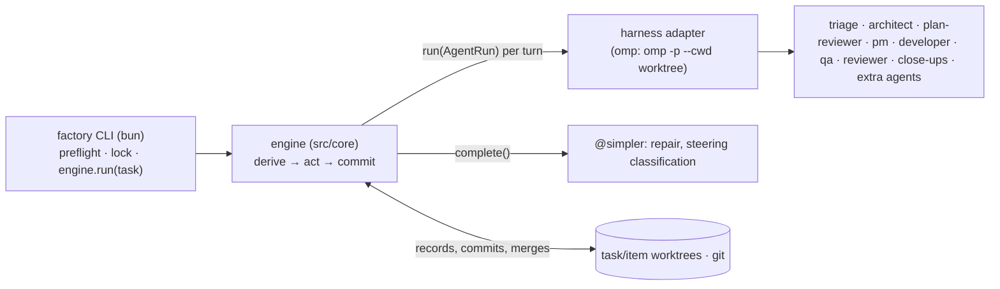
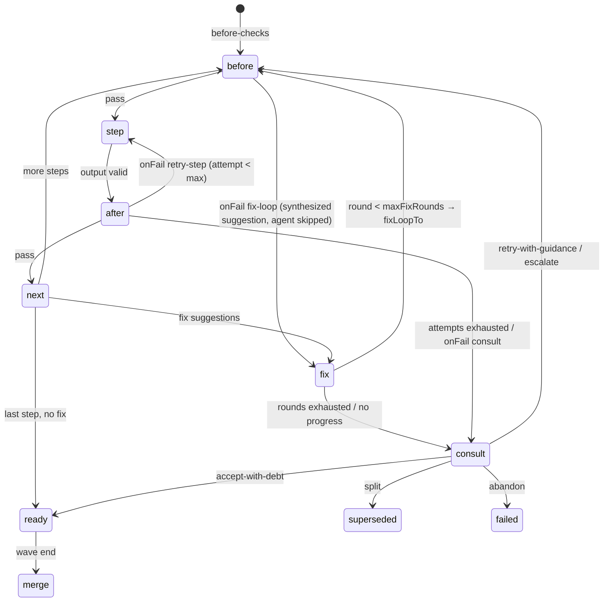

# software-factory v2 — Architecture & Contracts

Source spec: `docs/factory.v2.md`. v1: `plugins/software-builder`. This file is the build contract; deviations from the spec are listed in §1 with reasons.

## 0. Vocabulary

| Term | Meaning |
|---|---|
| task | Unit given to the factory: `{orchestrationFolder}/{task}/INTENT.md`. Root task or child epic task. |
| task kind | Decided by triage: `simple` \| `story` \| `spike` \| `epic` \| `saga` (engine semantics, not config). |
| item | Unit scheduled inside a task: kind `simple`, a story kind (`dev`, `no-behavior`, `test-only`, …), a spike kind (`fact-finder`, `poc`, `test-assumptions`, …) or `epic` (child task). Story/spike kinds are config. |
| wave | Ordered batch of items run in parallel; ends with serial merges + wave close-up. |
| iteration | One architect plan generation `N`: plan → review → PM → waves → plan close-up. May span several engine runs (restart). |
| step | One agent call with a committed record (§6): item steps and orchestration steps alike. |
| engine | Harness-agnostic TS (`src/core`). All mechanics; no orchestration prompts. |
| task worktree | Worktree on `topic/{task}` (root) or `topic/{task}--{epic}` (epic); holds that task's orchestration folder. |

## 1. Spec traceability & decisions

| Spec | Component | Decision / deviation |
|---|---|---|
| 1 TS/Bun, no mechanical prompts, YAML+schema, repair, restartable | `src/core`, `config/schemas` | Engine is a plain Bun process (§2). Repair is structure-only (§6.4). State derived from committed records + git (§6). |
| 2 prompt-debloat on all prompts | `agents/**` | Templates written per the prompt-debloat skill; preflight renders all. |
| 3 model roles, aliases, fallbacks → launch config | `models` config, `src/core/config/roles.ts`, adapter | Roles resolved mechanically; adapter emits harness-specific role/fallback config. |
| 4 harness-agnostic core | `src/core`, `src/harness/{types,omp,fake}` | Core never imports harness code. Branches/worktrees are engine-managed git (portable), not harness isolation. |
| 5 INTENT.md, clean git, topic branches, assignments committed first | `src/core/git`, §6 | **Deviation:** git cannot hold `topic/a` and `topic/a/b` together; children use `--`. Every agent input committed before launch. |
| 6 own branch+worktree per dev agent; commit even if rejected; propagate failure | `src/core/git`, §7 | Engine commits after every step regardless of outcome; failed items/epics propagate to parent status. |
| 7 story kinds configurable | `flows.story.*` | Step lists, checks, loop targets; PM classifies with config criteria. |
| 8 hierarchy, spikes | `flows.*`, plan limits | `simple` is also a plannable item kind (no review). Epics only one level deep (§8.6). Limits enforced mechanically. |
| 9 ingestion/triage | `flows/ingest.ts` | Triage always writes verified `context.yaml`; simple implemented by the same session on its own branch. |
| 10 architect flow, plan review, reviewer decisions | `flows/iteration.ts` | Per-suggestion dispositions; allowed set per agent; `human-stop` off by default. |
| 11 PM edits JSON | `agents/pm.md`, `src/core/plan/edits.ts` | PM output applied in one commit; PM also runs for single-item tasks (kind + assignment). |
| 12 mechanical dev process; retries → architect; escalation | `flows/item.ts` | QA gets engine evidence; targets restricted to infra test runner (anti-cheat). |
| 13 steering mailbox | `src/core/steer.ts` | One mailbox at the root task, routed by refs. |
| 14 architect standby; relaunch per iteration | `flows/iteration.ts`, `src/core/sessions.ts` | Architect = persistent session (resumable session id recorded in its step record). Turns (consult, wave report, close-up) resume it; a new iteration starts a fresh architect hydrated from artifacts (like v1); failed resume → fresh session + hydration. |
| 15 philosophy | `agents/_shared/philosophy.md` | Generic python-setup rules in every dev/review prompt. |
| 16 config | `config/*` | §5; extra agents, checks, hooks at any seam. |
| 17 bun launch, preflight, omp per iteration | `bin/factory.ts`, `src/cli`, `src/harness/omp` | **Deviation:** spec keeps one omp process per iteration to preserve IRC. Here each agent turn is its own harness process and a persistent role keeps its conversation as a resumable session on disk (same architect context, survives restarts, no live handles). §2, §11. |
| 18 concerns + remarkable decisions funnel, blocking/non-blocking ADRs, human-involvement modes (added after v2 build) | — | **Deliberately not hand-built**: goal of the first self-hosted fire test `concerns-funnel` (`docs/FIRE_TEST.md` §Self-host), so the factory extends itself. Current state: review dispositions (§8.7) and steering mailbox (§8.8) only. |
| 19 workspaces via omp isolation, preflight, status/cleanup/gc, commit content from agents, wave-end merger + escalation, saga with independent epic launches, no-model omp tests; 20 architect cache coherence/compaction, schema-free architect output (added after v2 build) | — | **Deliberately not hand-built**: second self-hosted fire-test goal `omp-workspaces`. Current state: engine-managed worktrees (§7), item-level integrate step, in-process epics, schema-bound architect plan, no cache/compaction management; prior omp research in `docs/spikes/`. |
| 26 feedback/approval per kind | `reviewPolicy`, `criteria`, §9 | Mechanical checks per kind + disposition criteria in prompts. |
| Fire test / DoD | `docs/FIRE_TEST.md`, README, templates, schemas | §13. Out of scope (not in spec): pushing, parallel epics. |

## 2. Runtime topology



- `factory run` = preflight → run lock → `engine.run(task)`: loop derive → act → commit until the task is `done`, `blocked` (human), `failed`, or `stopped` (budget/limits). Epics run as child tasks in the same process. Exit code: `0` done, `10` blocked on human, `1` failed/error. Restart at any time = run again.
- A turn = one harness call: a fresh session or a resumed one (`session.resume`). Persistent roles (triage, architect) keep a session id; the engine serializes turns per session (`sessions.ts`) and resumes after restarts using the id recorded in the step record. Resume failure (`sessionLost`) → fresh session hydrated from artifacts.
- Concurrency: `limits.maxParallelItems` item flows per task; `limits.maxParallelTurns` concurrent harness turns across the whole run (global semaphore; turns, not flows, so nested epics cannot deadlock).
- Run lock `$(git rev-parse --git-common-dir)/factory/{rootTask}.lock` (pid, host, start); dead pid → takeover (journaled).
- Locks: one repo-wide git-write mutex held only for each git command/commit (engine git commands use `-c gc.auto=0`); one merge-path lock per parent task held across a whole item merge sequence (agent turns inside it commit through the git-write mutex as usual).

## 3. Module layout

```
plugins/software-factory/
  package.json  tsconfig.json  README.md
  bin/factory.ts
  src/cli/          init, run, status, steer, preflight
  src/core/         (no harness imports)
    config/         load, layer, validate, roles, hook/seam validation
    records/        step records, yaml io, ajv, repair, citation verify
    git/            naming, worktrees, repo mutex, commit, merge path, HEAD guard
    derive/         task/iteration/wave/item state from records + git
    plan/           plan limits, edits validate/apply, scheduler
    flows/          ingest, item step machine, iteration, epic, consults, seams
    checks/         gates (+ratchet), targets (junit), red-test, test-diff, size, scope, custom
    steer.ts        mailbox
    sessions.ts     persistent-agent handles: per-session FIFO turns, resume threading, rehydrate on sessionLost
    prompts.ts      template render
    engine.ts       run(task): derive → act → commit loop
  src/harness/types.ts  src/harness/omp/  src/harness/fake/
  agents/           {agent}.md, steps/{step}.md, _shared/*.md
  config/pipeline.default.yaml  config/project.template.yaml  config/schemas/*.schema.json
  docs/ARCHITECTURE.md  docs/FIRE_TEST.md
  test/
```

## 4. Harness adapter contract

```ts
export interface Harness {
  run(l: AgentRun): Promise<AgentOutcome>;                    // one turn (fresh or resumed)
  complete(c: { role: string; models: string[]; system: string; prompt: string; schema: JSONSchema }): Promise<unknown>;
}
export interface AgentRun {
  agent: string; definition: string;   // rendered agent definition (frontmatter + body), inline for extra agents too
  prompt: string;                      // rendered step input (already committed)
  role: string; models: string[];      // role name + resolved primary/fallbacks
  tools: string[];                     // exposed tools
  cwd: string;                         // worktree
  outputSchema: JSONSchema;
  label: string;                       // {task}/{item|run}/{step}#a{n}
  session: { resume?: string; keep: boolean };
}
export type AgentOutcome =
  | { ok: true;  data: unknown; sessionId?: string; traceRef?: string; usage?: Usage }
  | { ok: false; error: string; data?: unknown; sessionId?: string; traceRef?: string; usage?: Usage;
      transient?: boolean; sessionLost?: boolean };
```

Rules: core never imports harness code; adapters hold no orchestration logic and never see git policy. `complete` output is always re-validated by the engine. The fake harness replays scripted outcomes by `label` and records calls. The omp adapter's launch templates, output extraction and config generation are in `docs/OMP_ADAPTER.md` (from the omp spike).

## 5. Configuration

| File | Required | Content |
|---|---|---|
| `<repo>/.factory/project.yaml` | yes (`factory init` from template, committed by init) | `orchestrationFolder` (default `.factory/tasks`), `adrFolder` (`docs/adr`), `worktreeRoot` (`../<repo>.factory-wt`), `scripts` {setup, compile, lint, test} (hints for infra), `paths.tests`, `paths.prod` globs, `skillDirs`. |
| pipeline layers | no | `config/pipeline.default.yaml` → `.factory/pipeline.yaml` → `{task}/pipeline.yaml` (epics inherit parent task layer). Maps merge, arrays replace, `null` deletes. After the first run all config is read from the task worktree (committed); `factory status` prints its path. |

```yaml
models:
  roles:                      # {model, fallbacks?} | {alias}
    workhorse:       { model: opencode-go/deepseek-v4.1-flash, fallbacks: [alt-workhorse] }
    alt-workhorse:   { model: opencode-go/muse-spark-1.3-contributor, fallbacks: [workhorse] }
    task-reviewer:   { alias: alt-workhorse }
    wave-close-up:   { alias: workhorse }
    plan-close-up:   { alias: alt-workhorse }
    task-escalation: { model: anthropic/claude-sonnet-5-5:max }
    simpler:         { model: google-antigravity/gemini-3.8-flash, fallbacks: [workhorse] }
    pm:              { alias: alt-workhorse }
    architect:       { model: anthropic/claude-opus-5-5:max, fallbacks: [alt-architect] }
    alt-architect:   { model: opencode-go/muse-spark-1.3-contributor }
agents:                       # built-in: {role, tools?}; extra: {role, definition, output, tools?}
  triage: { role: workhorse }        infra: { role: workhorse }       architect: { role: architect }
  plan-reviewer: { role: alt-architect }   pm: { role: pm }            developer: { role: workhorse }
  qa: { role: task-reviewer }        reviewer: { role: task-reviewer } fact-finder: { role: workhorse }
  wave-close-up: { role: wave-close-up }   plan-close-up: { role: plan-close-up }
  # docs-writer: { role: workhorse, definition: .factory/agents/docs-writer.md, output: developer }
  #   output: developer (writes code → own item/branch) | review (read-only) | path to JSON schema (read-only)
checks:                       # built-ins (§9) + command checks
  # mutation: { run: "uv run mutmut run --paths-to-mutate {{changedProd}}", expect: pass,
  #             cwd: item, timeoutSec: 900, phase: after, onFail: fix-loop }
hooks:                        # extra agents/checks at any seam (§8.10)
  # after:item.step.develop: [ { check: mutation, when: { kinds: [dev] } } ]
  # after:wave.merge:        [ { agent: docs-writer } ]
flows:
  simple:            { steps: [ { id: develop, agent: developer, checks: [gates, simple-guard] } ] }
  story:
    dev:
      criteria: "behavior change; tests first"
      steps:
        - { id: test-first, agent: developer, checks: [test-first-scope, target-red] }
        - { id: develop, agent: developer, escalatable: true, session: reuse, retryRole: alt-workhorse,
            checks: [gates, target-green, size] }
        - { id: qa, agent: qa, checks: [red-test, test-diff] }      # default phase: before
        - { id: review, agent: reviewer, focus: code, escalatable: true }
        # - { id: security-review, agent: reviewer, focus: security }
      fixLoopTo: develop
    no-behavior: { criteria: …, steps: [develop(gates,size), qa(test-diff), review], fixLoopTo: develop }
    test-only:   { criteria: …, steps: [develop(gates, tests-only), review], fixLoopTo: develop }
  spike:
    fact-finder:      { criteria: …, steps: [research, review(focus: result)], fixLoopTo: research }
    poc:              { criteria: …, steps: [develop(poc-scope), review(focus: result)], fixLoopTo: develop }
    test-assumptions: { criteria: …, steps: [develop(gates, tests-only), review(focus: result)], fixLoopTo: develop }
limits: { maxParallelItems: 4, maxParallelTurns: 6, maxStepAttempts: 2, maxInterruptions: 3, maxFixRounds: 3, maxConsultsPerItem: 2,
          maxSplitDepth: 1, maxPlanReviewRounds: 2, maxAmendmentsPerIteration: 3, maxIterations: 6,
          maxInfraRetries: 3, gateRetries: 1, storyMaxProdLines: 300, simpleMaxProdLines: 150, stubMaxProdLines: 40,
          maxMilestones: 8, maxItemsPerPlan: 50, checkOutputBytes: 4000, hydrationBytes: 40000 }
budget: { perTaskUsd: 100, perIterationUsd: 30, perItemUsd: 8 }   # enforced when harness reports usage
diversity: warn
harness: omp
reviewPolicy:
  default: [fix, optional, architect, human-awareness, human-async]   # human-stop deliberately absent
criteria: { triage: …, dispositions: … }
prompts: { overrides: {}, extraSkillDirs: [] }
```

Role resolution: alias chain (cycle → error), fallbacks expanded recursively (dedupe, primary first). Escalated items: `escalatable` steps use `task-escalation`. Preflight validates: every step/hook agent exists; extra `definition` renders; `output` resolves; every check id and seam name exists; code-writing agents only where §8.10 allows; diversity.

## 6. Records, artifacts, restart

### 6.1 Step record (one format for every agent call)
`{dir}/{seq:03}-{name}-a{n}/` with `input.md` (rendered prompt), `meta.yaml` {agent, role, models, session, traceRef, status: started|ok|rejected|error|interrupted, usage, startedAt, endedAt}, `output.yaml`, `checks.yaml`.
- Item steps: `{task}/items/{item}/steps/` on the item branch. Orchestration steps (triage, infra, every architect turn, plan-review, pm, consults, close-ups, steering classification, hooks at non-item seams): `{task}/runs/` on the task branch. `meta.yaml` stores `sessionId` for persistent roles.

### 6.2 Task folder
```
{orchestrationFolder}/{task}/
  INTENT.md  pipeline.yaml?  triage.yaml  context.yaml  infra.yaml  gates-baseline.yaml
  plan/plan-{N}.yaml  plan/plan-{N}.{k}.yaml (amendments)  plan/edits-{N}.{k}.yaml
  items/{item}/assignment.yaml                 # task branch, committed by the edits commit
  items/{item}/steps/…                         # item branch
  waves/wave-{N}.{w}.yaml   closeup-{N}.yaml   decisions/{seq}-{kind}.yaml
  runs/…   state.yaml (materialized view)   journal.ndjson (audit only)
  {epic}/INTENT.md …                           # child task, written by the edits commit
  steer/ (root task only)
```
Canonical artifacts (plan, edits, wave, closeup, decisions) are written in the same commit as the step record that produced them.

### 6.3 Invariants
1. `input.md` + `meta(status: started)` committed before launch.
2. A step is done iff `output.yaml` validates and is committed with final `meta`.
3. Engine commits the worktree after every item step (`factory({item}): {step} a{n} [{status}]`), even on failure.
4. State is derived (`src/core/derive`) from committed records + git (`merge-base --is-ancestor` for merged). `state.yaml` is rewritten for humans and never read for decisions.
5. PM edits apply atomically: edits artifact + assignments + epic INTENTs + record in one commit.
6. Start-up repair (per worktree): `MERGE_HEAD` → `merge --abort` (merge path re-runs). Task worktree: uncommitted operator-editable files (`INTENT.md`, `{task}/pipeline.yaml`, `.factory/*.yaml`, `steer/fromuserpending/*`) committed as `factory: operator edits` (journaled); everything else uncommitted → `git stash push -m factory-stray-{ts}` (never discarded). Item worktree: dirty → commit `interrupted`. Record with `started` and no final meta → `interrupted`; next attempt does not count toward `maxStepAttempts` until `maxInterruptions`.
7. Sessions are resumable across processes: a persistent role's latest `sessionId` is read from its newest step record; resume failure → fresh session with hydration (§4).

### 6.4 Output validation & repair
1. Harness schema enforcement (when supported). 2. `complete(@simpler)` structural repair; accepted only if every leaf value of the repaired object (enums, verdicts, statuses especially) appears in the raw output. 3. Invalid → resumed turn in the same session with the validation errors (when the session was kept). 4. Relaunch once. 5. `error`.

## 7. Git & worktrees

- Branches: root `topic/{task}`; child `topic/{task}--{item}`; inside an epic `topic/{task}--{epic}--{item}`. Slugs `^[a-z0-9]+(-[a-z0-9]+)*$`; reserved: `simple`.
- First run: main checkout must be clean except the task's `INTENT.md`; `topic/{task}` created from its HEAD; task worktree `{worktreeRoot}/topic_{task}`; INTENT copied and committed there. The main checkout is never modified afterwards.
- Item worktree `{worktreeRoot}/{branch with / → _}`, created when its wave starts, from the parent tip after the previous wave's merges (assignment already on that tip); `ensureWorktree` is idempotent (reuse existing branch, prune stale registrations); `infra.setup` runs on creation; removed after merge/failure, branch kept.
- HEAD guard: record branch + HEAD before an agent step; after: branch changed → `error`, restore; HEAD moved → `reset --soft` to recorded HEAD, engine commits. Prompts forbid git writes.
- Merge path (wave end, serial in PM order, under the parent's merge-path lock): in item worktree `git merge <parent>` → conflict → `integrate` step (developer) → if the tree differs from the last gated tree: gates + target-green → failure → fix loop (QA/review re-run) → `git merge --no-ff` into the task worktree → remove worktree → `after:item.merge` hooks.
- Epics merge into their parent through the same path.

## 8. Flows

### 8.1 Ingest
1. `triage` (persistent session, cwd = scratch worktree on `topic/{task}--simple` from the task tip): returns `triage.yaml` {kind, rationale, size, risks} + `context.yaml` citations `{file, lines: "a-b", anchors[], summary}` (always).
2. Citations verified (file exists, range in bounds, all anchors in range); failures returned via a resumed turn (≤ `maxStepAttempts`), then dropped (journaled).
3. `infra` if `infra.yaml` missing (epics inherit): validates/derives setup commands, gates `{id, command}`, `testRunner` {command, selectorArgs, junitArg}, runs gates → `gates-baseline.yaml`.
4. Route: `simple` → resumed triage turn (implement) in the same worktree → checks `gates`, `simple-guard` → green: merge path. Guard failure or gate attempts exhausted: the scratch branch becomes a `no-behavior` item (QA + review added; work kept). Non-simple: scratch worktree and branch removed. `story`/`spike` → PM (single item) → item flow → merge → `task.done`. `epic`/`saga` → iteration flow. Child epic tasks skip classification (kind fixed) but still produce `context.yaml`.

### 8.2 Item step machine


After a fix round all review-type steps re-run. A wave ends when every item is terminal (merged, failed, superseded) or human-blocked (`human-async` item, blocked epic): ready items merge; human-blocked items carry over and go through the merge path at the end of the wave in which they become ready; their dependents stay blocked. Dependents of `failed` items become `blocked-by-failure` and go into the wave report. Split: item `superseded`, branch kept; new items start from the parent tip and reference the old branch.

### 8.3 Kinds
- `dev`: `test-first` changes tests (plus new interface-stub files under `paths.prod`, ≤ `stubMaxProdLines`, so tests of new modules can collect) and declares `target` {selectors[], expectRed[]} (or, for bootstrap stories, `{gate}` / `{command, customTarget: true}`; QA is told when custom). Engine builds the command from `infra.testRunner` + selectors + junit arg.
- `no-behavior`: tests must stay materially the same (QA judges `test-diff`).
- `test-only`: tests only.
- `simple` item: develop + gates + `simple-guard`; no review. Guard fail → continues as `no-behavior` on the same branch.
- Spikes: `fact-finder` → `items/{item}/findings.md`; `poc` → code confined to `items/{item}/poc/`; `test-assumptions` → tests that stay. Results go to the architect in the next wave report.

### 8.4 Architect iteration
1. Iteration `N` = 1 + count of existing `closeup-*.yaml` (any decision); resume if `plan-N` exists without `closeup-N`. An answered `blocked` close-up therefore starts iteration N+1 with the answer hydrated. `maxIterations` uses the same count.
2. Fresh plan: architect (persistent) gets INTENT, context, infra, prior plans, close-ups, debt, taken steering → `plan-N`: milestones (≤ 8; gherkin scenarios + directional interfaces), uncertainties → spike outlines, item outlines only where clear (later milestones `replan-after`), assumptions (+ why, + disposition if user input wanted), epics (root task only; INTENT text), tech debt (`adjacent|impacting|blocking`; resolution for impacting/blocking), ADRs (engine writes to `adrFolder`), escalate flags.
3. `plan-reviewer` (one-shot per round) → `fix` → architect turn (revise) (≤ `maxPlanReviewRounds`; repeated fingerprints stop early) → unresolved recorded as architect decisions.
4. PM → edits (items: slug, kind, title, assignment, outlineRef, milestone, wave, deps, scenario refs, citations subset) → validated (§9) → applied (§6.3.5). Escalate flags come from outlines via `outlineRef`.
5. Waves in order; ≤ `maxParallelItems` items concurrently; epic items run as child tasks in-process (own iterations, own `maxParallelItems`) and count as one item of the wave.
6. Wave end: merge path → gates on parent tip (ratchet `gates-baseline.yaml`) → `wave-close-up` → architect turn (wave report + spike results + consults + debt + undelivered steering) → `continue` | `amend` (plan delta → PM edits; ≤ `maxAmendmentsPerIteration`) | `end-iteration`.
7. `plan-close-up` (milestones vs scenarios vs INTENT) → architect turn → `complete` | `next-iteration` | `blocked(question)` → `closeup-N.yaml`. `next-iteration` continues in the same process with a fresh architect session.
- Resumed run (restart): the architect session id from its latest record is resumed; on `sessionLost` a fresh architect is hydrated with plan-N, amendments, wave reports, decisions, taken steering and told to continue, not replan.

### 8.5 Consults & decisions
| Context | Options |
|---|---|
| item (rounds/attempts exhausted, size over limit, `architect` disposition) | `retry-with-guidance(text, persist)`, `split(outlines)`, `escalate`, `accept-with-debt(debt)`, `abandon(reason)` |
| non-item (close-up `fix`, failing non-item seams, merged-item hooks) | `fix-item(outline → PM edits)`, `accept-with-debt`, `human-async(question)`, `abort(reason)` |
| wave report | `continue`, `amend`, `end-iteration` |
| plan close-up | `complete`, `next-iteration`, `blocked(question)` |

The live architect session (resumed turn, queued per session) if one exists for the iteration, else a fresh architect with the same hydration. Every decision is a record + `decisions/` artifact.

### 8.6 Epics
Written by the edits commit (`{epic}/INTENT.md`, on the parent branch); branch + task worktree `topic/{task}--{epic}`; child task runs its own iterations; final `closeup` maps to parent item status `done|failed|blocked`; merges through the merge path. Epic plans cannot define epics (depth 2, matches `topic/{task}--{epic}--{item}`).

### 8.7 Review dispositions
Every review-type output: `{status, summary, suggestions: [{id, disposition, summary, detail, location?}]}`; verdict derived (any `fix` ⇒ changes requested).

| disposition | Engine action |
|---|---|
| `fix` | item: back to `fixLoopTo`; non-item: consult (non-item options) |
| `optional` | given to the developer if another round happens; otherwise stored as debt (`state` + wave report + close-up + next plan) |
| `architect` | consult; decision final |
| `human-awareness` | architect decides now; `tousertoreview` item records the decision |
| `human-async` | `tousertoreview`; item + dependents blocked; others continue; an answer re-runs the step that raised it with the answer in `input.md` |
| `human-stop` | `tousertoreview`; exit 10. Offered only if in `reviewPolicy` |

Schema enum + prompt section generated from the agent's allowed set and `criteria.dispositions`.

### 8.8 Steering mailbox (root task only)
- `steer/tousertoreview/{id}.yaml` {id, ref: `{epic?}/{item?}` | plan, disposition, question, draftDecision, blocks, status}.
- `steer/fromuserpending/*` free text. Processing is single-flight per tick: `complete(@simpler)` → {refs, kind: answer|directive|stop, urgency: now|next-architect-call, summary} → one commit: `git mv` to `fromusertaken/`, classification yaml, effects (answers close/unblock items). Directives carry `deliveredAt` (architect record id) once sent; undelivered ones go with the next architect turn (`now` → immediate queued turn). `stop` → finish running steps, exit 10.
- Active run (root or epic) polls the root mailbox. `factory steer` / `factory status` operate on it.

### 8.9 Not in v2
Pushing branches (operator's job), parallel epics.

### 8.10 Seams & hooks
`hooks.{before|after}:{seam}`: ordered entries `{agent}` | `{check}`, optional `when: {kinds, escalated, taskKinds}`. A step's `checks` attach at the check's `phase` (default after; `red-test`, `test-diff`: before).

| Seam | cwd | `base` for placeholders | Failure / `fix` → |
|---|---|---|---|
| `ingest.triage` | triage scratch worktree | task fork point | consult (non-item) |
| `ingest.infra` | task worktree | task fork point | consult (non-item) |
| `plan.architect`, `plan.review`, `plan.edits` | task worktree | tip at plan commit | architect turn |
| `item.start`, `item.step.{id}`, `item.accept` | item worktree | item branch point | item fix loop |
| `item.merge` | task worktree | tip before merge | consult (non-item) |
| `wave.start`, `wave.merge`, `wave.closeup` | task worktree | tip at wave start | wave report → architect |
| `iteration.start`, `iteration.closeup` | task worktree | tip at plan commit | architect decision |
| `task.done` | task worktree | task fork point | consult (non-item) |

Hook agent outputs use the review contract (read-only) except code-writing agents (`output: developer`): at item seams they work in the item worktree; at other seams the engine creates a synthetic item `hook-{name}-{recordSeq}` (own branch/worktree, gates, merge path) before the seam completes. Synthetic items never fire hooks; preflight rejects configs where they would be required to.

## 9. Mechanical checks

| Check | Default phase / onFail | Rule |
|---|---|---|
| schema | every record | §6.4 |
| citations | triage | file, range, anchors |
| plan limits | plan, edits | milestones ≤ 8, items ≤ 50, unique slugs, deps acyclic and only on earlier waves, kinds exist, outlineRef exists, epics only in root plans |
| gates | after / retry-step | infra gates; gates green in `gates-baseline.yaml` must stay green; `gateRetries` re-runs, flaky recorded |
| test-first-scope | after / retry-step | changes under `paths.tests` + new (not modified) `paths.prod` files totalling ≤ `stubMaxProdLines` |
| tests-only | after / retry-step | changes only under `paths.tests` |
| target-red | after / retry-step | junit: every `expectRed` id fails (assertion), suite collects; collection/import errors ≠ red |
| target-green | after / retry-step | selected tests pass |
| red-test | before QA / fix-loop (synthesized) | temp worktree at item tip with `paths.prod` restored to the test-first commit → `expectRed` ids fail |
| test-diff | before QA / feed | diff of `paths.tests` since test-first (or branch point) |
| size | after / consult (split) | prod changed lines ≤ `storyMaxProdLines` |
| simple-guard | after / reroute no-behavior | prod lines ≤ `simpleMaxProdLines`; test changes rename-only (`diff -M`) |
| poc-scope | after / retry-step | changes only under the item's `poc/` |
| custom `checks.<id>` | configurable | command, `expect` pass/fail, `cwd: item|task`, placeholders `{{worktree}} {{changedProd}} {{changedTests}} {{base}}`, timeout; `onFail: retry-step|fix-loop|consult|feed` |

## 10. Agents & prompts

| Agent | v1 source | Default role | Output |
|---|---|---|---|
| triage | new (fact-finder style) | workhorse | triage + context; simple: developer |
| infra | infra.md | workhorse | infra |
| architect | plan-goal-execution.md + oracle duties | architect | plan, decisions |
| plan-reviewer | mentor.md | alt-architect | review |
| pm | orchestrate-goal-execution.md | pm | plan-edits |
| developer | implement-subtask.md | workhorse (escalated: task-escalation) | developer {status, summary, target?, evidence[], concerns[]} |
| qa | check-and-commit-subtask.md (verification) | task-reviewer | review |
| reviewer | check-and-commit-subtask.md (review) | task-reviewer (escalated: task-escalation) | review |
| fact-finder | fact-finder.md | workhorse | fact-finder |
| wave-close-up | wave-end-checkpoint.md | wave-close-up | wave-closeup + review |
| plan-close-up | plan-completeness-checker.md | plan-close-up | plan-closeup + review |
| removed | subtask-dev-process, goal-flow command, oracle | — | mechanics in TS; consults → architect |

Composition (cache-friendly order): `_shared/philosophy.md` + `{agent}.md` (stable) → `steps/{step}.md` → assignment/citations → dynamic feedback last. `{{var}}` only; unknown placeholder = preflight error. Overrides per agent/step. QA/reviewer: developer report is a claim; evidence = engine checks + diff + own inspection. All agents except developer/triage-simple/integrate are read-only.

## 11. CLI

```
bun run factory init [--repo .]               # .factory/project.yaml from template (committed)
bun run factory run <task|path/INTENT.md> [--repo .] [--max-iterations N]   # always resumes
bun run factory status <task>                 # tree, items, waves, budgets, open tousertoreview
bun run factory steer <task> "text"           # → root task steer/fromuserpending
bun run factory preflight <task>
```
Preflight: first-run cleanliness (§7), configs + layers valid, roles resolve, templates render, schemas compile, harness binary present and generated harness config valid, run lock free.

## 12. Extensibility, loop prevention, resilience, model splits, token economy

### 12.1 Extensibility
New story/spike kinds = config entries with `criteria` (PM enum + guide generated). Steps `{id, agent, role?, retryRole?, escalatable?, session?: fresh|reuse, checks?, focus?, timeoutSec?}`; extra agents; command checks; hooks at any seam; per-agent dispositions; prompt overrides; skill dirs; per-kind `limits`; harness by id.

### 12.2 Loop prevention
| Loop | Bound | No-progress detector (fingerprint = sha1 of normalized text) | Exhaustion |
|---|---|---|---|
| step attempts | `maxStepAttempts` | same failing-check fingerprint as previous attempt | consult |
| interruptions | `maxInterruptions` | — | `error` |
| fix rounds | `maxFixRounds` | empty diff since last round, or repeated suggestion fingerprints | consult now |
| consults per item | `maxConsultsPerItem` | same decision twice without new diff | `failed` |
| splits | `maxSplitDepth` | — | consult → abandon |
| plan review | `maxPlanReviewRounds` | repeated fix fingerprints | architect decides |
| amendments | `maxAmendmentsPerIteration` | — | end iteration |
| iterations | `maxIterations` (existing close-ups, per task) | two iterations with zero merged items | blocked |
| harness errors | `maxInfraRetries`, backoff | — | `error`; never consumes fix rounds |
| repair | §6.4 | — | `error` |

### 12.3 Resilience
Run lock; repo mutex + `gc.auto=0`; start-up repair (§6.3.6); `error` (transient/provider/timeout) distinct from `rejected`; adapter fallback chains; gate re-runs; per-step and per-check timeouts; derived state reconciles any crash window; resumable sessions.

### 12.4 Model splits
| Class | Roles | Used by |
|---|---|---|
| workhorse (cheap) | workhorse; alt-workhorse (= task-reviewer, pm, plan-close-up); wave-close-up | triage, infra, developer, qa, reviewer, fact-finder, pm, close-ups |
| simpler (cheapest) | simpler | repair, steering classification |
| escalation | task-escalation | developer + reviewer of flagged items |
| architect (expensive) | architect; alt-architect | plan, consults, decisions; plan review, fallback |

Producer and reviewer split within class (developer `workhorse` ↔ qa/reviewer `alt-workhorse`; architect ↔ plan-reviewer `alt-architect`). Alt on retry: from fix round 2 the developer runs `retryRole` (`alt-workhorse`); for that round reviewing steps resolving to the same primary model swap to the producer's base role (`workhorse`). A rotated round starts a fresh developer session. Escalated items: `task-escalation` for both (spec). `diversity` checks at preflight.

### 12.5 Token economy
Cache-ordered prompts; assignments carry only their citations + milestone excerpt; `session: reuse` with delta-only follow-ups; tail-capped check output; hydration from structured summaries capped at `hydrationBytes`; architect started lazily; `simpler` for mechanical text; failing `before` checks skip the agent; usage → records + `state` totals; `budget` exceed: item → consult, iteration → end, task → `human-stop` item + exit 10.

## 13. Testing & fire test
- `bun test` (fake harness + temp git repos), behavior only: crash/restart at each commit point, interrupted not counted, fix loop → consult → escalate, alt-on-retry swap, dispositions incl. human-async blocking dependents and answer re-run, steering single-flight, edits validation, target-red rejects collection errors, red-test catches tests that pass without the prod change, merge path conflict → integrate, HEAD guard, branch naming, session resume threading + sessionLost rehydration.
- Fire test (`docs/FIRE_TEST.md`): `/home/slava/aiexp/python-setup`, GOAL from spec, ≤ 5 launches; operator answers `tousertoreview` via `fromuserpending` (logged); after each launch trace analysis (records, journal, session transcripts) → harness fixes → next launch.

## 14. Open items
Resolved: The harness adapter, CLI dispatch, launch templates, unattended configuration overlays, structured output extraction, and failure classifications are fully specified in `docs/OMP_ADAPTER.md`.
