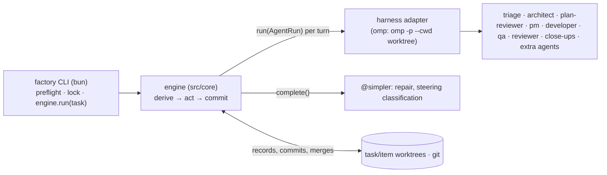
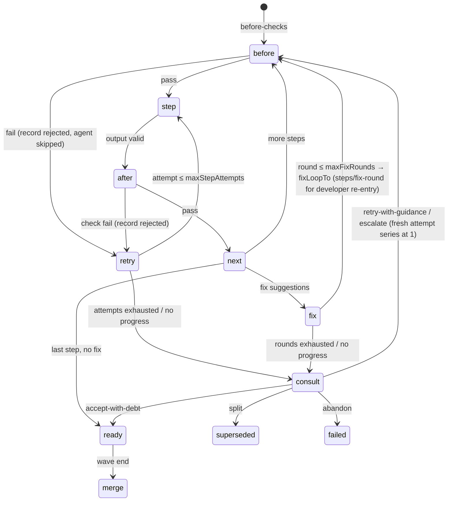

# software-factory v2 — Architecture & Contracts

Source spec: `docs/factory.v2.md`. v1: `plugins/software-builder`. This file is the build contract; deviations from the spec are listed in §1 with reasons.

## 0. Vocabulary

| Term | Meaning |
|---|---|
| task | Unit given to the factory: `{orchestrationFolder}/{task}/INTENT.md`. Root task or child epic task. |
| task kind | Decided by triage: `simple` \| `story` \| `spike` \| `epic` \| `saga` (engine semantics, not config). |
| item | Unit scheduled inside a task: kind `simple`, a story kind (`dev`, `no-behavior`, `test-only`, …), a spike kind (`fact-finder`, `poc`, `test-assumptions`, …) or `epic` (child task). Story/spike kinds are config. |
| wave | Ordered batch of items run in parallel; ends with serial merges + wave close-up. |
| iteration | One architect plan generation `N`: plan → review → PM → waves → plan close-up. May span several engine runs (restart). |
| step | One agent call with a committed record (§6): item steps and orchestration steps alike. |
| engine | Harness-agnostic TS (`src/core`). All mechanics; no orchestration prompts. |
| task worktree | Worktree on `topic/{task}` (root) or `topic/{task}--{epic}` (epic); holds that task's orchestration folder. |

## 1. Spec traceability & decisions

| Spec | Component | Decision / deviation |
|---|---|---|
| 1 TS/Bun, no mechanical prompts, YAML+schema, repair, restartable | `src/core`, `config/schemas` | Engine is a plain Bun process (§2). Repair is structure-only (§6.4). State derived from committed records + git (§6). |
| 2 prompt-debloat on all prompts | `agents/**` | Templates written per the prompt-debloat skill; preflight renders all. |
| 3 model roles, aliases, fallbacks → launch config | `models` config, `src/core/config/roles.ts`, adapter | Roles resolved mechanically; adapter emits harness-specific role/fallback config. |
| 4 harness-agnostic core | `src/core`, `src/harness/{types,omp,fake}` | Core never imports harness code. Branches/worktrees are engine-managed git (portable), not harness isolation. |
| 5 INTENT.md, clean git, topic branches, assignments committed first | `src/core/git`, §6 | **Deviation:** git cannot hold `topic/a` and `topic/a/b` together; children use `--`. Every agent input committed before launch. |
| 6 own branch+worktree per dev agent; commit even if rejected; propagate failure | `src/core/git`, §7 | Engine commits after every step regardless of outcome; failed items/epics propagate to parent status. |
| 7 story kinds configurable | `flows.story.*` | Step lists, checks, loop targets; PM classifies with config criteria. |
| 8 hierarchy, spikes | `flows.*`, plan limits | `simple` item flow is the conversion target for oversized triage-simple work (no review). PM chooses story/spike/epic kinds (§8.4). Epics only one level deep (§8.6). Limits enforced mechanically. |
| 9 ingestion/triage | `flows/ingest.ts` | Triage always writes verified `context.yaml`; simple implemented by the same session on its own branch. Context pack runs after infra, before architect (§8.1). |
| 10 architect flow, plan review, reviewer decisions | `flows/iteration.ts` | Per-suggestion dispositions; allowed set per agent; `human-stop` off by default. |
| 11 PM edits JSON | `agents/pm.md`, `src/core/plan/apply.ts` + `limits.ts` | PM output applied in one commit; all non-simple tasks go through architect + PM (§8.4). |
| 12 mechanical dev process; retries → architect; escalation | `flows/item-machine.ts` | QA gets engine evidence; targets restricted to infra test runner (anti-cheat). |
| 13 steering mailbox | `src/core/steer.ts` | One mailbox at the root task, routed by refs. |
| 14 architect standby; relaunch per iteration | `flows/iteration.ts`, `flows/step-runner.ts` | Architect = persistent session (resumable session id committed to its step record at turn start via `onSession`). Turns (consult, wave report, close-up) resume it; a new iteration starts a fresh architect hydrated from records (like v1); `sessionLost` → fresh session + hydration from records. `src/core/sessions.ts` (`PersistentAgent` FIFO helper) is currently only exercised by tests; live flows thread resume ids through step records instead. |
| 15 philosophy | `agents/_shared/philosophy.md` | Generic python-setup rules in every dev/review prompt. |
| 16 config | `config/*` | §5; extra agents, checks, hooks at any seam. |
| 17 bun launch, preflight, omp per iteration | `bin/factory.ts`, `src/cli`, `src/harness/omp` | **Deviation:** spec keeps one omp process per iteration to preserve IRC. Here each agent turn is its own harness process and a persistent role keeps its conversation as a resumable session on disk (same architect context, survives restarts, no live handles). §2, §11. |
| 18 concerns + remarkable decisions funnel, blocking/non-blocking ADRs, human-involvement modes (added after v2 build) | `src/core/{concerns,triage,review-policy}.ts`, `flows/{step-runner,iteration,epic-propagation,adrs}.ts`, `cli/status.ts` | **Implemented** in the concerns funnel (§8.11), with six accepted deviations: epic-config root-only (`adr-epic-config-root-only`), close-up-dismiss via resolutions (`adr-closeup-no-suggestions-triage`), saga open-only (`adr-epic-push-condensed`), immediate halt (`adr-autonomous-immediate-halt`), triage-coverage (`adr-funnel-triage-coverage`), epic mailbox isolation (`adr-epic-mailbox-isolation`); counts follow `adr-remarkable-counts-semantics`, dismiss criteria `adr-dismiss-criteria-row`. |
| 19 workspaces via omp isolation, preflight, status/cleanup/gc, commit content from agents, wave-end merger + escalation, saga with independent epic launches, no-model omp tests; 20 architect cache coherence/compaction, schema-free architect output (added after v2 build) | — | **Deliberately not hand-built**: second self-hosted fire-test goal `omp-workspaces`. Current state: engine-managed worktrees (§7), item-level integrate step, in-process epics, schema-bound architect plan, no cache/compaction management; prior omp research in `docs/spikes/`. |
| 26 feedback/approval per kind | `reviewPolicy`, `criteria`, §9 | Mechanical checks per kind + disposition criteria in prompts. |
| Fire test / DoD | `docs/FIRE_TEST.md`, README, templates, schemas | §13. Out of scope (not in spec): pushing, parallel epics. |

## 2. Runtime topology



- `factory run` = preflight → run lock → `engine.run(task)`: loop derive → act → commit until the task is `done`, `blocked` (human), `failed`, or `stopped` (budget/limits). Epics run as child tasks in the same process. Exit code: `0` done, `10` blocked on human, `1` failed/error. Restart at any time = run again.
- A turn = one harness call: a fresh session or a resumed one (`session.resume`). Persistent roles (triage, architect) keep a session id committed to `meta.yaml` at turn start via `onSession`; restarts resume the recorded id, including an interrupted step's session (short continue-and-yield prompt under `limits.timeoutNudgeSec`). Resume failure (`sessionLost`) → fresh session hydrated from records. Concurrent ordinary turns are bounded by the global turns semaphore; per-session FIFO exists only in the `PersistentAgent` helper.
- Transient timeout: a resumable kept session is resumed once with a short finalize nudge (`time budget exhausted: stop exploring, yield your result now…`) under `limits.timeoutNudgeSec`; when the step has no effective timeout the nudge defaults to half the 45m harness backstop (1350s). A fresh session is used only on `sessionLost`. See §12.3.
- Concurrency: `limits.maxParallelItems` item flows per task; `limits.maxParallelTurns` concurrent harness turns across the whole run (global semaphore; turns, not flows, so nested epics cannot deadlock).
- Run lock `{worktreeRoot}/.factory-runtime/locks/{rootTask}.lock` (pid, host, start); dead pid → takeover (console warning + journaled). The path is outside the main checkout.

## 3. Module layout

```
plugins/software-factory/
  package.json  tsconfig.json  README.md
  bin/factory.ts
  src/cli/          init, run, status, steer, preflight
  src/core/         (no harness imports)
    config/         load, layer, validate, roles, hook/seam validation
    records/        step records, yaml io, ajv, repair, citation verify
    git/            naming, worktrees, repo mutex, commit, merge path, HEAD guard
    derive/         task/iteration/wave/item state from records + git
    plan/           plan limits, edits validate/apply, scheduler, failure-blocker (wave order/readiness derive in derive/wave.ts)
    flows/          ingest, item step machine, iteration, epic, consults, seams, adrs.ts, epic-propagation.ts
    checks/         gates (+ratchet), targets (junit), red-test, test-diff, size, scope, custom
    concerns.ts     engine-owned concern store: fingerprint dedup, triage, resolutions, reconcile
    triage.ts       severity policy, human routing, review triage, hydration byte caps
    review-policy.ts  triager set + dismiss auto-append, allowed dispositions
    steer.ts        mailbox
    sessions.ts     PersistentAgent FIFO helper (currently only exercised by tests; live flows use step-runner resume)
    prompts.ts      template render
    engine.ts       run(task): derive → act → commit loop
  src/harness/types.ts  src/harness/omp/  src/harness/fake/
  agents/           {agent}.md, steps/{step}.md, _shared/*.md
  config/pipeline.default.yaml  config/project.template.yaml  config/schemas/*.schema.json
  docs/ARCHITECTURE.md  docs/FIRE_TEST.md
  test/
```

## 4. Harness adapter contract

```ts
export interface Harness {
  run(l: AgentRun): Promise<AgentOutcome>;                    // one turn (fresh or resumed)
  complete(c: { role: string; models: string[]; system: string; prompt: string; schema: JSONSchema }): Promise<unknown>;
}
export interface AgentRun {
  agent: string; definition: string;   // rendered agent definition (frontmatter + body), inline for extra agents too
  prompt: string;                      // rendered step input (already committed)
  role: string; models: string[];      // role name + resolved primary/fallbacks
  tools: string[];                     // exposed tools
  cwd: string;                         // worktree
  outputSchema: JSONSchema;
  label: string;                       // {task}/{item|run}/{step}#a{n}
  session: { resume?: string; keep: boolean };
  timeoutSec?: number; onSession?: (sid: string) => void; onUsage?: (u: Usage) => void;
}
export type AgentOutcome =
  | { ok: true;  data: unknown; sessionId?: string; traceRef?: string; usage?: Usage; transcriptBytes?: number; stdoutBytes?: number; toolCallCount?: number }
  | { ok: false; error: string; data?: unknown; sessionId?: string; traceRef?: string; usage?: Usage; transcriptBytes?: number; stdoutBytes?: number; toolCallCount?: number;
      transient?: boolean; sessionLost?: boolean; launchError?: boolean; timedOut?: boolean };

Rules: core never imports harness code (only `src/harness/types.ts` types); adapters hold no orchestration logic and never see git policy. `complete` output is always re-validated by the engine. The fake harness replays scripted outcomes by `label` and records calls. The omp adapter's launch templates, output extraction and config generation are in `docs/OMP_ADAPTER.md` (from the omp spike). `timedOut` + `transcriptBytes`/`stdoutBytes` feed the nudge-retry and transcript-size guard paths (§12.3).

## 5. Configuration

| File | Required | Content |
|---|---|---|
| `<repo>/.factory/project.yaml` | yes (`factory init` from template, committed by init) | `orchestrationFolder` (default `.factory/tasks`), `adrFolder` (`docs/adr`), `worktreeRoot` (`../<repo>.factory-wt`), `scripts` {setup, compile, lint, test} (hints for infra), `paths.tests`, `paths.prod` globs, `skillDirs`. |
| pipeline layers | no | `config/pipeline.default.yaml` → `.factory/pipeline.yaml` → `{task}/pipeline.yaml` (epics inherit parent task layer — `pipelineFor` falls back to the root task `pipeline.yaml` for child dirs; `models.roles.<name>` defs replace atomically per layer). Maps merge, arrays replace, `null` deletes. After the first run all config is read from the task worktree (committed); `factory status` prints its path. Preflight validates the effective pipeline from the task worktree when it exists. |

```yaml
models:
  roles:                      # {model, fallbacks?} | {alias}
    workhorse:       { model: opencode-go/deepseek-v4.1-flash, fallbacks: [alt-workhorse] }
    alt-workhorse:   { model: opencode-go/muse-spark-1.3-contributor, fallbacks: [workhorse] }
    task-reviewer:   { alias: alt-workhorse }
    wave-close-up:   { alias: workhorse }
    plan-close-up:   { alias: alt-workhorse }
    task-escalation: { model: anthropic/claude-sonnet-5-5:max }
    simpler:         { model: google-antigravity/gemini-3.8-flash, fallbacks: [workhorse] }
    pm:              { alias: alt-workhorse }
    architect:       { model: anthropic/claude-opus-5-5:max, fallbacks: [alt-architect] }
    alt-architect:   { model: opencode-go/muse-spark-1.3-contributor }
agents:                       # built-in: {role, timeoutSec?}; extra: {role, timeoutSec?, definition, output}
  triage: { role: workhorse }        infra: { role: workhorse }       architect: { role: architect }
  plan-reviewer: { role: alt-architect }   pm: { role: pm }            developer: { role: workhorse }
  qa: { role: task-reviewer }        reviewer: { role: task-reviewer } fact-finder: { role: workhorse }
  wave-close-up: { role: wave-close-up }   plan-close-up: { role: plan-close-up }
  # docs-writer: { role: workhorse, definition: .factory/agents/docs-writer.md, output: developer }
  #   output: developer (writes code → own item/branch) | review (read-only) | path to JSON schema (read-only)
checks:                       # built-ins (§9) + command checks
  # mutation: { run: "uv run mutmut run --paths-to-mutate {{changedProd}}", expect: pass,
  #             cwd: item, timeoutSec: 900, phase: after, onFail: fix-loop }
hooks:                        # extra agents/checks at any seam (§8.10)
  # after:item.step.develop: [ { check: mutation, when: { kinds: [dev] } } ]
  # after:wave.merge:        [ { agent: docs-writer } ]
flows:
  simple:            { steps: [ { id: develop, agent: developer, checks: [gates, simple-guard] } ] }
  story:
    dev:
      criteria: "behavior change; tests first"
      steps:
        - { id: test-first, agent: developer, checks: [test-first-scope, target-red] }
        - { id: develop, agent: developer, escalatable: true, session: reuse, retryRole: alt-workhorse,
            checks: [gates, target-green, size] }
        - { id: qa, agent: qa, checks: [red-test, test-diff] }      # default phase: before
        - { id: review, agent: reviewer, focus: code, escalatable: true }
        # - { id: security-review, agent: reviewer, focus: security }
      fixLoopTo: develop
    no-behavior: { criteria: …, steps: [develop(gates,size), qa(test-diff), review], fixLoopTo: develop }
    test-only:   { criteria: …, steps: [develop(gates, tests-only), review], fixLoopTo: develop }
  spike:
    fact-finder:      { criteria: …, steps: [research, review(focus: result)], fixLoopTo: research }
    poc:              { criteria: …, steps: [develop(poc-scope), review(focus: result)], fixLoopTo: develop }
    test-assumptions: { criteria: …, steps: [develop(gates, tests-only), review(focus: result)], fixLoopTo: develop }
limits: { maxParallelItems: 4, maxParallelTurns: 6, maxStepAttempts: 2, maxInterruptions: 3, maxFixRounds: 3, maxConsultsPerItem: 2,
          maxSplitDepth: 1, maxPlanReviewRounds: 2, maxAmendmentsPerIteration: 3, maxIterations: 6,
          maxInfraRetries: 3, maxInfraRetriesExpensive: 1, gateRetries: 1, gateTimeoutSec: 900,
          storyMaxProdLines: 300, simpleMaxProdLines: 20, stubMaxProdLines: 40,
          maxMilestones: 8, maxItemsPerPlan: 50, checkOutputBytes: 4000,
          stepToolCallWarning: 60, minFreeDiskMb: 2048, steerPollSec: 60,
          stepTranscriptWarningBytes: 5MiB }
budget: { perTaskUsd: 100, perIterationUsd: 30, perItemUsd: 40, perStepUsd: 25, expensiveRoles: [architect, task-escalation] }   # enforced when harness reports usage
diversity: warn
harness: omp
humanInvolvement: autonomous            # autonomous | principal | detailed
concerns:
  raiseAllowlist: [developer, fact-finder, architect, qa, reviewer, plan-reviewer, wave-close-up, plan-close-up]
  minDigestSeverity: medium             # lowest severity worth a human digest
  minBlockingSeverity: high             # lowest severity that can block an item
reviewPolicy:
  default: [fix, optional, architect, human-awareness, human-async]   # human-stop absent; dismiss auto-appended for triagers
criteria: { triage: …, dispositions: … }
prompts: { overrides: {}, extraSkillDirs: [] }
```

Role resolution: alias chain (cycle → error), fallbacks expanded recursively (dedupe, primary first). Escalated items: `escalatable` steps use `task-escalation`. A task layer may replace a whole role def (e.g. `{alias: alt-architect}` for `architect`; fire tests run a cheap architect this way). Preflight validates: every step/hook agent exists; extra `definition` renders; `output` resolves; every check id and seam name exists; code-writing agents only where §8.10 allows; diversity.

## 6. Records, artifacts, restart

### 6.1 Step record (one format for every agent call)
Item steps: `{task}/items/{item}/steps/{seq:03}-{name}-r{round}-a{attempt}/`; orchestration steps (triage, infra, context-pack, every architect turn, plan-review, pm, consults, close-ups, steering classification, hooks at non-item seams): `{task}/runs/{seq:03}-{name}-a{attempt}/` on the task branch. Each holds `input.md` (rendered prompt), `meta.yaml` {agent, role, models, session, traceRef, timeoutSec, status: started|ok|rejected|error|interrupted, usage, startedAt, endedAt}, `output.yaml`, `checks.yaml`.
- Orchestration steps are idempotent on restart: an `ok` committed record for the exact step id is reused (journaled `step_reused`), re-running only its `writeArtifact` (e.g. consult dedupes by existing decision file; wave/close-up artifacts rewrite).
- Attempt numbering: `getNextStepAttempt` — started/interrupted reuses the attempt until `maxInterruptions`, then +1; `error` and `ok` reuse the attempt (ok is normally reused as a whole instead); `rejected` +1. A fresh retry-with-guidance/escalate decision restarts the item series at attempt 1.
- `meta.yaml` stores `sessionId` for persistent roles (committed at turn start). Item record dir names encode the fix round; orchestration records keep the legacy form.

### 6.2 Task folder
```
{orchestrationFolder}/{task}/
  INTENT.md  pipeline.yaml?  triage.yaml  context.yaml  infra.yaml  gates-baseline.yaml  context-pack.md
  plan/plan-{N}.yaml  plan/plan-{N}.{k}.yaml (amendments)  plan/edits-{N}.0.yaml  plan/edits-{N}.{k}.yaml
  items/{item}/assignment.yaml                 # task branch, committed by the edits commit
  items/{item}/steps/…                         # item branch
  concerns/                                   # engine-owned, task branch: c-*.yaml / rm-*.yaml
  waves/wave-{N}.{w}.yaml   closeup-{N}.yaml   decisions/{seq}-{kind}.yaml
  runs/…   state.yaml (materialized view)   journal.ndjson (audit only)
  {epic}/INTENT.md …                           # child task, written by the edits commit
  steer/ (root task only)
```
Canonical artifacts (plan, edits, wave, closeup, decisions) are written in the same commit as the step record that produced them.

### 6.3 Invariants
1. `input.md` + `meta(status: started)` committed before launch.
2. A step is done iff `output.yaml` validates and is committed with final `meta`.
3. Engine commits the worktree after every item step (`factory({item}): {step} a{n} [{status}]`), even on failure.
4. State is derived (`src/core/derive`) from committed records + git (merged = merge commit with the item branch as second parent). `state.yaml` is rewritten for humans and never read for decisions.
5. PM edits apply atomically: edits artifact + assignments + epic INTENTs + record in one commit.
6. Start-up repair (per worktree): `MERGE_HEAD` → `merge --abort` (merge path re-runs). Task worktree: all tracked modifications + untracked files under `{orchestrationFolder}/**` (engine records — `journal.ndjson`, `state.yaml`, `runs/`, `items/*/steps`, `waves/`, `decisions/`, `closeup-*.yaml`, `plan/` — plus operator inputs `INTENT.md`, `pipeline.yaml`, `steer/fromuserpending`) committed as `factory: restart recovery`; only remaining dirt OUTSIDE the orchestration folder (agent droppings, target src edits, editor backups) → `git stash push -u -m factory-stray-{ts}` (never discarded; engine recovery evidence is never stashed). Item worktree: same split for its task-dir slice (orchestration dir → `factory: restart recovery`, rest stashed). Record with `started` and no output → `interrupted` (journaled `record_marked_interrupted`); next attempt does not count toward `maxStepAttempts` until `maxInterruptions`. Restart resumes an interrupted step's recorded session with the short continue-and-yield prompt (§2).
7. Sessions are resumable across processes: a persistent role's latest `sessionId` is read from its newest step record (architect: newest `architect-*-{N}` record); resume failure → fresh session with hydration (§4).

### 6.4 Output validation & repair
1. Harness schema enforcement (when supported). 2. `complete(@simpler)` structural repair; accepted only if every leaf value of the repaired object (enums, verdicts, statuses especially) appears in the raw output. 3. Invalid → resumed turn in the same session with the validation errors (`{label}#repair-ask`, when the session was kept). 4. Relaunch once (fresh session, `{label}#relaunch`). 5. `error` (transient) / `rejected` (agent output). Head-guard branch change short-circuits to `error` before repair.

## 7. Git & worktrees

- Branches: root `topic/{task}`; child `topic/{task}--{item}`; inside an epic `topic/{task}--{epic}--{item}`. Slugs `^[a-z0-9]+(-[a-z0-9]+)*$`, no `--`, `simple`/`scratch` reserved (allowed only for the conversion item / scratch branch).
- First run: main checkout must be clean except INTENT.md files (`{orchestrationFolder}/*/INTENT.md` untracked are ignored, plus the task's current intent); `topic/{task}` created from its HEAD; task worktree `{worktreeRoot}/topic_{task}`; INTENT copied and committed there. The main checkout is never modified afterwards.
- Item worktree `{worktreeRoot}/{branch with / → _}`, created when its wave starts, from the parent tip after the previous wave's merges (assignment already on that tip); `ensureWorktree` is idempotent (reuse existing branch, prune stale registrations). Removed after merge; branch kept.
- HEAD guard: record branch + HEAD before an agent step; after: branch changed → `error`, HEAD re-pointed at the original branch without moving the foreign ref (agent commit preserved there and journaled as `head_guard_foreign_commit`), soft-reset to recorded HEAD; HEAD moved on the same branch → `reset --soft` to recorded HEAD, engine commits. Prompts forbid git writes. `infra.setup` runs inside check temp worktrees (`red-test`), baseline backfill, and on the merge path in the item worktree before gates/target-green (a fresh worktree has no installed deps — the typecheck `TS2688` class); not on worktree creation.
- Merge path (wave end, serial in PM order, under the parent's merge-path lock): in item worktree `git merge <parent>` → conflict → `integrate` step (developer) → conflict-marker scan over changed/untracked files ignoring orchestration records (markers → abort + `integrate_conflict_markers_left`, never conclude) → if the child tree differs from the pre-merge tree: `infra.setup` + gates + target-green → pre-merge marker re-scan → failure → merge returns `ok: false` and the engine consults the architect (no automatic QA/review re-run) → `git merge --no-ff` into the task worktree → remove worktree → `after:item.merge` hooks.
- Epics merge into their parent through the same path.

## 8. Flows

### 8.1 Ingest
1. `triage` (persistent session, cwd = scratch worktree on `topic/{task}--scratch` from the task tip): returns `triage.yaml` {kind, rationale, size, risks} + `context.yaml` citations `{file, lines: "a-b", anchors[], summary}` (always). Kinds: `simple` (docs/renames/trivial splits, ≤~10–20 lines, no classes/collaborating functions, zero tradeoffs) vs `story` (more, or any tradeoff/design/interface choice) per `agents/criteria/triage.md`; `simpleMaxProdLines: 20` enforces the bound mechanically.
2. Citations verified (file exists, range in bounds, all anchors in range); failures dropped immediately and journaled (`citations_dropped`).
3. `infra` if `infra.yaml` missing (epics inherit; copies parent files in): validates/derives setup commands, gates `{id, command}`, `testRunner` {command, selectorArgs, junitArg}, runs gates → `gates-baseline.yaml`.
4. `context-pack` after infra, before architect, when enabled (`pipeline.contextPack`, default on) and kind ≠ `simple` (fresh session, fact-finder agent/role, fragment `steps/context-pack.md`; whole history injected, no byte cap): builds `context-pack.md`. Stale rule (`isContextPackStale`): iteration ≤1 stale iff not done; iteration >1 stale iff any non-`.factory` file changed since the pack commit. Refreshed in later iterations under step id `context-pack-{N}`.
5. Route: `simple` → resumed triage session `simple-implement` turn (developer) in the same scratch worktree → configured `flows.simple` checks (`gates`, `simple-guard`) → green: merge to task branch. Guard/check failure: the scratch branch is renamed to the `simple` item branch and a `no-behavior` assignment is written (QA + review added; work kept; status via the normal item flow). Non-simple: scratch worktree removed; story/spike/epic/saga all run the iteration flow (§8.4). Child epic tasks skip classification (kind fixed) and inherit infra.

### 8.2 Item step machine


Failing before-checks skip the agent turn and record `rejected`; failing after-checks record `rejected` too. Check `onFail` is config-declared but not dispatched per mode today: every failure retries the attempt or, when bounds/no-progress fire, consults. `test-diff` is `feed`-style (always-ok info). Fix re-entry targets `fixLoopTo` with the `steps/fix-round` fragment for developer steps; review-type steps re-run naturally as the flow advances. A wave ends when every item is terminal (merged, failed, superseded) or blocked: ready items merge serially in PM order; blocked items (open `human-async` question or blocked epic child) carry over to the next wave (`it.wave < wave && status == blocked`); their dependents stay blocked. Dependents of `failed` items become `blocked-by-failure` transitively to a fixpoint and go into the wave report. Split: item `superseded`, branch kept; outlines are recorded in the decision artifact and new items are scheduled via later PM edits (no automatic sibling creation).

### 8.3 Kinds
- `dev`: `test-first` changes tests (plus new — never modified — `paths.prod` stub files, added lines ≤ `stubMaxProdLines`, so tests of new modules can collect) and declares `target` {selectors[], expectRed[]} (or, for bootstrap stories, `{gate}` / `{command, customTarget: true}`; QA is told when custom). Engine builds the command from `infra.testRunner` + selectors + junit arg.
- `no-behavior`: tests must stay materially the same (QA judges `test-diff`).
- `test-only`: tests only.
- `simple` item: conversion target for oversized triage-simple work (`no-behavior` kind on the renamed scratch branch); the `flows.simple` config (develop + gates + `simple-guard`, no review) defines the checks run before conversion.
- Spikes: `fact-finder` (read-only; structured findings yielded, no `findings.md` written by the engine) / `poc` (code confined to the item's `poc/` dir under the orchestration folder) / `test-assumptions` (tests that stay). Spike outputs live in step records; the wave report carries merged/failed/blocked summaries plus the shared hydration bundle (plans, close-ups, taken steering, decisions) — not raw spike findings.

### 8.4 Architect iteration
1. Iteration `N` = 1 + count of existing `closeup-*.yaml` backed by an `ok` committed `architect-closeup-{N}` record. Resume if `plan-N` exists without `closeup-N`, and PM/edits/review rounds are restart-idempotent (§6.1). An answered `blocked` close-up therefore starts iteration N+1 with the answer hydrated. `maxIterations` uses the same count; exceeding it returns `blocked`.
2. Fresh plan: architect (persistent) gets INTENT, context, context-pack, infra (+ baseline + mutation warnings + notes), prior plans, close-ups, debt, taken steering → `plan-N`: milestones (≤ 8; gherkin scenarios + directional interfaces), uncertainties → spike outlines, item outlines only where clear (later milestones `replanAfter`), assumptions (+ why, optional disposition), epics (root task only; INTENT text), tech debt (`adjacent|impacting|blocking`; resolution for impacting/blocking), ADRs (engine writes `{adr.id}.md` with title+context to `adrFolder`), escalate flags. Early outline-count pre-check (§8.4.2a): right after architect-plan/revise yields, the engine validates milestone/item counts vs limits — on violation ONE resumed architect repair turn with concrete counts runs before plan-review/PM (`plan_limits_repair` journal); residual violations ride into review as `{{limitViolations}}` rather than failing.
3. `plan-reviewer` (one-shot per round) → `fix` → architect turn (revise) (≤ `maxPlanReviewRounds`; no-fix approval breaks early; reviewer failure fails the iteration; loop helper is called but fingerprints are not accumulated) → revise until approval or round cap. The reviewer also receives `{{limitViolations}}` (the deterministic outline-count verdict, `none` when clean) surfaced in the rendered `{{limits}}` section, and must pass/fail counts explicitly.
4. PM → edits (items: slug, kind, title, assignment, outlineRef, milestone, wave, deps, scenario refs, citations subset) → validated (plan + edits limits: unique slugs, deps acyclic and on earlier waves, kinds exist incl. `epic` at root only, outlineRef names a plan outline/epic) → applied atomically (§6.3.5; `edits-{N}.0.yaml`). Escalate flags come from outlines via `outlineRef`. PM/amend roles are hardcoded `alt-workhorse` in the step call today. PM validation failure backstop (§8.4.4a): after the resumed PM repair still fails, the iteration bounces to the architect ONCE (`architect-pmfix-{N}`, errors + offending output as feedback) and PM re-runs; a second failure fails the iteration with the bounce noted (`pm_edits_bounced_to_architect`, `pm_edits_validation_failed` with `bounced: true`). Restart in the dead state (ok `pm-edits-{N}` record, no `edits-{N}.0.yaml`, `pm_edits_validation_failed` journal) goes straight to the bounce without re-running PM first (`pm_edits_restart_bounce`).
5. Waves in order (`w = 1..maxWave`, extended by amendments); ≤ `maxParallelItems` items concurrently; epic items run as child tasks in-process (one `runIteration` per parent tick, shared budget tracker, root mailbox) and count as one item of the wave.
6. Wave end: ready items through the merge path (merge failure → item consult) → `wave-close-up` (summary: merged/failed/blocked-by-failure) → architect turn (close-up output + plan + shared hydration + context-pack) → `continue` | `amend` (plan delta → PM amend → `edits-{N}.{k}.yaml`; ≤ `maxAmendmentsPerIteration`; cap ignored = amendment skipped) | `end-iteration`. No separate parent-tip gate run at wave end; merge-path gates run per item when its tree changed.
7. `plan-close-up` (milestones vs scenarios vs INTENT) → architect turn → `complete` | `next-iteration` | `blocked(question)` → `closeup-N.yaml` (blocked also writes `closeup-{N}` question, `ref: plan`). Any blocked item returns iteration `blocked` before close-up. `next-iteration` continues in the same process with a fresh architect session.
- Resumed run (restart): the architect session id from its latest `architect-*-{N}` record is resumed; on `sessionLost` a fresh session runs the same turn prompt with the record context (no separate resume fragment is invoked today).

### 8.5 Consults & decisions
| Context | Options |
|---|---|
| item (rounds/attempts exhausted, budget over limit, merge-path failure, size over limit, `architect` disposition) | `retry-with-guidance(text, persist)`, `split(outlines)`, `escalate`, `accept-with-debt(debt)`, `abandon(reason)` |
| non-item (failing non-item seams, merged-item hooks) | `fix-item(outline → PM edits)`, `accept-with-debt`, `human-async(question)`, `abort(reason)` |
| wave report | `continue`, `amend`, `end-iteration` |
| plan close-up | `complete`, `next-iteration`, `blocked(question)` |

Consults resume `architectSessionId` when known (fallback: fresh session starting cold with the consult prompt vars; hydration bundle is only in plan/wave/close-up prompts). Every decision is a record + `decisions/` artifact. Item series: retry/escalate starts attempts at 1 past `afterRecord`; split marks `superseded` (outlines recorded, no auto-scheduling); abandon → `failed`; accept-with-debt → `ready`. `human-async` consult writes `q-{item}-{seq}`. Non-item consults have no live engine callers today.

### 8.6 Epics
Written by the edits commit (`{epic}/INTENT.md`, on the parent branch); branch + task worktree `topic/{task}--{epic}` (child task dir `{orchestrationFolder}/{parent}/{epic}`); child inherits infra/baseline copies, shares the parent budget tracker and root mailbox; child runs its own iterations via one `runIteration` per parent tick; `child-closeup.yaml` (`done|failed|blocked`) maps to parent item status `ready|failed|blocked`, and a `ready` epic goes through the standard wave-end merge path like any ready item. Epic plans cannot define epics (depth 2, matches `topic/{task}--{epic}--{item}`).

### 8.7 Review dispositions
Every review-type output: `{status, summary, suggestions: [{id, disposition, summary, detail, location?}]}`; the item advances only on the last step with no `fix`/`human-stop`.

| disposition | Engine action |
|---|---|
| `fix` | item: back to `fixLoopTo` (bounds in §12.2); non-item: consult (non-item options) |
| `optional` | appended to feedback on the next fix re-entry; persisted debt comes from `accept-with-debt` decisions and plan `techDebt` (§12.5 debt set); with no further round, stored as debt (`state` + wave report + close-up + next plan) |
| `architect` | consult on bounds/no-progress paths today (`architect`-disposition consult trigger is not wired as a direct trigger); decision final |
| `human-awareness` | informational `tousertoreview` item (`awareness-{item}-{suggestion}`, `blocks: []`); no architect turn is forced; architect decides now and the `tousertoreview` item records the decision |
| `human-async` | `tousertoreview` (`q-{item}-{suggestion}`, `blocks: [item]`); item + dependents blocked; others continue; an answer re-runs the next step with the answer appended to `feedback` (prompt var), not `input.md`; concern-id dispositions block only when the router wrote an open blocking question |
| `human-stop` | offered only if in `reviewPolicy`; blocks terminal success like `fix`; task-level open question breaks to close-up, budget stop exits 10 |
| `dismiss` | triager (reviewer/plan-reviewer) only; requires a reason (non-empty `detail`); concern becomes `dismissed` and is kept on disk with the reason; `dismiss` is auto-appended to the triager's allowed set |

Schema enum + prompt section generated from the agent's allowed set and `criteria.dispositions`. Allowed set today is the code fallback `["fix", "optional", "architect", "human-awareness", "human-async"]` (plus a per-agent `reviewPolicy.<agent>` override in item flows); the `reviewPolicy.default` key in YAML is not read by the engine.

### 8.8 Steering mailbox (root task only)
- `steer/tousertoreview/{id}.yaml` {id, ref: item | `{task}/{item}` | plan, disposition, question, draftDecision, blocks, status, answer?}. Stable ids: reviews `q-{item}-{suggestion}` / `awareness-{item}-{suggestion}`, consults `q-{item}-{seq}`, infra-exhaustion `escalation-{item?}-{step}-a{n}`, close-up `closeup-{N}`, budget `budget-stop`, disk `low-disk-space`. Re-raising an existing id never clobbers an answer.
- `steer/fromuserpending/*` free text. Processing is single-flight per task dir (`KeyedMutex` + `repo.writeLock`): `complete(@simpler)` → {refs, kind: answer|directive|stop, urgency, summary} → per message: `git mv` to `fromusertaken/`, classification yaml, effects (answers close matching open questions). Directives are hydrated into the next plan/wave/close-up via the shared hydration bundle (taken text files); no `deliveredAt` tracking and no immediate architect turn exist. `stop` → finish running steps, exit 10 (checked at tick start, wave ticks, and between item steps).
- Active run (root or epic) polls the ROOT mailbox: at every engine tick AND during wave execution, between item steps plus at least every `limits.steerPollSec` (default 60s, unref'd interval). `factory steer` / `factory status` operate on it.

### 8.9 Not in v2
Pushing branches (operator's job), parallel epics.

### 8.10 Seams & hooks
`hooks.{before|after}:{seam}`: ordered entries `{agent}` | `{check}`, optional `when: {kinds, escalated, taskKinds}`. A step's `checks` attach at the check's `phase` (`red-test`, `test-diff`, or `phase: before` run before the agent; everything else after).

| Seam | cwd | `base` for placeholders | Wired today |
|---|---|---|---|
| `ingest.triage` | triage scratch worktree | task fork point | no call site |
| `ingest.infra` | task worktree | task fork point | no call site |
| `plan.architect`, `plan.review`, `plan.edits` | task worktree | tip at plan commit | no call site |
| `item.start`, `item.accept` | item worktree | item branch point | no call site |
| `item.step.{id}` | item worktree | item branch point | before + after, results journaled only |
| `item.merge` | task worktree | tip before merge | after only, results journaled only |
| `wave.start`, `wave.merge`, `wave.closeup` | task worktree | tip at wave start | no call site |
| `iteration.start`, `iteration.closeup` | task worktree | tip at plan commit | no call site |
| `task.done` | task worktree | task fork point | after only, results journaled only |

Hook checks run and their failures are collected; hook agents are journaled (`hook_agent`) but not executed, and hook results do not fail the seam. Synthetic-item creation for code-writing hook agents is not implemented; preflight only rejects the self-triggering combo (code-writing hooks at both non-item and item seams).

### 8.11 Concerns funnel

**Store (engine-owned).** Every task branch carries `concerns/{id}.yaml`, one file per fingerprint: concerns are `c-{fingerprint}.yaml`, remarkable decisions `rm-{fingerprint}.yaml`. ids are `sha256` prefixes of a stable identity: concerns hash `kind + normalized summary + location`, remarkables hash chosen + alternatives. Re-raising merges: longest detail wins, highest severity wins, affects union (deduped/sorted); legacy pre-union `c-*` files are rename-merged on the next raise. Status lifecycle `open | dismissed | routed | resolved`; files also keep the source step record, `lastSeen`, pending resolutions and dismiss reason. `reconcileConcerns` rebuilds the store from committed ok step records at startup, merging idempotently, so a crash or store loss heals from artifacts. Remarkable decisions use the same aggregation and appear as digest-only `rm-*` entries.

**Triage contract.** Triage uses exact-id matching: review suggestions whose id matches a stored concern id are triage, not findings; all remaining suggestions are ordinary findings. Only `isTriagerAgent` (the step's reviewer and plan-reviewer) may triage, and dismiss requires a non-empty `detail` (the reason) or the step fails. Dismissed concerns become `dismissed`, keep the reason on disk and route nothing except dismissed escalated concerns, which emit a digest-only q-escalated entry. `routeHumanDisposition` is the single human router: at or above `minBlockingSeverity` `human-async`/`human-stop` block (below it they downgrade to a `human-awareness` digest); `human-awareness`, dismissed escalated concerns and `rm-*` remarkables are digest-only (`q-concern-{id}` / `q-escalated-{id}`), and remarkables are threshold-exempt. Routing outcomes:

| Outcome | Engine action |
|---|---|
| blocker affecting a dependent item | affected item + declared dependents blocked; architect consult before the wave |
| `architect` | next architect turn |
| `optional` / tech-debt | plan tech-debt list |
| `human-*` | steer mailbox under the severity policy |
| `dismiss` | `dismissed` with reason on disk; nothing routed except dismissed escalated concerns, which emit a digest-only q-escalated entry |

**Close-up propose/confirm.** Close-ups are non-triagers and their schemas have no suggestions: re-triage flows through `concernResolutions` (resolve/carry/propagate/dismiss proposals stored as `pendingResolution` by `applyCloseupResolutions`; architect fragments instruct `concernConfirms` accept/reject instead). `applyConcernConfirms` accepts a proposal (resolve closes, carry routes to the architect, dismiss closes with the pending note as reason, propagate clears the local proposal for the epic push) or rejects it, clearing the proposal unchanged; accepting a dismiss proposal with an empty pending note fails the step at pre-flight. `applyWaveCloseupFallback` handles triage-less open concerns that predate the close-up: tech-debt becomes `optional` debt, assumptions/risks/questions route to the architect, blockers stay open; epic copies are skipped.

**Epic condensing.** `propagateEpicConcerns` copies open/routed child concerns and open remarkables to the parent store: summaries are prefixed `[epic]`, payloads of at most `120` bytes stay verbatim, longer ones are condensed/halved under a `500`-byte cap; the parent copy records `epic:{epic}/{record}` as source and is committed with the child-closeup. Blocked child questions are forwarded as `q-epic-*` questions with blocks remapped from `task` to the parent task slug; propagation is open-only for concerns, and remarkables ride only on unfiltered pushes.

**ADRs.** Engine ADRs are written as canonical ADR markdown (`# title`, `## Context`, `## Decision`, `## Consequences`, `## Blocking`); repo `docs/adr/*.md` one-paragraph notes predate the engine and are historical notes, not the canonical format. Blocking ADRs park the task; remarkable ADRs are digest-only `human-awareness` and never wait. The `humanInvolvement` mode (`autonomous` | `principal` | `detailed`) selects prompt criteria and the blocking table only:

| Mode | Blocking ADR | Remarkable ADR |
|---|---|---|
| autonomous | `human-stop` | digest-only `human-awareness` |
| principal | `human-async` | digest-only `human-awareness` |
| detailed | `human-async` | digest-only `human-awareness` |

**Counts, digest and budgets.** `countConcerns` reports status counts over `c-*` files only (remarkables are not counted); `factory status` prints them. Digest mailbox entries persist with no retention/archival rule. Hydration caps are code constants, not config: review/qa hydrate up to `2000` bytes of diff, close-ups `2000` bytes of task diff, planning/other steps `500` bytes of prompt input, and `renderConcernsYaml` defaults to an `8000`-byte ceiling; epic copies use `120`/`500`.

**Accepted deviations.**
- immediate halt: `adr-autonomous-immediate-halt` (awareness `awareness-plan-2-autonomous-halt-deviation`) — a blocking ADR parks the task at plan time, before unblocked work runs, instead of deferring the stop.
- triage-coverage: `adr-funnel-triage-coverage` (awareness `awareness-plan-4-funnel-triage-coverage-awareness`) — only plan generation is plan-reviewer-triaged; architect concerns from consult/wave-report/close-up turns aggregate but stay open until an architect turn hydrates them, with hydration + wave close-up fallback as the safety net; simple-task concerns stay open because that flow has no reviewer or waves.
- epic-config root-only: `adr-epic-config-root-only` — epic children do not inherit the parent task layer, so root `humanInvolvement`/`concerns`/`reviewPolicy` overrides do not reach child epics.
- close-up-dismiss: `adr-closeup-no-suggestions-triage` — close-ups are not triagers; dismiss via resolutions + architect confirm as above.
- saga open-only: `adr-epic-push-condensed` — only open/routed concerns and open remarkables propagate; forwarded `q-epic-*` questions are the only blocked-signal path.
- epic-mailbox-isolation: `adr-epic-mailbox-isolation` — epic children keep task-local mailboxes and poll the root mailbox for answers; only blocked child questions reach the parent as forwarded `q-epic-*` questions, epic-local digests are not routed back up, and parent answers are not copied back down.

## 9. Mechanical checks

| Check | Default phase / failure path | Rule |
|---|---|---|
| schema | every record | §6.4 |
| citations | triage | file, range, anchors; failures dropped + journaled |
| plan limits | plan, edits | milestones ≤ 8, items ≤ 50, unique slugs, deps acyclic and only on earlier waves, kinds exist, outlineRef names a plan outline/epic, epics only in root plans (`validatePlan`/`validateEdits`; edits failures fail the iteration) |
| gates | after / retry-step | infra gates (declared `infra.setup` ran first on the merge path); per-test ratchet for test-runner gates with `junitArg` (fail iff new failing/erroring test ids or collection errors vs baseline; newly passing baseline failures reported as improvements); gates without junit stay green-ratchet; `gateRetries` re-runs, flaky recorded; every attempt bounded by `gateTimeoutSec`; gate that dirties the worktree is restored, flagged `mutatesWorktree`, fails, and journals `worktree_mutation_detected` |
| test-first-scope | after / retry-step | changes under `paths.tests` + new (status `A` only) `paths.prod` stub files, added lines ≤ `stubMaxProdLines`; anything outside test+prod globs fails |
| tests-only | after / retry-step | changes only under `paths.tests` |
| target-red | after / retry-step | junit: every `expectRed` id fails (assertion), suite collects; collection/import errors ≠ red; bootstrap `{gate}`/`customTarget` expects non-zero exit |
| target-green | after / retry-step | selected tests pass; a `{gate}` target accepts a recorded gate *command* (mapped to the configured gate id; unknown values still fail loudly with id+command catalogue) and applies the same gates-baseline ratchet as the gates phase: a baseline-red gate fails only on NEW failing test ids / collection errors (per-test when `junitArg` is set, status-only otherwise), while a baseline-green or unknown gate failure fails |
| red-test | before QA / retry-step | temp detached worktree at item tip with `paths.prod` restored to the test-first commit (+ `infra.setup` rerun) → `expectRed` ids fail; bootstrap targets run in place expecting non-zero exit |
| test-diff | before QA / info | always-ok diff of `paths.tests` since test-first (or branch point) |
| size | after / warn | prod changed lines vs `storyMaxProdLines` — advisory only (no rejection, no consult on size alone; scope is the architect's judgment) |
| (simple path) | simple pre-check / convert | `gates` must be green + advisory size check; over `simpleMaxProdLines` or red gates → convert to a `no-behavior` item (never reject). No mechanical content rules. |
| poc-scope | after / retry-step | changes only under `{orchestrationFolder}/{task}/items/{item}/poc/` (step records excluded) |
| custom `checks.<id>` | configurable | command, `expect` pass/fail, `cwd: item|task`, placeholders `{{worktree}} {{wt}} {{changedProd}} {{changedTests}} {{base}} {{head}} {{task}} {{item}}`, `gateTimeoutSec`/step timeout; own mutation guard (fails + journals); declared `onFail` not dispatched today |

## 10. Agents & prompts

| Agent | v1 source | Default role | Output |
|---|---|---|---|
| triage | new (fact-finder style) | workhorse | triage + context |
| infra | infra.md | workhorse | infra |
| architect | plan-goal-execution.md + oracle duties | architect | plan, decisions |
| plan-reviewer | mentor.md | alt-architect | review |
| pm | orchestrate-goal-execution.md | pm (aliased alt-workhorse; PM steps hardcode `alt-workhorse`) | plan-edits |
| developer | implement-subtask.md | workhorse (escalated: task-escalation) | developer {status, summary, target?, evidence[], concerns[]} |
| qa | check-and-commit-subtask.md (verification) | task-reviewer | review |
| reviewer | check-and-commit-subtask.md (review) | task-reviewer (escalated: task-escalation) | review |
| fact-finder | fact-finder.md | workhorse | fact-finder |
| wave-close-up | wave-end-checkpoint.md | wave-close-up (step hardcodes `alt-workhorse`) | wave-closeup artifact only |
| plan-close-up | plan-completeness-checker.md | plan-close-up (step hardcodes `alt-workhorse`) | plan-closeup input to the architect turn |
| removed | subtask-dev-process, goal-flow command, oracle | — | mechanics in TS; consults → architect |

Composition (cache-friendly order): `_shared/philosophy.md` + `{agent}.md` (stable) → `steps/{step}.md` → assignment/citations → dynamic feedback last. `{{var}}` only; unknown placeholder = preflight error. Overrides per agent/step. QA: developer report is a claim; evidence = engine checks + diff + own inspection. Only the developer agent def carries write tools (`edit`/`write`/`ast_edit`); triage/simple-implement/integrate are developer turns, not separate tools. Read-only agents still get `bash` for probing (except architect/close-ups/plan-reviewer/pm, which have no `bash`).

Producer outputs may also carry structured `concerns[]` and `remarkable[]` (funnel inputs), reviewers may triage them through `suggestions[]`, and close-ups/architects emit `concernResolutions`, `concernConfirms` and `concernResolution`. Prompt fragments receive `concernsYaml` (terse hydrated concerns) and `humanInvolvementCriteria` (active mode + shared blocking table); reviewer/plan-reviewer triage works by exact id. Byte budgets per consumer: review/qa diff up to `2000` bytes, close-up task diff `2000`, planning/other prompt input `500`, renderer default ceiling `8000`; epic copies condense with `120`-byte verbatim and `500`-byte caps.

## 11. CLI

```
bun run factory init [--repo .]               # .factory/project.yaml from template (committed)
bun run factory run <task|path/INTENT.md> [--repo .] [--max-iterations N]   # preflight first, always resumes
bun run factory status <task>                 # derived state: tree, items, waves, spend by role/item, running steps w/ elapsed, open tousertoreview
bun run factory steer <task> "text"           # → root task steer/fromuserpending
bun run factory preflight <task>
```
Preflight: first-run cleanliness (§7), disk space (`limits.minFreeDiskMb` on worktreeRoot, runtime tmp, repo, system tmp), configs + layers valid (effective pipeline from the task worktree when present), roles resolve, templates render, schemas compile, harness binary present and generated harness config valid, run lock free. `factory run` refuses to start when preflight fails or another live holder owns the lock. `factory status` additionally prints `Concerns: open N | dismissed N | routed N | resolved N` (counting `c-*` files only) and splits open mailbox entries into `Blocking Questions` and `Digest Questions`; answers go through `factory steer <task> "answer to <id>: …"`.

## 12. Extensibility, loop prevention, resilience, model splits, token economy

### 12.1 Extensibility
New story/spike kinds = config entries with `criteria` (PM enum + guide generated). Steps `{id, agent, role?, retryRole?, escalatable?, session?: fresh|reuse, checks?, focus?, stepFragment?, timeoutSec?}`; extra agents; command checks; hooks at any seam; per-agent dispositions; prompt overrides; skill dirs; per-kind `limits`; harness by id.

### 12.2 Loop prevention
| Loop | Bound | No-progress detector (fingerprint = sha1 of normalized text) | Exhaustion |
|---|---|---|---|
| step attempts | `maxStepAttempts` | same failing-check fingerprint as previous attempt (check compares attempt > max; fingerprint arg is empty today) | consult |
| interruptions | `maxInterruptions` | — | attempt +1 past the cap (no `error` is raised; `checkInterruptions` is unused) |
| fix rounds | `maxFixRounds` | empty code diff since last round, or repeated suggestion fingerprints (round 2+) | consult now |
| consults per item | `maxConsultsPerItem` | same decision twice without new diff | `failed` |
| splits | `maxSplitDepth` | — | not enforced today (consult `split` only marks `superseded`) |
| plan review | `maxPlanReviewRounds` | repeated fix fingerprints (helper called without fingerprints today) | round cap ends review, plan stands |
| amendments | `maxAmendmentsPerIteration` | — | amendment skipped, wave continues |
| iterations | `maxIterations` (existing close-ups, per task) | two iterations with zero merged items | blocked |
| harness errors | `maxInfraRetries` (cheap) / `maxInfraRetriesExpensive` (roles in `budget.expensiveRoles`), backoff | — | stable-id `tousertoreview` question + `infra_retry_escalated` journal; record ends `error`; never consumes fix rounds |
| step cost | `budget.perStepUsd` | — | same escalation as harness-error exhaustion |
| repair | §6.4 | — | `error` (transient) / `rejected` (agent output) |

### 12.3 Resilience
Run lock; repo mutex + `gc.auto=0`; hooks disabled (`core.hooksPath=/dev/null`); start-up repair (§6.3.6); `error` (transient/provider/timeout) distinct from `rejected`; adapter fallback chains; gate re-runs; per-step and per-check timeouts; suspend-aware active timers (monotonic; `system_suspend_detected` journal events; failures across a suspend re-run once instead of recording red); disk guards (`limits.minFreeDiskMb` in preflight, engine ticks, steps, gates → `low-disk-space` question + exit 10); TMPDIR on disk (`{worktreeRoot}/.factory-runtime/tmp`); derived state reconciles any crash window; resumable sessions; SIGINT/SIGTERM terminates child groups and marks running steps `interrupted` (exit 130/143).

### 12.4 Model splits
| Class | Roles | Used by |
|---|---|---|
| workhorse (cheap) | workhorse; alt-workhorse (= task-reviewer, pm, plan-close-up); wave-close-up | triage, infra, developer, qa, reviewer, fact-finder, pm, close-ups |
| simpler (cheapest) | simpler | repair, steering classification |
| escalation | task-escalation | developer + reviewer of flagged items |
| architect (expensive) | architect; alt-architect | plan, consults, decisions; plan review, fallback |

Producer and reviewer split within class (developer `workhorse` ↔ qa/reviewer `alt-workhorse`; architect ↔ plan-reviewer `alt-architect`). Alt on retry: from fix round 2 the developer runs `retryRole` (`alt-workhorse`); for that round reviewing steps resolving to the same primary model swap to the producer's base role (`workhorse`) — only when the producer step actually declares `retryRole`. A rotated round starts a fresh developer session. Escalated items: `escalatable` steps use `task-escalation`. `diversity` checks workhorse/task-reviewer and architect/alt-architect primary equality at preflight (`warn`/`error`/`off`).

### 12.5 Token economy
Cache-ordered prompts; assignments carry only their citations + milestone excerpt; `session: reuse` by default for item steps (fresh only when configured or on rotated developer rounds); timeout retry resumes kept session with short engine nudge and reduced timeout; cheap fact-finder pre-builds `context-pack.md` so expensive architect works from prepared context within an explicit exploration budget instead of broad scans; tail-capped check output; whole history from plans/close-ups/taken-steering/decisions injected with no byte caps (budgets + turn limits are the only runaway guards); `simpler` for mechanical text; failing `before` checks skip the agent; transcript/stdout over `stepTranscriptWarningBytes` journals a warning; usage → records + `state` totals (task runs + item worktrees + epic children, by role and item); `budget` exceed: item → consult, iteration → wave loop break, task → `human-stop` item + exit 10.

## 13. Testing & fire test
- `bun test` (fake harness + temp git repos), behavior only: crash/restart at each commit point, interrupted not counted, fix loop → consult → escalate, alt-on-retry swap, dispositions incl. human-async blocking dependents and answer re-run, steering single-flight + wave polling + stop, edits validation, target-red rejects collection errors, red-test catches tests that pass without the prod change, merge path conflict → integrate, HEAD guard, branch naming, session resume threading + sessionLost rehydration, gates mutation guard + per-test ratchet + backfill, suspend-aware timers, disk guards, spend scan dedup.
- The concerns funnel regression suites: store fingerprint/dedup + legacy migration, review and plan-review triage, close-up propose/confirm lifecycle, hydration byte caps, epic propagation condensing + `q-epic-*` forwarding, ADR blocking table per mode, severity routing and allowlist agreement between config and code defaults, counts/status digest, and docs sentinels (`docs-concerns.test.ts`).
- Fire test (`docs/FIRE_TEST.md`): `/home/slava/aiexp/python-setup`, GOAL from spec, ≤ 5 launches; operator answers `tousertoreview` via `fromuserpending` (logged); after each launch trace analysis (records, journal, session transcripts) → harness fixes → next launch.

## 14. Open items
Resolved: The harness adapter, CLI dispatch, launch templates, unattended configuration overlays, structured output extraction, and failure classifications are fully specified in `docs/OMP_ADAPTER.md`. Known doc/code deltas still open: check `onFail` dispatch, hook-agent execution + synthetic items, reviewPolicy.default consumption, `architect`-disposition consult trigger, `human-stop` immediate exit, `maxSplitDepth` enforcement, review fingerprint no-progress wiring, PM/close-up hardcoded roles.
