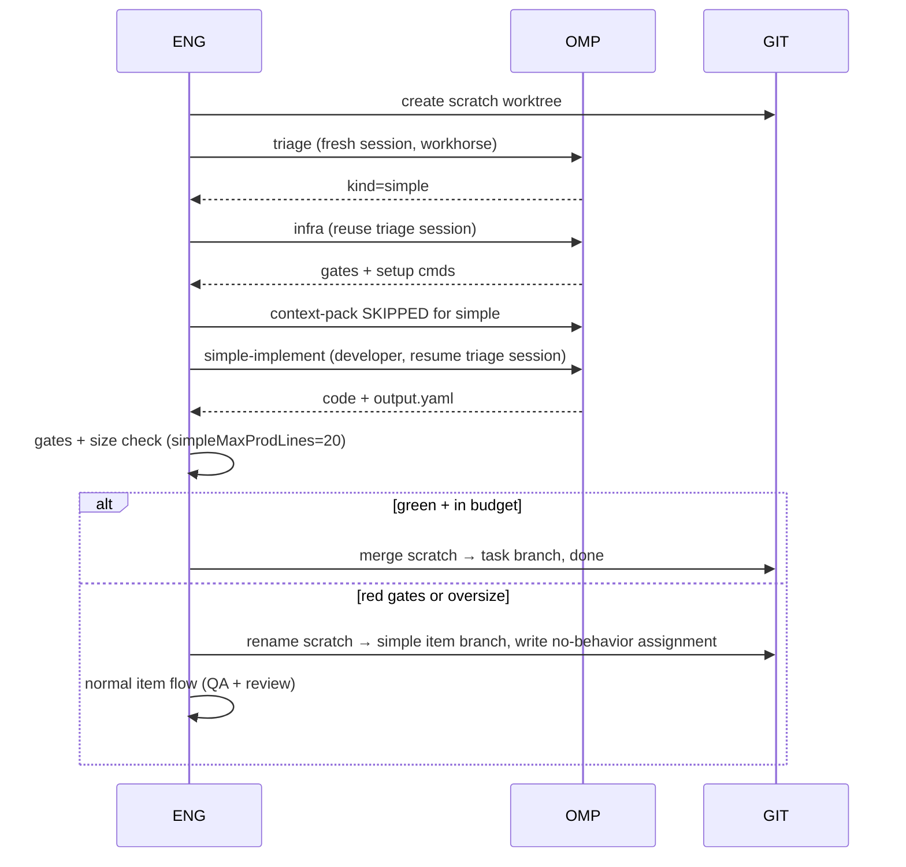

# software-factory — As-Built Implementation

HEAD `46262d3` (2026-11-09). Design companion: `ARCHITECTURE.md` (design intent).
This doc describes **as-built behavior at HEAD**: what the engine actually does,
verified against code + live fire-test records.

## 1. Overview

The factory is a **Bun/TS orchestration engine** (`plugins/software-factory/src/`, ~7.2k LOC)
that drives work through **child `omp` processes**. The engine itself holds no model:
every LLM turn is either `harness.run()` (spawns `omp` as a child process with a
system prompt + turn prompt + JSON schema + tool allowlist, in a worktree cwd) or
`harness.complete()` (in-process one-shot, used only for cheap judge/classify/repair
calls). omp provides persistent sessions (`--resume` + `--session-dir`); the engine is
stateless per turn and re-discovers all state from **records on git branches**.

- **Git as database**: each task gets `topic/<task>`; each item gets
  `topic/<task>--<item>` (worktree per item); epic children nest further
  (`engine.ts:123-169`). Every step turn commits `input.md` + `meta.yaml` (status
  `started`) **before** launch (§6.3.1), then `output.yaml`/`checks.yaml` + final meta
  after. Interrupted runs resume by scanning prior records for sessions.
- **Records discipline**: `{task}/runs/NNN-<step>-a<A>/` for orchestration steps,
  `items/<item>/steps/NNN-<step>-r<R>-a<A>/` for item steps. `meta.yaml` holds
  `agent/role/models/session/timeoutSec/usage/traceRef`. `traceRef` points at the omp
  session JSONL in `.factory-runtime/sessions/`.
- **Config layers** (`pipeline.default.yaml` header): `config/pipeline.default.yaml` <
  `<repo>/.factory/pipeline.yaml` < `{task}/pipeline.yaml`. Maps deep-merge (except
  `models.roles.*` which replace atomically); arrays replace; `null` deletes.
- **Flow**: triage classifies (`simple|story|spike|epic|saga`) → `simple` runs one
  developer turn on a scratch worktree; everything else runs the **iteration loop**:
  context-pack → architect plan (+ brief judge) → plan-review rounds → architect-revise →
  pm-edits → waves (items × [test-first/develop/qa/review + fix-loop] in parallel, then
  parent-merge → integrate → gates → merge) → wave close-up + architect wave-report
  (+ pm-amend loop) → plan close-up + architect closeup → next iteration / done.

Live evidence cited below: fire-test task `concerns-funnel` at
`/home/slava/aiexp/agentic-swarm.factory-wt/topic_concerns-funnel/.factory/tasks/concerns-funnel/`
(branch `topic/concerns-funnel`), runtime
`/home/slava/aiexp/agentic-swarm.factory-wt/.factory-runtime/sessions/`.

## 2. Sequence diagrams

Actors: `ENG` engine (Bun), `OMP` child omp process, `HARN` omp harness adapter,
`GIT` worktrees/branches, `OP` operator (steer mailbox).

### a. Simple task


(`ingest.ts:371,468,578`; ARCHITECTURE.md:241. `flows.simple` = one `develop` step,
fragment `simple-implement`, checks `[gates, size]` — `pipeline.default.yaml:245`.)

### b. Story full path

```mermaid
sequenceDiagram
    participant ENG
    participant OMP
    participant GIT
    ENG->>OMP: triage → infra (reuse session)
    ENG->>OMP: context-pack (fact-finder, FRESH session)
    ENG->>OMP: architect-plan (architect role, session kept as architectSessionId)
    ENG->>OMP: brief-select judge (in-process complete, simpler) per plan turn
    ENG->>OMP: plan-review (plan-reviewer) ↔ architect-revise (resume architect session)
    Note over ENG,OMP: up to maxPlanReviewRounds=2
    ENG->>OMP: pm-edits (pm, yield-only, forceFresh) → optional resumed-repair
    ENG->>GIT: write items/*/assignment.yaml, wave schedule
    loop waves, maxParallelItems=4
        loop items in parallel
            ENG->>OMP: test-first → develop → qa → review (item worktree)
            ENG->>ENG: checks per step; review fix → fix-round loop to fixLoopTo
            ENG->>OMP: consult (architect, sequenced id) on exhaustion/escalation
        end
        ENG->>GIT: parent-merge item branches → task branch
        ENG->>OMP: integrate (developer) per item
        ENG->>ENG: gates ratchet vs baseline
        ENG->>GIT: merge passing items
    end
    ENG->>OMP: wave-close-up (wave-close-up) + architect-wave-report (resume architect session)
    ENG->>OMP: pm-amend loop (≤maxAmendmentsPerIteration=3) on report feedback
    ENG->>OMP: plan-close-up + architect-closeup
    ENG->>ENG: iteration verdict: done / blocked / failed / next iteration (≤6)
```

### c. Context prep + architect turn

```mermaid
sequenceDiagram
    participant ENG
    participant OMP
    ENG->>OMP: context-pack (fact-finder/workhorse, session fresh)
    OMP-->>ENG: context-pack.md (no byte cap; turn budget is the bound)
    ENG->>ENG: buildArchitectBrief — skeleton of one-line entries
    ENG->>OMP: brief-select judge (complete, simpler, system/brief-select)
    OMP-->>ENG: {"include": [...ids]} (fail-open: full brief on error)
    ENG->>OMP: architect-plan prompt = task/iteration/intent/context/infra/debt/steering/limits + contextPack + taskStatus + hydrationContext(brief) + limitViolations + criteria + concernsYaml + Output schema §
    Note over ENG,OMP: plan turn: sessionMode reuse + existingSessionId=architectSessionId (persistent thread). Limits-violation re-plan: resumedRepair on SAME session with errors-only prompt (iteration.ts:1304).
```

### d. Review & escalation paths

```mermaid
sequenceDiagram
    participant ENG
    participant OMP
    participant OP
    ENG->>OMP: review / qa / plan-review (dispositionsCriteria filtered to reviewPolicy)
    OMP-->>ENG: suggestions[] with disposition
    alt fix / optional
        ENG->>OMP: fix-round (develop, feedback=suggestion text)
    else architect
        ENG->>OMP: consult (architect, sequenced consult id, resume architect session)
        ENG->>ENG: retry / escalate / split / abandon / accept-debt per decision
    else human-async
        ENG->>OP: steer mailbox question (blocks item, others continue)
    else human-stop
        ENG->>ENG: blocks item AND task; task-level open question breaks to close-up
    else human-awareness
        ENG->>OP: digest-only tousertoreview item (blocks: [])
    else dismiss (triager-only)
        ENG->>ENG: concern kept on disk as dismissed, logged with reason
    end
    ENG->>OMP: empty-wave consult (maxEmptyWaves=3 → consult instead of another empty wave)
    ENG->>OMP: pm-amend loop (wave-report feedback → pm-amend → re-report, ≤3)
```
(Dispositions: `pipeline.default.yaml:427-434`; `review-policy.ts`; item-machine
routing `item-machine.ts:891-995`. `accept-debt`/`abandon`/`split` are consult
decisions, not review dispositions.)

### e. Epic execution (in-process child task)

```mermaid
sequenceDiagram
    participant ENG
    participant GIT
    ENG->>GIT: child branch topic/<task>--<epic>, child worktree (engine.ts:141-143)
    ENG->>ENG: child task run on PARENT branch, kind fixed (skips triage)
    Note over ENG: child inherits infra; own iterations + waves + closeups
    ENG->>ENG: epic concerns → propagateEpicConcerns to parent (open/routed only)
    ENG->>GIT: record epic child status on parent; merge child branch back
    ENG->>ENG: saga/escalation pointers: q-epic-* questions; child failure → item failed
```
(`engine.ts:123-225` `runTaskChild`; `iteration.ts:2444,3774`; epic child closeup
`child-closeup.yaml`.)

### f. Saga (NOT IMPLEMENTED as launches)

> **NOT IMPLEMENTED**: saga launches do not exist in code. Triage can classify
> `saga`, but no saga launcher/loop exists (`engine.ts` has only `runTaskChild` for
> epics; no `saga` symbol in `src/` outside artifacts/propagation/epic-push).
> ARCHITECTURE.md:40 defers this to the `omp-workspaces` fire-test goal.
> What exists: epic→parent concern propagation (`epic-propagation.ts`,
> `adr-epic-push-condensed`: only open/routed concerns + open remarkables propagate;
> `q-epic-*` questions are the blocked-signal path).

## 3. Per-step LLM audit (HUMAN REVIEW)

**Shared launch mechanics** (all `runAgentStep` steps, `step-runner.ts:369`):
prompt = `agents/steps/<fragment>.md` rendered with `KNOWN_VARS` (`prompt-vars.ts`)
+ appended `## Output` schema section (§6.4); system = `agents/<agent>.md` body
(frontmatter stripped) + description. Tools = frontmatter ∪ `agents.<name>.tools`
override ∪ `structuredOutput:[yield]` extras; empty = yield-only (pm guarded:
`step-runner.ts:801-812` hard-errors if pm resolves file tools). Launch =
child omp process via `harness.run` (`step-runner.ts:852`) with label
`<task>/[items/<item>/]<step>#a<attempt>`; record (`input.md` + `meta.yaml`
`started`) committed **before** launch. Sessions: omp persistent sessions;
`sessionMode: reuse` resumes (`existingSessionId` or kept session or interrupted
record's session); timeouts resume with `TIMEOUT_NUDGE_PROMPT`; session-loss retries
once fresh. Output: ajv validation → repair chain (below) → `output.yaml` +
`checks.yaml` + final meta (`role/models/session/usage/traceRef`).
Record root: `CF = .../concerns-funnel`; `RT = .../.factory-runtime/sessions`.

| Step | Call site | Agent / role → models | Prompt (template + vars) | Tools | Session |
|---|---|---|---|---|---|
| triage | `ingest.ts:371` | triage / workhorse → `[deepseek-v4.1-flash, muse-spark-1.3-contrib]` | `agents/triage.md` + `steps/triage.md`; vars `task,intent,triageCriteria` | read grep glob find bash lsp ast_grep eval | fresh (first turn; session kept for infra/simple-implement) |
| infra | `ingest.ts:468` | infra / workhorse → same chain | `agents/infra.md` + `steps/infra.md`; `task,intent,context` | read grep glob find bash lsp ast_grep eval | **reuse** triage session |
| context-pack | `ingest.ts:268` (iter `iteration.ts:1189`) | fact-finder / workhorse | `agents/fact-finder.md` + `steps/context-pack.md`; `task,intent,context` | read grep glob find bash lsp ast_grep eval | **fresh** always; re-runs as `context-pack-{N}` when stale |
| simple-implement | `ingest.ts:578` | developer / workhorse | `agents/developer.md` + `steps/simple-implement.md`; `intent,citations,concernsYaml` | +edit write ast_edit checkpoint rewind (no bash) | reuse triage session |
| architect-plan | `iteration.ts:1221` (+limits repair `:1304`) | architect / architect → `[muse-spark-1.3-contrib]` (+`alt-architect` fallback in config; fire-test aliases architect→cheap, see meta below) | `agents/architect.md` + `steps/architect-plan.md`; `task,iteration,intent,context,infra,debt,steering,limits,contextPack,taskStatus,hydrationContext,limitViolations,humanInvolvementCriteria,concernsYaml` | read grep glob find lsp ast_grep task checkpoint (no file writes) | reuse `architectSessionId` (persistent thread across plan/revise/consults/reports); limits-repair = `resumedRepair` errors-only prompt, same session |
| plan-review | `iteration.ts:1446` | plan-reviewer / alt-architect | `agents/plan-reviewer.md` + `steps/plan-review.md`; `plan,intent,context,limits,dispositionsCriteria,limitViolations,humanInvolvementCriteria,concernsYaml` | read grep glob find lsp ast_grep | fresh per round (`revRecordName` sequenced) |
| architect-revise | `iteration.ts:1542` (+pmfix bounce `:1635`) | architect / architect | `steps/architect-revise.md`; `plan,planReview,contextPack,taskStatus,…` | as architect | reuse `architectSessionId` |
| pm-edits | `iteration.ts:1751` (+retry forceFresh `:1692`, +repair `:1821`) | pm / alt-workhorse→`[contrib, flash]` | `agents/pm.md` (yield-only) + `steps/pm-edits.md`; `plan,taskStatus,kinds,citations,limits,storyKindsCriteria` | **[] yield-only** (guarded) | `forceFresh` deliberate re-run; validation-repair resumes pm session errors-only |
| test-first | `item-machine.ts:946` (step id) | developer / workhorse, retry→alt-workhorse | `steps/test-first.md`; `assignment,citations,feedback,concernsYaml`; checks `[test-first-scope, target-red]` run before | developer set | fresh; rotated rounds (fixRound≥2) force fresh session |
| develop | same | developer / workhorse (+`retryRole: alt-workhorse`, `escalatable`) | `steps/develop.md`; `assignment,target,citations,feedback,concernsYaml`; after-checks `[gates, target-green, size]` | developer set | reuse kept session; fixRound≥2 fresh |
| qa | same | qa / alt-workhorse, escalatable | `steps/qa.md`; `assignment,checks,testDiff,diff,dispositionsCriteria,humanInvolvementCriteria,concernsYaml` | read grep glob find bash lsp ast_grep task checkpoint rewind | per-step |
| review | same | reviewer / alt-workhorse, escalatable | `steps/review.md` (+focus code/result); same vars as qa minus testDiff | as qa | per-step |
| fix-round | `item-machine.ts:885` | developer | `steps/fix-round.md`; `assignment,feedback,checks,diff,concernsYaml` | developer set | reuse |
| integrate | `merge-path.ts:192` | developer / workhorse | `agents/developer.md` + `steps/integrate.md`; `item,diff` | developer set | per-item |
| research (spike) | item-machine flow `fact-finder` kinds | fact-finder / workhorse | `steps/research.md`; `assignment,intent,citations,feedback,concernsYaml` | fact-finder set | per-step |
| poc / test-assumptions (spike develop) | item-machine (`stepFragment` poc / test-assumptions) | developer / workhorse | `steps/poc.md` (`assignment,context,feedback`) / `steps/test-assumptions.md` (same) | developer set | per-step |
| wave-close-up | `iteration.ts:3040` | wave-close-up / workhorse→`[flash, contrib]` | `agents/wave-close-up.md` + `steps/wave-close-up.md`; `task,waveReport,infra,gateDiff,humanInvolvementCriteria,concernsYaml` | read grep glob find bash lsp ast_grep (no checkpoint) | fresh per wave (`waveCloseupStepId` sequenced) |
| architect-wave-report | `iteration.ts:3127` | architect / architect | `steps/architect-wave-report.md`; `plan,waveReport,debt,steering,contextPack,taskStatus,…` | as architect | reuse `architectSessionId` |
| pm-amend | `iteration.ts:3245` (+repair `:3329`) | pm / alt-workhorse | `steps/pm-amend.md`; `plan,taskStatus,feedback,waveReport` | [] yield-only | reuse; repair resumes pm session |
| plan-close-up | `iteration.ts:3848` | plan-close-up / alt-architect | `agents/plan-close-up.md` + `steps/plan-close-up.md`; `intent,plan,context,humanInvolvementCriteria,concernsYaml` | read grep glob find lsp ast_grep | fresh |
| architect-closeup | `iteration.ts:3883` | architect / architect | `steps/architect-closeup.md`; `closeup,plan,intent,contextPack,taskStatus,…` | as architect | reuse `architectSessionId` |
| consult-item | `consults.ts:154` | architect / architect | `steps/architect-consult-item.md`; `item,assignment,priorAttempts,diff,feedback,contextPack,…` | as architect | reuse `architectSessionId`; **sequenced id `consult-<item>-<n>` — never reuses done-ness** (`step-runner.ts:395`) |
| consult-nonitem | `consults.ts:309,456` | architect / architect | `steps/architect-consult-nonitem.md`; `task,context,feedback,debt,contextPack,…` | as architect | reuse architect session; sequenced/never-reused |
| brief-select judge | `brief.ts:376` `harness.complete` in-process | simpler → `[gemini-3.8-flash, workhorse]` | system `system/brief-select.md`; prompt = goal + skeleton + `{"include":[...]}` instruction; schema `brief-select.schema.json`; fail-open → full brief | none (in-process) | none |
| steer-classify | `steer.ts:161` `harness.complete` in-process | caller ctx role, default simpler | system `system/steer-classify.md`; schema `steer-classification.schema.json`; failure → skip, message stays pending | none | none |
| repair-simpler | `step-runner.ts:1271` `harness.complete` | simpler | system `system/repair.md` (literal "Output valid JSON according to schema."); prompt = errors + raw output; same step schema; leaf-value guard rejects hallucinated repairs | none | none |

Exemplary live records (CF = `concerns-funnel` task dir):

- **triage** `CF/runs/002-triage-a1/`: `input.md` (Step: Triage + hierarchy matrix +
  full INTENT + injected `## Task/## Intent` sections); `output.yaml` (kind=epic,
  rationale, size ~20 files/>1500 lines); meta workhorse
  `[deepseek-v4.1-flash, muse-spark-1.3-contrib]`, 37.5k/9.2k tokens $0.012,
  `traceRef: RT/2026-11-07T18-59-57-712Z_01a1b761-…jsonl`. (001-triage-a1 has no
  output — superseded attempt.)
- **infra** `CF/runs/003-infra-a1/`: meta workhorse, 80k/29.8k tokens, timeout 900.
- **architect-plan-1** `CF/runs/006-architect-plan-1-a1/`: meta architect
  `[muse-spark-1.3-contrib]` (fire-test alias), session `01a1b894-…`, 31k/11k tokens.
  Same session id recurs in `017-architect-wave-report-1-1-a2` and
  `012-consult-concerns-contracts-a1` — the persistent architect thread.
- **pm-edits-1** `CF/runs/011-pm-edits-1-a1/`: meta pm/alt-workhorse
  `[contrib, flash]`, 16.7k/19.3k tokens; input = plan + limits JSON + kinds guide.
- **consult** `CF/runs/012-consult-concerns-contracts-a1/`: input =
  `architect-consult-nonitem` fragment + full context-pack markdown; same architect session.
- **wave-close-up-1-1** `CF/runs/014-wave-close-up-1-1-a1/`: input = rules + wave
  report + infra gates block + gateDiff; output `wave-closeup.schema.json`.
- **item develop** `CF/items/contracts-drift-fix/steps/002-develop-r1-a1/`: input =
  assignment JSON + target selectors/expectRed + citations; meta developer/workhorse
  125k/48k tokens, session `01a1bc9d-…`.
- **item review** `.../steps/004-review-r1-a1/`: meta reviewer/alt-workhorse,
  101k/66k tokens, timeout 3600.

Doc-vs-code gaps found: (1) **`steps/pm-single-item.md` and `steps/architect-resume.md`
have KNOWN_VARS + preflight registrations (`prompt-vars.ts:99,135`,
`prompts.ts:474,477`) and schema mapping (`step-runner.ts:159`) but NO call site in
`src/` — dead fragments, NOT IMPLEMENTED paths. `architect-resume` was likely
superseded by resumed `architect-plan`/`architect-revise` turns. (2) **saga** —
see §2f. (3) `maxSplitDepth: 1` is declared but "not enforced today"
(`pipeline.default.yaml:350`). (4) Hook agents are "only journaled" — hook agent
results do not fail the seam; synthetic-item creation for code-writing hook agents
is "not implemented" (`pipeline.default.yaml:183-187`).

## 4. Cross-cutting mechanics

- **Timeout tiers** (agent → `timeoutSec`; step-level overrides agent; else harness
  default 2700s; monotonic time, sleep-immune): architect 7200 (poc-class 2h tier) ·
  developer 5400 · qa/reviewer/plan-reviewer/fact-finder 3600 · triage/infra/pm/
  wave-close-up/plan-close-up 2700. Fire-test task overrides pin 900–1200 (see metas).
  Timeout-nudge = `limits.timeoutNudgeSec` or **half the step's own timeout**
  (default 1350); interrupted resumes reuse the nudge budget (`step-runner.ts:610-620`).
- **Retry/repair chain** (in order): ① sessionLost → one fresh-session rehydration;
  ② transient errors → `maxInfraRetries` (3; expensive roles 1) with exponential
  backoff ≤10s, resumable turns keep session (timeout turns get nudge prompt);
  exhaustion/cost-cap → `human-async` escalation question, never consumes fix rounds;
  ③ output validation: direct → `simpler_repair` (complete@simpler + leaf-value
  presence guard) → ask same session (kept sessions only) → relaunch once → `rejected`.
  ④ launch errors (omp never ran): fail-fast throw, no attempts consumed.
  ⑤ step-level: `maxStepAttempts: 2` → consult; `maxFixRounds: 3` → consult;
  `maxConsultsPerItem: 2` → abandon; item retryRole rotation + fresh sessions.
- **Model fallback walk**: fresh turns walk primary + fallbacks as `--model`
  candidates (`harness.ts:318-320`, `buildModelCandidates`); on resume the recorded
  model is kept (single candidate, never switch mid-session). Overlay
  (`overlay.ts:51-85`): `modelRoles` + `retry.{modelFallback,maxRetries:3,
  usageAwareFallback,fallbackChains}` + `eval.autoBackground off` + `title none` +
  `checkpoint enabled` + `advisor off` + `bash.{gitGuard off, allowCompound}` +
  mnemopi recall off + `update.auto off`. Mid-turn fallbacks journaled
  (`harness_model_fallback`). Steer dead-letter: classification failure → journal
  `steer_poll_error`, message stays pending.
- **Checkpoint/rewind availability**: omp overlay mounts checkpoint tools globally;
  agents opt in via tools list — developer/qa/reviewer have `checkpoint` (+developer
  has it; qa/reviewer also `rewind`); architect has `checkpoint`; triage/infra/
  fact-finder/pm/close-ups do not.
- **Cost caps** (`budget`, `pipeline.default.yaml:384-391`): perTask 100 / perIteration
  30 / perItem 40 / perStep 25 USD; step cap checked during transient retries →
  escalation; iteration break; task → human-stop + exit 10. Expensive roles:
  architect, task-escalation.
- **Disk/tmp guards**: `minFreeDiskMb: 2048` on repo/worktree/tmp; preflight fails,
  steps/gates raise low-disk and stop exit 10 (`step-runner.ts:425-436`,
  `disk-space.ts`). Runtime tmp `{worktreeRoot}/.factory-runtime/tmp/` with
  `TMPDIR/TMP/TEMP` redirect + stale purge (`runtime-tmp.ts`).
- **Records/commit invariants**: input.md + meta(started) committed before launch;
  session-id commits (`[session]`); HEAD guard before/after turn (branch change =
  error, restore + journal); artifact written before final meta in one commit.
