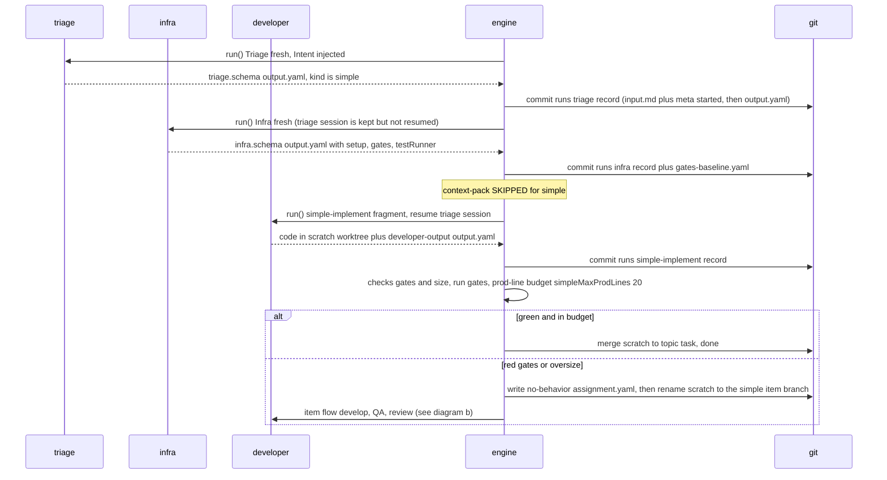
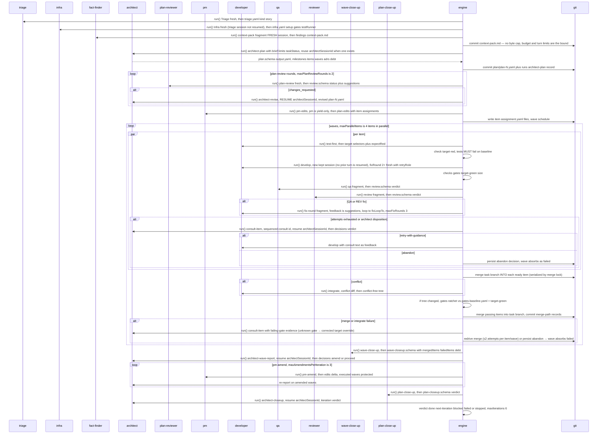
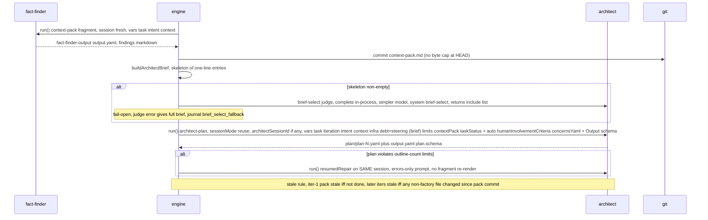
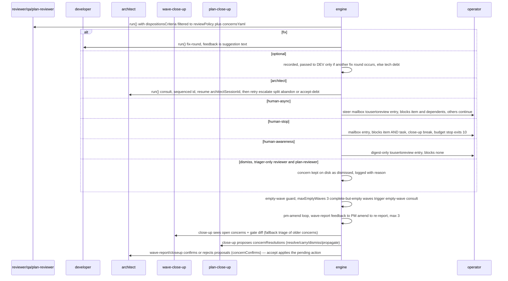
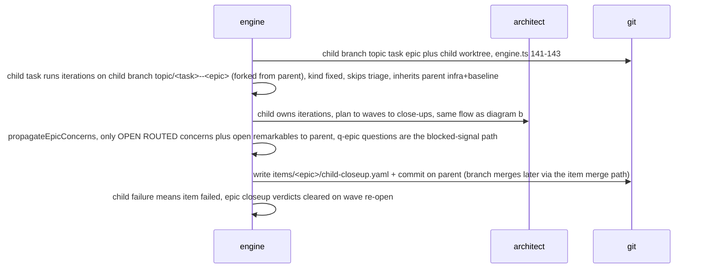

# software-factory — As-Built Implementation

HEAD `e4d3570` (2026-11-09). Design companion: [`ARCHITECTURE.md`](ARCHITECTURE.md) (design intent).
This doc describes **as-built behavior at HEAD**: what the engine actually does,
verified against code + live fire-test records.

## 1. Overview

The factory is a **Bun/TS orchestration engine** (`plugins/software-factory/src/`)
that drives work through **child `omp` processes**. The engine itself holds no model:
every LLM turn is either `harness.run()` — spawning `omp` as a child process with a
system prompt + turn prompt + JSON schema + tool allowlist, in a worktree cwd — or
`harness.complete()` (in-process one-shot, used only for cheap judge/classify/repair
calls). omp provides persistent sessions (`--resume` + `--session-dir`); the engine is
stateless per turn and re-discovers all state from **records on git branches**.

- **Git as database**: each task gets `topic/<task>`; each item gets
  `topic/<task>--<item>` (worktree per item); epic children nest further
  (`engine.ts:125-184`). Every step turn commits `input.md` + `meta.yaml` (status
  `started`) **before** launch (§6.3.1), then `output.yaml`/`checks.yaml` + final meta
  after. Interrupted runs resume by scanning prior records for sessions.
- **Records discipline**: `{task}/runs/NNN-<step>-a<A>/` for orchestration steps,
  `items/<item>/steps/NNN-<step>-r<R>-a<A>/` for item steps. `meta.yaml` holds
  `agent/role/models/session/timeoutSec/usage/traceRef`. `traceRef` = first entry in
  `.factory-runtime/sessions/` whose name contains the session id — normally the
  session JSONL, but the session directory can win the scan (`harness.ts:254-262`).
- **Config layers** (`pipeline.default.yaml` header): `config/pipeline.default.yaml` <
  `<repo>/.factory/pipeline.yaml` < `{task}/pipeline.yaml`. Maps deep-merge (except
  `models.roles.*` which replace atomically); arrays replace; `null` deletes.
- **Flow**: triage classifies (`simple|story|spike|epic|saga`) → `simple` runs
  triage→infra→one developer turn on a scratch worktree; everything else runs the **iteration loop**:
  context-pack → architect plan (+ brief judge) → plan-review rounds → architect-revise →
  pm-edits → waves (items × [test-first/develop/qa/review + fix-loop] in parallel, then
  merge parent into each ready item (conflict → integrate) → gates ratchet → merge item
  into task) → wave close-up + architect wave-report
  (+ pm-amend loop) → plan close-up + architect closeup → next iteration / done.

Live evidence below: fire-test task `concerns-funnel` at
`/home/slava/aiexp/agentic-swarm.factory-wt/topic_concerns-funnel/.factory/tasks/concerns-funnel/`
(branch `topic/concerns-funnel`), runtime
`/home/slava/aiexp/agentic-swarm.factory-wt/.factory-runtime/sessions/`.
Record shorthand: `CF = .../concerns-funnel`, `RT = .../.factory-runtime/sessions`.

## 2. Sequence diagrams

Agents are first-class actors below: `TRI` triage, `INF` infra, `FF` fact-finder,
`ARC` architect, `PRV` plan-reviewer, `PM` project manager, `DEV` developer,
`QA`, `REV` reviewer, `WCU` wave-close-up, `PCU` plan-close-up — plus `ENG` engine,
`GIT` worktrees/branches, `OP` operator. Artifact files pass between actors.
`run()` = child omp process turn; `complete()` = in-process one-shot.

### a. Simple task (triage → infra → simple-implement → gates/size → merge-or-convert)



### b. Story task full path (ingest → plan → waves → merge → close-ups)



### c. Context prep + architect turn



### d. Review & escalation paths



### e. Epic execution (child task in-process)



### f. Saga — NOT IMPLEMENTED

> **NOT IMPLEMENTED.** Triage can classify `saga` (`triage.schema.json` enum + criteria
> row), but no saga launcher exists: `src/` has only `engine.ts:125-184` (`runChildTask`)
> for epics and `epic-propagation.ts` (epic→parent concern push, comments call it
> "epic-to-saga"). [`ARCHITECTURE.md`](ARCHITECTURE.md):40 defers this to the
> `omp-workspaces` fire-test goal. What exists: epic→parent propagation (open/routed
> concerns + open remarkables) and forwarded `q-epic-*` blocking questions.

## 3. Per-step LLM audit (HUMAN REVIEW)

Shared launch mechanics (every `runAgentStep`, `step-runner.ts:369`): prompt =
[`agents/steps/<fragment>.md`](../agents/steps/triage.md) rendered with the
fragment's `KNOWN_VARS` entry (`prompt-vars.ts`; preflight rejects unknown
placeholders) + appended `## Output` schema section; system = [`agents/<agent>.md`](../agents/triage.md)
body (frontmatter stripped). Tools = frontmatter (a missing list falls back to
`tools.defaults`, default `[edit, bash]`), **replaced** by an `agents.<name>.tools`
override when set, **plus** `tools.structuredOutput` (default `yield`) whenever a schema
is attached; `[]` = yield-only (pm guarded: file tools → hard error). Launch = child omp process via `harness.run`
(`step-runner.ts:852`); record (`input.md` + `meta.yaml` `started`) committed
**before** launch. Sessions: omp persistent sessions; a step resumes only
`existingSessionId` or the newest interrupted record's session (`keep` merely
persists the new session for the repair-ask leg); timeouts resume with
`TIMEOUT_NUDGE_PROMPT`; session-loss retries once fresh; item steps pass no
`existingSessionId`, so test-first/develop/qa/review each start a new session
(`reuse` = keep; developer steps at fixRound≥2 force `fresh`). Output: ajv validation → repair
chain (direct → simpler_repair via `complete@simpler` + leaf guard → ask same
session when kept → relaunch once → rejected) → `output.yaml` + `checks.yaml`.

Live quotes below are from the `concerns-funnel` fire-test records
(2026-11-07/08). Where HEAD changed the prompt/config since (noted per step),
the code is authoritative.

Tool-set shorthand (from agent frontmatter): `dev` = read grep glob find edit write
ast_grep ast_edit bash debug eval lsp task checkpoint rewind; `ff` = read grep glob
find bash lsp ast_grep eval + `mcp__webmcp_scrape_batch`/`search_engine_batch` +
task checkpoint rewind; `arch` = read grep glob find lsp ast_grep task checkpoint
rewind. All steps with a schema also get `yield`.

Var sources: `assignment` = `items/<slug>/assignment.yaml`; `target` = newest
developer-output target; `diff` = `git diff parent..HEAD` + pending work; `checks` =
failing-check summaries; `citations` = assignment citations; `context` = `context.yaml`
(or caller text); `plan`/`planReview`/`waveReport`/`closeup`/`feedback` = prior step
`output.yaml`; `contextPack` = `context-pack.md`; `infra` = `infra.yaml`;
`debt`+`steering` = `buildArchitectBrief`; `taskStatus` = derived state block;
`concernsYaml` = concern store hydrated per step role; `*Criteria` = `agents/criteria/*`.

| Step | Template links | Model role → models | Tools / subagents | Start / session kind |
|---|---|---|---|---|
| triage | [agent](../agents/triage.md) · [fragment](../agents/steps/triage.md) · [schema](../config/schemas/triage.schema.json) | workhorse → `deepseek-v4.1-flash`, fallback `muse-spark-1.3-contrib` | read grep glob find bash lsp ast_grep eval; no task/subagents | child omp `run()`; **new kept** session (only simple-implement resumes it) |
| infra | [agent](../agents/infra.md) · [fragment](../agents/steps/infra.md) · [schema](../config/schemas/infra.schema.json) | workhorse → same chain | read grep glob find bash lsp ast_grep eval | child `run()`; **fresh** (no session passed) |
| context-pack | [agent](../agents/fact-finder.md) · [fragment](../agents/steps/context-pack.md) · [schema](../config/schemas/fact-finder-output.schema.json) | workhorse → same chain | `ff` set | child `run()`; **fresh always**; re-runs as `context-pack-N` when stale |
| simple-implement | [agent](../agents/developer.md) · [fragment](../agents/steps/simple-implement.md) · [schema](../config/schemas/developer-output.schema.json) | workhorse → same chain | `dev` set | child `run()`; resumes the triage session when triage ran in this process (restart → new); scratch worktree |
| architect-plan | [agent](../agents/architect.md) · [fragment](../agents/steps/architect-plan.md) · [schema](../config/schemas/plan.schema.json) | architect → `claude-opus-5-5:max`, fallback `alt-architect` (`muse-spark-1.3-contrib`); fire-test aliases architect→cheap | `arch` set (no file writes) | child `run()`; **reuse `architectSessionId` when present** — one thread per iteration across plan/revise/consults/reports (cleared on next-iteration); outline-count violations → `resumedRepair`, errors-only prompt |
| plan-review | [agent](../agents/plan-reviewer.md) · [fragment](../agents/steps/plan-review.md) · [schema](../config/schemas/review.schema.json) | alt-architect → `muse-spark-1.3-contrib` | read grep glob find lsp ast_grep | child `run()`; fresh per round (sequenced `plan-review-N-K`) |
| architect-revise | [agent](../agents/architect.md) · [fragment](../agents/steps/architect-revise.md) · same plan schema | architect → same chain | `arch` set | child `run()`; reuse architect session (writes plan-N); second caller `architect-pmfix-N` = PM-validation bounce (same fragment, not exercised in this fire-test) |
| pm-edits | [agent](../agents/pm.md) · [fragment](../agents/steps/pm-edits.md) · [schema](../config/schemas/plan-edits.schema.json) | pm (→alt-workhorse: `contrib`, `flash`) | **[] yield-only** (guarded: file tools → `pm_tools_guard_rejected` error) | child `run()`; new kept session; validation-repair resumes that PM session errors-only; `forceFresh` only on the architect-bounce re-run |
| test-first | [agent](../agents/developer.md) · [fragment](../agents/steps/test-first.md) · same developer-output schema | workhorse → `flash` (no retryRole; fix rounds re-enter develop) | `dev` set | child `run()`; new session |
| develop | [agent](../agents/developer.md) · [fragment](../agents/steps/develop.md) · same schema | workhorse, `retryRole: alt-workhorse`, `escalatable` | `dev` set | child `run()`; new kept session (repair-ask works); fixRound≥2 fresh |
| fix-round | [agent](../agents/developer.md) · [fragment](../agents/steps/fix-round.md) · same schema | workhorse (fixRound≥2 → alt-workhorse) | `dev` set | child `run()`; fixRound≥2 = fresh session |
| qa | [agent](../agents/qa.md) · [fragment](../agents/steps/qa.md) · review schema | task-reviewer→alt-workhorse | read grep glob find bash lsp ast_grep task checkpoint rewind | child `run()`; new session |
| review | [agent](../agents/reviewer.md) · [fragment](../agents/steps/review.md) · review schema (flow `focus` declared, not rendered) | task-reviewer→alt-workhorse, escalatable | as qa | child `run()`; new session |
| integrate | [agent](../agents/developer.md) · [fragment](../agents/steps/integrate.md) · developer-output schema | workhorse | `dev` set | child `run()`; on conflict only; diff in prompt |
| research (spike) | [agent](../agents/fact-finder.md) · [fragment](../agents/steps/research.md) · [schema](../config/schemas/fact-finder-output.schema.json) | workhorse | `ff` set | child `run()`; new session |
| poc / test-assumptions (spike develop) | [agent](../agents/developer.md) · [fragment](../agents/steps/poc.md) / [test-assumptions](../agents/steps/test-assumptions.md) · developer-output schema | workhorse | `dev` set | child `run()`; new session |
| consult (item / non-item / empty-wave / merge / concern) | [agent](../agents/architect.md) · [fragments item](../agents/steps/architect-consult-item.md) / [non-item](../agents/steps/architect-consult-nonitem.md) · [schema](../config/schemas/decisions.schema.json) | architect → same chain | `arch` set | child `run()`; resume architect session; **sequenced id (`consult-<item>-<n>`) — never reuses done-ness** (`step-runner.ts:395`) |
| wave-close-up | [agent](../agents/wave-close-up.md) · [fragment](../agents/steps/wave-close-up.md) · [schema](../config/schemas/wave-closeup.schema.json) | alt-workhorse → `contrib`, `flash` (call overrides agent role) | read grep glob find bash lsp ast_grep | child `run()`; fresh per wave (sequenced id) |
| architect-wave-report | [agent](../agents/architect.md) · [fragment](../agents/steps/architect-wave-report.md) · decisions schema | architect | `arch` set | child `run()`; resume architect session |
| pm-amend | [agent](../agents/pm.md) · [fragment](../agents/steps/pm-amend.md) · plan-edits schema | alt-workhorse → `contrib`, `flash` | [] yield-only | child `run()`; new kept session; repair resumes that PM session |
| plan-close-up | [agent](../agents/plan-close-up.md) · [fragment](../agents/steps/plan-close-up.md) · [schema](../config/schemas/plan-closeup.schema.json) | alt-workhorse → `contrib`, `flash` (call overrides agent role) | read grep glob find lsp ast_grep | child `run()`; fresh |
| architect-closeup | [agent](../agents/architect.md) · [fragment](../agents/steps/architect-closeup.md) · plan-closeup schema | architect | `arch` set | child `run()`; resume architect session |
| brief-select judge | [system](../agents/system/brief-select.md) · [schema](../config/schemas/brief-select.schema.json) | **simpler → `gemini-3.8-flash`, fallback workhorse** | none (in-process) | **`harness.complete()` in-process**; no session; fail-open → full brief |
| steer-classify | [system](../agents/system/steer-classify.md) · [schema](../config/schemas/steer-classification.schema.json) | **simpler** (passed by the poller) | none (in-process) | **`harness.complete()` in-process**; failure → message stays pending |
| repair-simpler | inline system string (NOT [`system/repair.md`](../agents/system/repair.md), which no engine path uses) · same step schema | simpler | none (in-process) | **`harness.complete()` in-process**; leaf-value guard rejects hallucinated repairs |

Record pointers (`CF/runs/...`, `CF/items/<item>/steps/...`): `meta.yaml` carries
`role/models/timeoutSec/usage/traceRef`; `traceRef` = first `RT/` entry matching the
session id (JSONL, occasionally the session dir).

### A. triage — `ingest.ts:371` · record `CF/runs/002-triage-a1/` · `agent: triage / workhorse`

Prompt vars (`task,intent,triageCriteria`): `## Task` = slug; `## Intent` = full INTENT.md
(acceptance bullets + scope); `## Triage Criteria` = hierarchy matrix (simple/story/spike/epic/saga).
Live assembled prompt — `CF/runs/002-triage-a1/input.md` (67 lines; vars rendered, head + injected sections):

```text
# Step: Triage
## Goal — Inspect ... determine task kind in the hierarchy ...
## Rules — Quick scoping ... Citations ≤ 12 ... Read-only ...
## Decision Rules
- `simple` = doc changes, renames, trivial file split ..., really trivial additive change (under ~10–20 lines, no classes, no collaborating functions, zero risk/tradeoffs).
- `story` when it needs more than ~10–20 lines of code, adds a class, or adds functions calling each other — plus any tradeoff/design decision, public interface/config shape choice, cross-module impact, non-obvious edge cases, or regression risk beyond touched code.
- Any task exceeding the story prod-line budget MUST be classified as `epic` or split into multiple stories.
- Any task with architectural unknowns MUST triage as `spike` or include spikes in its plan.
## Triage Criteria  ← criteria/triage.md matrix (simple|story|spike|epic|saga)
## Task
concerns-funnel
## Intent
# concerns-funnel
Implement spec item 18 of `docs/factory.v2.md` in `plugins/software-factory` (read it in full; it is the acceptance definition):
- structured `concerns[]` and remarkable decisions/tradeoffs in agent outputs;
- engine aggregation under the task folder (`concerns/`, stable fingerprint ids, dedup, status, source record);
- triage by the step's reviewer (workhorse class; architect output → plan-reviewer) with the review disposition vocabulary plus `dismiss` (logged with reason, kept);
- routing: blockers block dependent items + architect consult; `architect` → next architect turn; `human-*` → steer mailbox per policy; tech debt → plan tech-debt list;
- funnel worker → reviewer → epic architect → saga architect → human, less detail per level ...;
- blocking vs non-blocking ADRs; remarkable items reported in a mailbox digest, never waiting;
- human-involvement mode presets `autonomous`, `principal`, `detailed` ...;
- surfaced in wave/plan close-ups, `factory status`, state.yaml counts.
Update `plugins/software-factory/docs/ARCHITECTURE.md` (incl. the §1 row for item 18), README and config commentary. Keep prompts terse (debloated). Behavior tests only. Expected scope: a couple of iterations at most.
## Output
Yield a structured JSON object matching this schema:
- kind (enum: ["simple","story","spike","epic","saga"]) ...
- rationale ... - size ... - risks ...
```

Output (`output.yaml`, [schema](../config/schemas/triage.schema.json)):

```yaml
kind: epic
rationale: "Spec item 18 is a multi-component subsystem ... Estimated >1500
  changed lines across ~20 files ... far above the 300-line story budget ...
  decomposes naturally into milestones ... spanning multiple waves ..."
size: ~20 files, >1500 lines (engine flows, schemas, config, agents/prompts, ...)
risks:
  - Adding reviewer triage to every step multiplies reviewer turns/cost ...
  - "Stable concern identity and dedup across steps, fix rounds and restarts ..."
```

Meta: `role: workhorse, models: [deepseek-v4.1-flash, muse-spark-1.3-contrib]`,
37.5k/9.2k tokens $0.012, `traceRef: RT/2026-11-07T18-59-57-712Z_01a1b761-….jsonl`.
(001-triage-a1 has no output — superseded attempt.) No checks (no `checks.yaml`).
Engine writes `triage.yaml` + `context.yaml` in the same commit; citations are verified
against the scratch worktree and invalid ones are dropped with a `citations_dropped` event.

### B. infra — `ingest.ts:468` · record `CF/runs/003-infra-a1/` (live `input.md` 162 lines, `output.yaml`) · `agent: infra / workhorse`

Prompt vars (`task,intent,context`): same Task/Intent injection; fragment adds Tool Output
Fields Specification (`setup`, `gates[]`, `testRunner{command,selectorArgs,junitArg}`, `notes`)
plus gate-mutation rule (check-only flags), orchestration-folder lint-noise rule,
containment (work ONLY inside `cwd`).

```text
# Step: Infra
## Goal — Discover project infrastructure, worktree bootstrap, test runner, quality gates.
## Rules — Read-only ... Validate commands: Probe candidate commands with bash ...
  Gate mutation rule: quality gates MUST NOT mutate the worktree ...
## Output Fields Specification
- `setup`: Minimal shell commands ... - `gates`: Array of {"id","command"} ...
- `testRunner.command` ... `selectorArgs` ... `junitArg` ...
## Task / ## Intent (same injection as triage)
## Output — Yield structured JSON matching infra.schema.json
```

Output ([schema](../config/schemas/infra.schema.json)):

```yaml
setup: ["cd plugins/software-factory && bun install --frozen-lockfile"]
gates:
  - {id: typecheck, command: "cd plugins/software-factory && bun run typecheck"}
  - {id: test, command: "cd plugins/software-factory && bun test"}
testRunner: {command: "cd plugins/software-factory && bun test", selectorArgs: [],
  junitArg: "--reporter=junit --reporter-outfile={path}"}
notes: ["Only plugins/software-factory is a Bun package; ...", "No lint/format gate ...",
  "Bun test selectors are positional ...", "TMPDIR caveat: ..."]
```

Meta: workhorse `[flash, contrib]`, 80k/29.8k tokens, timeout 900.
Downstream: `gates-baseline.yaml` recorded; develop/merge/close-up checkpoints run these
gates and ratchet against it. Engine writes `infra.yaml` + `gates-baseline.yaml` in the
same `[ok]` commit (baseline gates run with retries disabled).

### C. context-pack — `ingest.ts:268` · record `CF/runs/005-context-pack-a1/` (live `input.md` 158 lines, `output.yaml` + `context-pack.md`) · `agent: fact-finder / workhorse`

Prompt vars (`task,intent,context`): fragment's Document Structure (§1–5) + read-only
+ no-subagent rules. **HEAD has no byte cap** (`agents/steps/context-pack.md` says
"no byte cap"; commit `a4d124e` removed the 40 000-byte rule); the live record below
predates that change and still shows the old cap line.

```text
# Step: Context Pack
## Goal — Build condensed, citation-backed context pack (context-pack.md) ...
## Rules — Fact-finder discipline (read/grep/glob/find/lsp/ast_grep). Strictly
  read-only ... NEVER issue git write commands or launch subagents ...
  Budget cap: MUST fit within 40000 bytes ...
## Context Pack Document Structure — 1. Module Map 2. Key Interfaces & Signatures
  3. Relevant Excerpts (path:line-range) 4. Existing Tests & Conventions
  5. Open Questions & Uncertainties
## Task / ## Intent (same injection)
```

Output ([schema](../config/schemas/fact-finder-output.schema.json)) — `findings` holds the
markdown pack; engine writes `context-pack.md`. Excerpt:

```yaml
status: ok
recommendations:
  - "Plan item 1: Core concerns/decisions data models, JSON schemas, fingerprint
    dedup, and storage in {task}/concerns/."
  - "Plan item 2: Reviewer triage integration (extend review disposition
    vocabulary with 'dismiss', ...) ..."
  - "Plan item 3: Concern routing engine (blocker dependency cascading ...) ..."
```

### D. architect-plan — `iteration.ts:1223` · record `CF/runs/006-architect-plan-1-a1/` (live `input.md` 1677 lines, `output.yaml`) · `agent: architect`

Prompt vars (`task,iteration,intent,context,infra,debt,steering,limits,contextPack,taskStatus`;
auto-added `humanInvolvementCriteria,concernsYaml`). `debt` and `steering` both receive
the `buildArchitectBrief` string; `context` is `context.yaml` (triage citations).
Fragment headings: Goal, Rules, Task & Iteration, Intent, Context, Context Pack,
Infrastructure, Tech Debt, Steering Directives, Limits, Task Status, Human involvement,
Open Concerns, Output. The injected `context-pack.md` block is lines 928–1482 of the
live input (~550 lines; pack §0–6). Live quote:

```text
# Step: Architect Plan
## Goal — Design iteration execution plan (plan-N.yaml) ...
## Rules — Exploration budget: work primarily from INTENT, triage citations ...
  citations:
  - file: docs/factory.v2.md
    lines: 89-103
    anchors: [18. concerns + remarkable decisions funnel, concerns[], ...]
    summary: "Acceptance definition: structured concerns[] ... reviewer triage
      plus dismiss, routing (blocker→dependent item + architect consult, ...) ..."
  - file: plugins/software-factory/docs/ARCHITECTURE.md
    lines: "39" ...
## 0. Acceptance Definition (Spec Item 18) ... ## 1. Module Map ... (pack)
## Infrastructure — {setup, gates, testRunner} ## Tech Debt — (empty iter 1)
## Steering Directives — (empty) ## Limits
{"maxParallelItems": 4, "maxParallelTurns": 6, "stubMaxProdLines": 40,
 "maxStepAttempts": 2, "maxInterruptions": 3, "maxFixRounds": 3,
 "maxConsultsPerItem": 2, "maxSplitDepth": 1, "maxPlanReviewRounds": 2,
 "maxAmendmentsPerIteration": 3, "maxIterations": 6, ... "storyMaxProdLines": 300,
 "simpleMaxProdLines": 20, "maxMilestones": 8, "maxItemsPerPlan": 50,
 "checkOutputBytes": 4000, "hydrationBytes": 40000, "contextPackBytes": 40000,
 "timeoutNudgeSec": 300, "minFreeDiskMb": 2048}
## Output — Yield structured JSON matching plan.schema.json ...
```

(The last two byte-cap keys were removed from `config/pipeline.default.yaml` in `a4d124e`
— the live record predates that; HEAD's limits JSON has neither.) Engine writes
`plan/plan-N.yaml` and persists full ADR records (routing blocking/remarkable per the
human-involvement table).

Output ([schema](../config/schemas/plan.schema.json)) — head:

```yaml
adrs:
  - {id: adr-concern-store-taskwt, decision: "Aggregate directly to
      taskWt/{task}/concerns/{id}.yaml inside step writeArtifact seams ...",
      context: "Item steps commit only childWt ... Precedent: writeQuestion ..."}
... milestones, waves, items, debt, uncertainties, spikeOutlines ...
```

Meta: `role: architect, models: [muse-spark-1.3-contrib]` (fire-test alias cheap),
`session: 01a1b894-…` — the iteration's architect thread; 31k/11k tokens.
Same session recurs in `017-architect-wave-report-1-1-a2` and `012-consult-…`; a
`next-iteration` close-up clears it so the next iteration starts fresh (hydrated from records).
Pre-launch: brief-select judge (in-process `complete@simpler`, [schema](../config/schemas/brief-select.schema.json);
fail-open journals `brief_select_fallback`).

### E. plan-review — `iteration.ts:1448` · record `CF/runs/007-plan-review-1-1-a1/` (live `input.md` 520 lines, `output.yaml`) · `agent: plan-reviewer`

Prompt vars (`plan,intent,context,limits,dispositionsCriteria,limitViolations,
humanInvolvementCriteria,concernsYaml`). Live assembled prompt (head + injected limits JSON
— same pre-`a4d124e` byte-cap keys as §D — + `## Plan` JSON + intent/context):

```text
# Step: Plan Review
## Goal — Conduct adversarial review of the architect's proposed plan, critiquing milestone scoping, interface contracts, Gherkin scenarios, risk coverage, and dependency structure.
## Rules — SKEPTICAL REVIEW: scrutinize the plan against project intent and real codebase constraints. Scrutiny checklist (numeric bounds come from the {"maxParallelItems": 4, "maxParallelTurns": 6, "stubMaxProdLines": 40, "maxStepAttempts": 2, "maxInterruptions": 3, "maxFixRounds": 3, "maxConsultsPerItem": 2, "maxSplitDepth": 1, "maxPlanReviewRounds": 2, "maxAmendmentsPerIteration": 3, "maxIterations": 6, "maxInfraRetries": 3, "maxInfraRetriesExpensive": 1, "gateRetries": 1, "gateTimeoutSec": 900, "storyMaxProdLines": 300, "simpleMaxProdLines": 20, "maxMilestones": 8, "maxItemsPerPlan": 50, "checkOutputBytes": 4000, "hydrationBytes": 40000, "contextPackBytes": 40000, ...} limits JSON).
## Dispositions Criteria — (filtered allowed set + table, as in QA/review)
## Rules — (defect-is-fix, no architect-for-routine-bugs, no human-async-when-repo-answers)
## Plan
{"iteration": 1, "milestones": [{"directionalInterfaces": ["artifacts.ts: Concern, ...", "config/schemas/developer-output.schema.json, plan.schema.json, ...: structured concerns[] + remarkableDecisions[] ...", "src/core/concerns.ts: concernFingerprint(c)->string; aggregateConcerns ..."], "id": "m1-contracts-aggregate", "scenarios": ["Given a developer step emitting concerns [{kind:blocker, ...}] When the step commits Then taskDir/concerns/c-<fp10>.yaml exists ...", "Given the same concern re-emitted on retry ... Then no second file is created ...", ...], "title": "Contracts and aggregation foundation"}, ...]}
## Task Intent — (same INTENT acceptance bullets)
## Context — (citations/context JSON)
## Limits — (limits JSON re-injected)
## Output — Yield review.schema.json (status approved/changes_requested + suggestions[{id, disposition, summary, detail, location}]).
```

Output ([schema](../config/schemas/review.schema.json)):

```yaml
status: changes_requested
summary: Plan structurally sound on bounds/DAG but unfalsifiable scenarios, ...
suggestions:
  - {id: m1-scenario-disjunction, disposition: fix, summary: M1 invalid-payload
      scenario allows either repair or reject, unfalsifiable, ...}
  - {id: spikes-without-items, disposition: fix, summary: Uncertainties list
      spikeOutlines but plan schedules zero spike items ...}
  - {id: mode-dependency-inversion, disposition: fix, summary: M3 ADR/mailbox
      routing gated by humanInvolvement mode defined only in M5 ...}
  - {id: simple-flow-untriaged, disposition: fix, summary: Simple items have no
      reviewer so simple concerns stay open forever ...}
```

→ `architect-revise` (`008-…`) on the same architect session; round 2
(`009/010-…`) before `pm-edits`. `≤ maxPlanReviewRounds=2`. step-runner concern-triages
the review; only `fix` triggers a revision (awareness/human-* route to the mailbox), and
a failed reviewer fails the iteration.

### F. architect-revise — `iteration.ts:1544` · record `CF/runs/008-architect-revise-1-1-a1/` (live `input.md` 1659 lines, `output.yaml`)

Vars (`plan,planReview,contextPack,taskStatus,…`). Live assembled prompt = approved plan + `## Plan Review Feedback` (review JSON below) + pack re-injection (`## Context Pack` §§0–6 again):

```text
# Step: Architect Revise (same Goal/Rules head as architect-plan)
## 0. Acceptance Definition ... ## 1-6. (injected contextPack.md)
## Current Plan
{plan JSON as approved}
## Plan Review Feedback
{"status": "changes_requested", "summary": "Plan structurally sound on bounds/DAG but unfalsifiable scenarios, spike-less uncertainties, mode inversion, ...", "suggestions": [{"id": "m1-scenario-disjunction", "disposition": "fix", "summary": "M1 invalid-payload scenario allows either repair or reject, unfalsifiable", "detail": "Given invalid concern Then repaired or rejected passes regardless. Specify which shapes repair (e.g. missing severity defaults) vs reject (unknown kind) ...", "location": {"file": "plugins/software-factory/config/schemas/developer-output.schema.json", "line": 61}}, {"id": "spikes-without-items", "disposition": "fix", "summary": "Uncertainties list spikeOutlines but plan schedules zero spike items", "detail": "u-text-budget and u-saga-propagation have spikeOutlines yet all 11 items are story; ... Add fact-finder/test-assumptions spikes before dependents or drop uncertainties.", "location": {"file": "plugins/software-factory/src/core/engine.ts", "line": 208}}, ...]}
## Context Pack
# Context Pack — concerns-funnel ... (full pack re-injected, §§0–6)
## Output — Yield revised plan-N.yaml matching plan.schema.json.
```

Output: revised `plan/plan-N.yaml` ([schema](../config/schemas/plan.schema.json)):

```yaml
adrs:
  - {id: adr-concern-store-taskwt, title: Direct taskWt writes with immediate
      taskWt commit, decision: "Write directly to taskWt/{task}/concerns/ in
      writeArtifact seams with writeYamlAtomic per file, then commit taskWt
      immediately after the item step ... Parallel-safe: distinct fingerprints
      are distinct files ..."}
```

Engine shallow-merges the revised object over the current plan, writes `plan/plan-N.yaml`, and re-persists ADRs.

### G. pm-edits — `iteration.ts:1753` · record `CF/runs/011-pm-edits-1-a1/` (live `input.md` 654 lines, `output.yaml`) · `agent: pm / yield-only`

[rules](../agents/steps/pm-edits.md): item fields (`slug,kind,title,assignment,outlineRef,milestone,
wave,deps,scenarioRefs,citations`); wave scheduling (deps only on earlier waves);
`## Kinds` guide + `storyKindsCriteria`; limits JSON (maxParallelItems=4…).
**No assignment/intent injection — PM structures architect outlines only.**
Live assembled prompt (head + `## Current Plan` JSON + kinds guide + limits):

```text
# Step: PM Edits — (Goal/Rules: deconstruct approved plan into scheduled item specs)
## Current Plan
{approved plan JSON: iteration, milestones, waves, adrs, debt}
## Kinds — (one-line story/spike kind guide + storyKindsCriteria text)
## Limits
{"maxParallelItems": 4, "maxParallelTurns": 6, ...} (same limits JSON)
## Output — Yield plan-edits.schema.json (items[{slug, kind, title, assignment, outlineRef, milestone, wave, deps, scenarioRefs, citations}]).
```

Output ([schema](../config/schemas/plan-edits.schema.json)) — head:

```yaml
iteration: 1
items:
  - {outlineRef: spike-text-budget, kind: test-assumptions, milestone: m1-contracts-aggregate,
     assignment: "Verify funnel byte budget assumptions (adr-funnel-text-budget)
     with NO prod code. Add permanent exploratory tests under test/engine/
     measuring item/wave diff bytes vs concern detail sizes; ...",
     citations: ["docs/factory.v2.md:89-103",
       "plugins/software-factory/src/core/flows/iteration.ts:439-485"], ...}
```

Meta: `role: alt-workhorse, models: [contrib, flash]`, `session: 01a1b8a5-…`,
16.7k/19.3k tokens. Validation-repair (`:1823`) resumes this session errors-only;
the bounce re-run after `architect-pmfix-N` uses `forceFresh` (e.g. `116-pm-edits-6-a2`).
Engine validates the delta (`validateEdits`: slugs, kinds, deps on earlier waves, outline
refs), writes `items/<slug>/assignment.yaml` per item, then `plan/edits-<N>.0.yaml`.

### H. test-first — item-machine `946` (step id) · record `CF/items/contracts-drift-fix/steps/001-test-first-r1-a1/` (live `input.md` 61 lines, `output.yaml` + `checks.yaml`) · `agent: developer / workhorse`

Vars (`assignment,citations,feedback,concernsYaml`). Live assembled prompt (61 lines, full):

```text
# Step: Test-First (Goal/Rules: test-paths only + never-modified stub budget; red expectation — compilation failure ≠ red; native test-id form; prove test infra first; never test lint/format; yield target {selectors, expectRed} per developer-output.schema.json)
## Assignment
{"slug": "contracts-drift-fix", "kind": "dev", ...} (same assignment shape as develop)
## Context & Citations
["docs/factory.v2.md:89-103", "plugins/software-factory/src/core/artifacts.ts:313-325", "plugins/software-factory/src/core/records/review-schema.ts:5-52"]
## Review Feedback (empty)
## Output — Yield target {selectors: [...], expectRed: [...]} + evidence.
```

Live output:

```yaml
status: ok
summary: "Authored test-first contract coverage for the producer type/schema drift: (1) review/QA/plan-reviewer outputs must accept remarkable[] plus lowercase concern detail ...; (2) architect decision outputs ... must accept concernConfirms[] ... and a singular concernResolution ...; (3) plan-closeup schema ... must accept concernConfirms[] while retaining concernResolutions[] ...; (4) TS artifacts must type DeveloperOutput/FactFinder/Review/WaveCloseup/PlanCloseup/Decision concerns as Concern[] ..."
target: {selectors: ["test/contracts/concern-schemas.test.ts", "test/contracts/concern-artifact-types.test.ts"], expectRed: [...]}
```

After-checks `[test-first-scope, target-red]` run post-turn (built-in checks are
after-phase; only `red-test`, `test-diff`, and custom `phase: before` checks run
pre-launch) — failure records `rejected`; `target-red` requires the declared tests to
fail on baseline code. `checks.yaml` in the record dir carries the JUnit evidence.

### I. develop — same dispatcher · record `CF/items/contracts-drift-fix/steps/002-develop-r1-a1/` (live `input.md` 72 lines, `output.yaml` + `checks.yaml`) · `agent: developer / workhorse`

Vars (`assignment,target,citations,feedback,concernsYaml`). Sections:
`## Goal/## Rules` (target-green, gates, sizing budget, ~60-tool-call budget) →
`## Assignment` (slug/kind/title/assignment/outlineRef/milestone/wave/citations) →
`## Target` (selectors/expectRed) → `## Context & Citations` (engine citations list) →
`## Review Feedback` (empty first round; fix suggestions on fix rounds) → `## Output`.

Live assembled prompt — `items/contracts-drift-fix/steps/002-develop-r1-a1/input.md` (72 lines; fragment head + injected assignment/target/citations):

```text
# Step: Develop
## Goal — Implement production code changes and supporting tests to satisfy the assignment, make declared targets pass green, and pass all project gates.
## Rules — Target green: every test selector and case identified in `target` MUST pass cleanly. Quality gates: run project gates via bash; all gates MUST succeed with exit code 0. Sizing budget: keep changes minimal and within the engine-enforced prod-line budget (see agent philosophy). Tool-call budget: aim to finish within ~60 tool calls. Evidence mandatory: yield status ok with non-empty evidence matching developer-output.schema.json.
## Assignment
{"slug": "contracts-drift-fix", "kind": "dev", "milestone": "m2-contracts-epic",
 "wave": 1, "scenarioRefs": ["m2-contracts-epic:1"],
 "citations": ["docs/factory.v2.md:89-103",
   "plugins/software-factory/src/core/artifacts.ts:313-325",
   "plugins/software-factory/src/core/records/review-schema.ts:5-52"], ...}
## Target
{"selectors": ["test/contracts/concern-schemas.test.ts",
  "test/contracts/concern-artifact-types.test.ts"],
 "expectRed": ["Concern producer schemas.adds remarkable and lowercase detail ...", ...]}
## Context & Citations ["docs/factory.v2.md:89-103", ...]
## Review Feedback (empty)
```

Output:

```yaml
status: ok
summary: "Implemented the producer type/schema drift fix: added
  remarkable/concern fields to review schemas and artifact types, ..."
target: {selectors: [...], expectRed: [...]}
evidence: [...]  # personal verification, schema-required non-empty
```

After-checks `[gates, target-green, size]`; failure → `rejected` + fix loop.
Meta: developer/workhorse, 108k/30k tokens, session `01a1bcab-…`, `repairedFrom: ask`
(the repair chain's same-session leg).

### J. fix-round — `item-machine.ts:887` · record `CF/items/adr-blocking-digest-v2/steps/005-develop-r2-a1/` (live `input.md` 4753 lines, `output.yaml` + `checks.yaml`) · `agent: developer` (round 2 → `alt-workhorse`)

Live assembled prompt (fragment head + injected assignment + prior `## Review Feedback` fix suggestions + checks/diff). Fragment head [fix-round](../agents/steps/fix-round.md):

```text
# Step: Fix-Round
## Goal — Address reviewer suggestions and gate failures from the previous development attempt. Deliver focused corrections resolving reported defects.
## Rules — Defect resolution: resolve all suggestions marked with disposition `fix`. Consider `optional` suggestions only if straightforward and safe. Delta focus: keep changes tightly scoped to reported concerns. Non-regression: ensure all previously green tests remain passing and all project gates pass cleanly. Updated evidence: yield status ok with updated evidence documenting personal verification of each corrected defect per developer-output.schema.json.
## Assignment
{"slug": "adr-blocking-digest-v2", "kind": "dev", "title": "Blocking vs remarkable ADRs", "assignment": "Blocking vs remarkable ADRs: full ADR md title/context/decision/consequences/blocking, blocking routed per mode table with exit-10 when stop, remarkable digest-only never waiting, dispositions.md exit-10 preserved. Tests: blocking mailbox+blocks, remarkable digest only.", "outlineRef": "adr-blocking-digest-v2", "milestone": "m3-routing", "wave": 9, ...}
## Review Feedback
{fix suggestions from 004-review-r1-a1: [FIX] items + optional nits}
## Check Results / ## Current Diff (prior-round state)
## Output — Yield developer-output.schema.json with updated evidence per corrected defect.
```

A fix re-entry runs the develop step at **fixRound 2: fresh session + `retryRole: alt-workhorse`** (later rounds stay fresh); the first develop turn is a new kept session. Meta confirms: `name: develop, fixRound: 2, role: alt-workhorse, models: [contrib, flash]`, 215k/70k tokens, `repairedFrom: relaunch` (output needed the relaunch leg of the repair chain). `checks.yaml` carries the gate evidence.

### K. qa — same dispatcher · record `CF/items/adr-blocking-digest-v2/steps/003-qa-r1-a1/` · `agent: qa / task-reviewer`

Prompt vars (`assignment,checks,testDiff,diff,dispositionsCriteria,humanInvolvementCriteria,concernsYaml`).
Caveat: the engine passes `testDiff: ""` and `checks:` = failing-check summaries only
(`item-machine.ts:906-910`), so both sections are empty on a clean first attempt; the
live record confirms it. Live assembled prompt —
`items/adr-blocking-digest-v2/steps/003-qa-r1-a1/input.md` (1118 lines):

```text
# Step: QA
## Goal — Perform independent quality assurance ... Guard against test weakening, false passes, and unverified claims.
## Rules — SKEPTICAL VERIFICATION: do NOT trust developer summaries. Scrutinize engine check results ... Test weakening defense: scrutinize testDiff ...
## Dispositions Criteria — Allowed dispositions for this review: fix, optional, architect, human-awareness, human-async.
Use ONLY these dispositions; any other disposition value fails validation.
# Review Suggestion Dispositions
| Disposition | When to Assign | Engine Action |
| `fix` | Concrete defect ... | Returns item to fixLoopTo step (bounded by maxFixRounds) ... |
| `optional` | Non-blocking polish ... | Passed to developer if another fix round occurs, otherwise tech debt ... |
| `architect` | Architectural contradiction ... | Triggers immediate architect consult ... |
| `human-awareness` | High-impact tradeoff ... | Architect decides immediately; informational steer/tousertoreview record ... |
| `human-async` | Missing business requirement ... | Blocking steer/tousertoreview entry; item and dependents pause ... |
## Assignment
{"slug": "adr-blocking-digest", "kind": "dev", "title": "Blocking vs remarkable ADRs", "assignment": "Implement blocking-vs-remarkable ADR classification ...", "outlineRef": ..., "milestone": ..., "wave": ..., ...}
## Engine Checks
(empty — no failing checks on this attempt)
## Test Diff
(empty — see caveat above)
## Code Diff
<item branch diff vs parent + pending work>
## Output — Yield structured JSON matching this schema:
- status (enum: ["approved","changes_requested"]) - summary - suggestions[] ...
```

Output (`output.yaml`, [schema](../config/schemas/review.schema.json)) — head:

```yaml
status: approved
summary: 4 ADR tests green, gates pass, no weakening; blocking halts exit-10, remarkable digest-only
suggestions:
  - {id: revise-adr-reroute-gap, disposition: optional, summary: Revise-path ADRs not persisted or routed, ...}
```

Verification: `checks.yaml` in the same record dir (`red-test` JUnit case ids, `test-diff`
with `files: []`/empty diff; `bun test` command quoted). Meta: `role: alt-workhorse`,
65k/31k tokens, session `01a1bb24-…`, timeout 900.
### L. review — same dispatcher · record `CF/items/contracts-drift-fix/steps/004-review-r1-a1/` · `agent: reviewer / task-reviewer`

Prompt vars (`assignment,checks,diff,dispositionsCriteria,humanInvolvementCriteria,concernsYaml`).
The flow's `focus: code` field is declared but never rendered at HEAD (`FlowStep.focus`
has no engine reader).
Live assembled prompt — `items/contracts-drift-fix/steps/004-review-r1-a1/input.md` (2803 lines; § head + dispositions + assignment + engine checks + full code diff):

```text
# Step: Review
## Goal — Conduct adversarial peer code review on completed changes ...
## Rules — SKEPTICAL SCRUTINY: base findings on actual git diff and codebase state, never developer summaries.
- Focus dimensions: `code` (clarity, wrapper discipline, complexity, validation, error typing); `security`; `consistency`; `result` (spikes).
- Reviewer boundary: reviewers critique; reviewers NEVER write fixes. Yield review.schema.json, using only allowed dispositions.
## Dispositions Criteria — same filtered table as §K (rows for fix/optional/architect/human-awareness/human-async);
  NOTE: the live record predates the triager dismiss append — at HEAD this list also
  includes `dismiss` for reviewer/plan-reviewer (`review-policy.ts:32-47`).
## Assignment
{"slug": "contracts-drift-fix", "kind": "dev", "title": "Producer type and schema drift", "assignment": "Schemas + TS only ... artifacts.ts: DeveloperOutput concerns Concern[], ReviewArtifact newConcerns + remarkable ...", "outlineRef": "contracts-drift-fix", "milestone": "m2-contracts-epic", "wave": 1, "scenarioRefs": ["m2-contracts-epic:1"], "citations": ["docs/factory.v2.md:89-103", "plugins/software-factory/src/core/artifacts.ts:313-325", "plugins/software-factory/src/core/records/review-schema.ts:5-52"]}
## Engine Checks
(empty on a clean first attempt — failing-check summaries only)
## Code Diff
diff --git a/.factory/tasks/concerns-funnel/items/contracts-drift-fix/steps/001-test-first-r1-a1/checks.yaml b/... (full item diff vs merge-base, ~2700 lines)
## Output — Yield structured JSON matching this schema:
- status (enum: ["approved","changes_requested"]) - summary - suggestions[{id, disposition, summary, detail, location{file,line}}]
```

Output (`output.yaml`, [schema](../config/schemas/review.schema.json)):

```yaml
status: approved
summary: "contracts-drift-fix approved: producer schemas + TS aligned, vocabularies exact, lowercase detail byte-verified, untouched schemas reject, typecheck + 17/17 contracts green"
suggestions:
  - {id: concern-resolution-name-collision, disposition: optional, summary: ConcernResolution defined twice with different enums ..., location: {file: plugins/software-factory/src/core/artifacts.ts, line: 337}}
  - {id: ts-json-requiredness-drift, disposition: optional, summary: TS Concern requires detail+severity while JSON schemas require kind+summary only (pre-existing) ...}
```

Meta: `role: alt-workhorse, models: [contrib, flash]`, 101k/66k tokens, timeout 3600, session `01a1bcf2-…`.

### M. integrate — `merge-path.ts:192` · record `CF/items/routing-human-debt-v2/steps/005-integrate-r1-a1/` · `agent: developer / workhorse` · [schema](../config/schemas/developer-output.schema.json)

Prompt vars (`item,diff`): `## Item` = slug; `## Conflict Diff` = `git diff` taken during the conflicted merge (renders as a combined `diff --cc`). Live assembled prompt (51 lines):

```text
# Step: Integrate
## Goal — Resolve git merge conflicts between the parent tip branch and the item branch. Deliver a cleanly merged tree with all tests and gates passing.
## Rules — Conflict resolution: inspect conflict markers (<<<<<<<, =======, >>>>>>>). Preserve design intent of both sides. Zero markers. Run project gates and test runner via bash. NEVER issue git write commands ... NEVER launch subagents.
## Item
routing-human-debt-v2
## Conflict Diff
diff --cc plugins/software-factory/src/core/derive/task.ts
index 37d1e24,4259339..0000000
--- a/plugins/software-factory/src/core/derive/task.ts
+++ b/plugins/software-factory/src/core/derive/task.ts
@@@ -17,8 -17,7 +17,12 @@@ import { deriveItemState, withRoutedBlo ...
  import { deriveWaveState, type DerivedWaveState } from "./wave.js";
  import { BudgetTracker } from "../budget.js";
  import { listConcerns } from "../concerns.js";
+ (conflicting import lines from both sides)
## Output — Yield developer-output.schema.json (status ok when tree is conflict-free and gates pass, blocked/failed otherwise, with verification in evidence).
```

Output:

```yaml
status: ok
summary: "Resolved the single merge conflict in .../derive/task.ts. The conflict was purely additive in the import block: HEAD adds isDebtConcern ... topic/concerns-funnel adds blockedByConcern ... Combined all three imports, preserving both sides' intent ..."
```

Meta: `role: workhorse`, 16k/4.7k tokens, timeout 1200, session `01a1bb07-…`.
On the conflict path a resolved tree is committed with `concludeMerge`; the engine then
merges the child into the task branch (`mergeChildIntoParent`, `--no-ff`). A failed
integrate aborts the merge and returns the item to the consult/redrive path.

### N. research (spike) — item-machine flow `fact-finder` · record `.../concerns-funnel/items/spike-saga-commit/steps/001-research-a1/` (on branch `topic/concerns-funnel--spike-saga-commit`) · `agent: fact-finder / workhorse`

Prompt vars (`assignment,intent,citations,feedback,concernsYaml`). Live assembled prompt (head + injected assignment + `## Task Intent`):

```text
# Step: Research
## Goal — Conduct technical spike research to eliminate architecture unknowns ...
## Rules — Investigative discipline: form multiple hypotheses ... Concrete references: ground every finding with repository paths ... Deliverable: yield fact-finder-output.schema.json. Do NOT write files; the engine writes findings to items/{item}/findings.md. Read-only ... NEVER issue git write commands or launch subagents.
## Assignment
{"slug": "spike-saga-commit", "kind": "fact-finder", "title": "Spike: saga propagation, commit, derive boundary", "assignment": "Read-only fact-finder verifying epic propagation timing, taskWt serialization/restart, and pure-derive vs act-phase boundary (adr-concern-store-taskwt, adr-routing-derived-state). Verify: runChildTask parent-copy timing after child completion before cleanup/merge, parent buildArchitectHydration extension seam for concernsYaml, taskWt runExclusive serialization under 4 parallel items, writeYamlAtomic + immediate taskWt commit idempotency on retry/restart, collectRoutedBlockers owner in derive/task.ts. Produce items/{item}/findings.md + structured findings; no prod code. Gates concerns-store, routing-blocker-derive, saga-propagate.", "outlineRef": "spike-saga-commit", "milestone": "m1-contracts-aggregate", "wave": 1, "scenarioRefs": ["m1-contracts-aggregate:s2", "m3-routing:s2", "m4-funnel-surface:s5"], "citations": ["docs/factory.v2.md:89-103", "plugins/software-factory/src/core/flows/iteration.ts:439-485", "plugins/software-factory/src/core/derive/task.ts:167-205"]}
## Task Intent
# concerns-funnel
Implement spec item 18 of `docs/factory.v2.md` ... (same INTENT.md acceptance bullets as triage/infra)
## Output — Yield structured JSON matching fact-finder-output.schema.json.
```

Output (`output.yaml`, [schema](../config/schemas/fact-finder-output.schema.json)):

```yaml
status: ok
summary: "Verified all five spike questions against the current engine source and with
  read-only execution probes. (1) runChildTask has a clean, pre-cleanup/pre-merge
  parent-copy window immediately after runIteration returns; ..."
```

Meta: `role: workhorse, models: [flash, contrib]`, timeout 900, session `01a1b8a7-…`, 216k/79k tokens.
**As-built gap:** the fragment tells the agent the engine writes `items/{item}/findings.md`,
but `item-machine`'s `writeArtifact` only persists human questions — no findings file is
written; the research result lives only in the step `output.yaml` (and no `checks.yaml`).

### O. poc (spike develop) — item-machine stepFragment `poc` · record `modernize/items/model-eval-poc/steps/001-develop-r1-a1/` (fire-test `topic_modernize`, `python-setup.factory-wt`) · `agent: developer / workhorse`

Prompt vars (`assignment,context,feedback,concernsYaml`). Live assembled prompt (head + injected assignment):

```text
# Step: PoC
## Goal — Implement a confined Proof of Concept to validate feasibility, test experimental APIs, or compare technical approaches.
## Rules — Strict folder isolation: ALL code ... MUST be written inside the item's poc/ folder ... Zero production changes: paths.prod and paths.tests MUST remain completely untouched. Feasibility report ... Yield status ok with evidence matching developer-output.schema.json. Fix-round re-entry: when Review Feedback below is non-empty, address ONLY the listed concerns ...
## Assignment
{"slug": "model-eval-poc", "kind": "poc", "title": "CPU accuracy/latency evaluation over all candidates", "assignment": "GOAL: CPU accuracy and latency evaluation over all matrix candidates ... No committed code; report only ...", "outlineRef": "model-eval-poc", "milestone": "M3", "wave": 2, "deps": ["model-candidate-matrix"], "scenarioRefs": ["M3-1"], "citations": [...], "escalate": true}
## Context (injected context/citations)
## Review Feedback (empty first round)
## Output — Yield developer-output.schema.json (status ok with evidence).
```
After-check `poc-scope` runs post-turn; `test-assumptions` runs `[gates, tests-only]`.

Output (`output.yaml`, developer-output schema):

```yaml
status: blocked
summary: PoC harness, corpus, downloads, and per-model CPU adapters are implemented and
  smoke-tested under the item poc folder, but the deadline expired before the full
  matrix scoring, metric aggregation, compliance decision, and feasibility report ...
target: {command: "cd .factory/tasks/modernize/items/model-eval-poc/poc && ..."}
```

Review fragment for the poc: `steps/002-review-r1-a1/input.md` head `# Step: Review` with `focus: result` (declared in `flows.spike.poc`; see §L — the engine does not render it). `test-assumptions` analogous ([fragment](../agents/steps/test-assumptions.md)): verified live at `CF/items/spike-text-budget/steps/001-develop-a1/input.md` (`# Step: Test Assumptions ... Permanent tests ... Test infra first ...`, 69-line assignment on funnel byte-budget assumptions, agent developer/workhorse, traceRef `RT/..._01a1b8a7-...`).

### P. consult (item) — `consults.ts:154` · record `CF/runs/027-consult-concerns-store-v2-a1/` · `agent: architect`

Prompt vars (`item,assignment,priorAttempts,diff,feedback,contextPack,humanInvolvementCriteria,concernsYaml`).
Live assembled prompt — `runs/027-consult-concerns-store-v2-a1/input.md` (1156 lines; rules + full pack + injected item/assignment/priorAttempts/diff/feedback):

```text
# Step: Architect Consult (Item)
## Goal — Resolve an item-level blockage, retry exhaustion, size violation, or reviewer escalation.
## Rules — Exploration budget: diagnose root causes from the assignment, prior attempts, current diff, review feedback, and the prepared context pack (# Context Pack — concerns-funnel (Spec Item 18) ... all file references repo-relative ...).
## 0. Acceptance Definition (Spec Item 18) ... ## 1. Module Map ... ## 2-6. (injected contextPack.md, ~550 lines)
## Item
concerns-store-v2
## Assignment
{"slug":"concerns-store-v2","kind":"dev","title":"Concerns store with merge and commit","assignment":"Implement src/core/concerns.ts: concernFingerprint over {kind,normalizedSummary,location,sortedAffects} excluding detail/severity, aggregateConcerns with merge ... NEVER wrap commitAll in repo.writeLock.runExclusive. ...", ...}
## Prior Attempts & Failures
Fix rounds exhausted (2/3)
## Current Diff
<item worktree diff vs merge-base at consult time>
## Review Feedback
Fix rounds exhausted (2/3) without resolution.
Latest fix requests:
- [FIX] reconcileConcerns rewrites every concern with fresh updatedAt/lastSeen and commits once per record on every startup: aggregateConcerns always calls writeYamlAtomic ... and reconcileConcerns replays every committed ok record unconditionally on each runTask (concerns.ts:81-96 ...). So every task restart advances updatedAt and source.lastSeen for all concerns ... Fix: make replay deterministic — process records in meta.endedAt order ...
## Context Pack
# Context Pack — concerns-funnel (Spec Item 18) ... (full pack re-injected)
## Output — Yield structured JSON matching decisions.schema.json.
```

Output (`output.yaml`, [schema](../config/schemas/decisions.schema.json)):

```yaml
context: item
decision: retry-with-guidance
persist: true
rationale: "Reviewer defect is valid and blocks M1 restart-idempotency invariant: unconditional replay with wall-clock timestamps rewrites every concern and commits per record on each startup ..."
text: "Fix reconcile idempotency in concerns-store-v2 (one round): 1) Add opts.at to aggregateConcerns/merge (default now ISO). Live step seams keep wall-clock; reconcile passes meta.endedAt. 2) Write-only-on-diff: compare merged vs existing on content fields ... 3) reconcileConcerns: enumerate committed ok records (runs + items/*/steps), read meta.endedAt, sort ascending ..., replay in order with at=endedAt; track dirty flag; single commitAll at end only if dirty ..."
```

Meta: `role: architect, models: [muse-spark-1.3-contrib]`, session `01a1b894-…` (same architect thread as plan/revise — one per iteration), 441k/2.8k tokens $0.0464. Live id `consult-concerns-store-v2` predates the `-<n>` suffix; HEAD emits `consult-<item>-<n>` and never reuses done-ness. Non-item variant ([fragment](../agents/steps/architect-consult-nonitem.md)) verified at `CF/runs/012-consult-concerns-contracts-a1/` (same session, same shape, `## Task` + `## Context` instead of item/assignment); empty-wave consults reuse it with seam `empty-waves-N`. Routed-concern consults (`consults.ts:456`, stepId `consult-concern-<id>`, same fragment) are idempotent by decision file existence.

### Q. wave-close-up — `iteration.ts:3042` · record `CF/runs/014-wave-close-up-1-1-a1/` · `agent: wave-close-up / alt-workhorse`

Prompt vars (`task,waveReport,infra,gateDiff,humanInvolvementCriteria,concernsYaml`).
Live assembled prompt (148 lines; rules + `## Task & Wave` + full `## Infrastructure Gates` block + gateDiff):

```text
# Step: Wave Close-Up
## Goal — Verify repository integrity and cleanliness on the merged task branch after all wave items finish. Audit gates against baseline and compile the wave outcome.
## Rules — Tree hygiene: check for stray untracked junk, leftover temporary artifacts, or lingering merge conflict markers. Gate baseline: run all infra gates via bash. Gates that were green in gates-baseline.yaml must remain green; report any regressions in failedItems/blockedItems and the summary. Outcome compilation: yield the wave outcome matching wave-closeup.schema.json. Status semantics: complete (all items merged, tree clean, gates green), has_failures (some items failed but iteration can continue), blocked (wave cannot proceed without operator input). Reviewer boundary: reviewers critique; reviewers NEVER write code fixes.
## Task & Wave
Task: concerns-funnel
Wave Report: Wave 1 completed. Merged items: spike-text-budget
## Infrastructure Gates
setup:
  - cd plugins/software-factory && bun install --frozen-lockfile
gates:
  - {id: typecheck, command: "cd plugins/software-factory && bun run typecheck"}
  - {id: test, command: "cd plugins/software-factory && bun test"}
testRunner: {command: "cd plugins/software-factory && bun test", selectorArgs: [], junitArg: "--reporter=junit --reporter-outfile={path}"}
notes:
  - Only plugins/software-factory is a Bun package; the repo root has no package.json ...
  - "No lint/format gate exists ... typecheck (tsc --noEmit) and test (bun test)."
  - Bun test selectors are positional ... JUnit output was verified ...
  - "TMPDIR caveat: this host sets TMPDIR under ..."
## Output — Yield structured JSON matching wave-closeup.schema.json.
```

Output ([schema](../config/schemas/wave-closeup.schema.json)):

```yaml
wave: 1
iteration: 1
status: has_failures
mergedItems: [spike-text-budget]
failedItems: [concerns-contracts]
blockedItems: [spike-saga-commit]
debt:
  - "Pre-existing test-gate red baseline persists: 2 head-guard failures when TMPDIR sits under .factory-runtime ..."
  - "concerns-contracts superseded/split into 3 sequenced stories (types -> schemas+policy) ..."
```

No `checks.yaml` on close-ups (verdict only). Fresh session per wave (sequenced `wave-close-up-W-N` id).

### R. architect-wave-report — `iteration.ts:3129` · record `CF/runs/017-architect-wave-report-1-1-a2/` (attempt 2) · `agent: architect`

Prompt vars (`plan,waveReport,debt,steering,contextPack,taskStatus,…`).
Live assembled prompt (3014 lines; rules + full pack + `## Current Plan` JSON + `## Wave Report` JSON).
The trailing Open Concerns instruction changed in `e4d3570`: HEAD now tells the architect to
settle pending close-up proposals with `concernConfirms` accept/reject; the live quote below
shows the older "raise concerns; condense stale detail" line.

```text
# Step: Architect Wave Report
## Goal — Evaluate the results of a completed execution wave, assess spike findings and accumulated debt, and decide the iteration path.
## Rules — Exploration budget: evaluate wave progress from the current plan, wave report, spike findings, and the prepared context pack (# Context Pack — concerns-funnel ...).
## 0. Acceptance Definition ... ## 1-6. (injected contextPack.md)
## Current Plan
{"iteration": 1, "milestones": [{"directionalInterfaces": ["artifacts.ts: Concern, RemarkableDecision, StoredConcernArtifact ...", "config/schemas: shared concern/remarkable partial ...", "src/core/concerns.ts: concernFingerprint(identity), aggregateConcerns(merge+escalated) ..."], "id": "m1-contracts-aggregate", "scenarios": ["Given a developer step emitting a blocker concern When the step commits Then concerns/c-<fp10>.yaml exists ...", ...], "title": "Contracts and aggregation foundation"}, ...]}
## Wave Report
{the §Q output JSON plus discarded-amendment/stranded-item notes; summary "Wave 1 ... 1/3 items merged ... same 2 pre-existing head-guard failures as baseline ...", recommendations ...}
## Tech Debt / ## Steering (injected) / ## Output — Yield decisions.schema.json.
```

Output:

```yaml
context: wave
decision: amend
outlines:
  - {deps: [], description: "Types only. In src/core/artifacts.ts add Concern/ConcernKind/ConcernSeverity/ConcernStatus, RemarkableDecision, StoredConcernArtifact ... Prod budget <=80 lines.", kind: story, milestoneId: m1-contracts-aggregate}
```

Meta: architect, session `01a1b894-…`, 226k/4.4k tokens $0.0235. Attempt 2 (`-a2`): re-report on amended waves.
Engine writes `waves/wave-<iteration>.<wave>.yaml` (merged/failed/blocked + summary) from
the merge results — not from the decision body. Only `decision: amend` is acted on here
(enters the pm-amend loop); every other verdict is recorded in the step's `output.yaml`
and the wave loop proceeds — iteration ending is owned by the plan/architect close-up
(or an empty-wave consult).

### S. pm-amend — `iteration.ts:3247` · record `CF/runs/016-pm-amend-1-1-a1/` · `agent: pm / yield-only`

Prompt vars (`plan,taskStatus,feedback,waveReport`). Live assembled prompt (438 lines; rules + `## Current Plan` JSON + `## Architect Amendment Directives` + `## Completed Wave Reports`):

```text
# Step: PM Amend
## Goal — Generate an updated plan edits artifact (edits-{N}.{k}.yaml) incorporating the architect's plan amendment into active execution.
## Rules — Delta execution: apply architect's modifications to upcoming waves. Add new items, update dependencies, or supersede remaining items. Protect history: DO NOT alter, reschedule, or remove items in waves that have already executed or merged. Dependency integrity: ensure all new dependencies reference either completed items from earlier waves or earlier items in the amended plan. Wave ordering stays strict (deps only on earlier waves). Output: yield the updated edits artifact matching plan-edits.schema.json.
## Current Plan
{"iteration": 1, "milestones": [...]}
## Architect Amendment Directives
{decision: amend, outlines: [...], debt/steering deltas}
## Completed Wave Reports
[{wave: 1, status: has_failures, ...}]
## Output — Yield the updated edits artifact matching plan-edits.schema.json.
```

Output:

```yaml
amendmentIndex: 1
items:
  - {assignment: "Types only (split 1/3 of concerns-contracts per decision 001; unblocks schemas+policy). In src/core/artifacts.ts add Concern/ConcernKind/ConcernSeverity/ConcernStatus, RemarkableDecision, StoredConcernArtifact ... Prod budget <=80 lines.", ...}
```

Loop bound `maxAmendmentsPerIteration=3`; executed-wave protection enforced. The engine
drops re-emitted existing slugs, validates the delta, runs one resumed repair on failure,
then writes `plan/edits-<N>.<k>.yaml` (and `plan-<N>.<k>.yaml`) and materializes the new
assignments; a failed/discarded amendment never fails the iteration.

### T. plan-close-up — `iteration.ts:3850` · record `CF/runs/044-plan-close-up-1-a1/` · `agent: plan-close-up / alt-workhorse`

Prompt vars (`intent,plan,context,humanInvolvementCriteria,concernsYaml`).
Live assembled prompt (543 lines; rules + `## Task Intent` + `## Plan` JSON + `## Context`):

```text
# Step: Plan Close-Up
## Goal — Audit completed iteration work against original plan milestones, Gherkin scenarios, and task intent. Deliver an independent completeness assessment.
## Rules — SKEPTICAL AUDIT: inspect real code, test suites, and gate results. NEVER rely on developer claims or wave summaries. Tracing requirements: trace each milestone and scenario in the plan to concrete implementing code and passing tests. Gap identification: flag any unimplemented scenarios, skipped edge cases, weakened tests, or unaddressed technical debt. Output: yield the audit matching plan-closeup.schema.json. Status semantics (your AUDIT verdict; the architect decides the iteration): complete (every milestone verified delivered), next-iteration (verified gaps remain for another iteration), blocked (you cannot assess without operator input; set question). Reviewer boundary: reviewers critique; reviewers NEVER write code fixes.
## Task Intent
# concerns-funnel
Implement spec item 18 of `docs/factory.v2.md` ... (same INTENT acceptance bullets)
## Plan
{"iteration": 1, "milestones": [{"directionalInterfaces": ["artifacts.ts: ...", "config/schemas: ...", "src/core/concerns.ts: ...", ...], "id": "m1-contracts-aggregate", "scenarios": ["Given a developer step emitting a blocker concern ...", ...], "title": "Contracts and aggregation foundation"}, ...]}
## Context
{citations, prior closeups/taskStatus}
## Output — Yield structured JSON matching plan-closeup.schema.json.
```

Output ([schema](../config/schemas/plan-closeup.schema.json)):

```yaml
iteration: 1
remainingMilestones: [m1-contracts-aggregate, m2-triage-modes, m4-funnel-surface, m5-docs]
completedMilestones: [m3-routing]
status: next-iteration
summary: "Skeptical audit of iteration 1 (concerns-funnel). M1 ..."
```

Fresh session per iteration close-up. The output is consumed in memory by
`architect-closeup` (no separate artifact write; only the step record's `output.yaml`).

### U. architect-closeup — `iteration.ts:3885` · record `CF/runs/045-architect-closeup-1-a1/` · `agent: architect`

Prompt vars (`closeup,plan,intent,contextPack,taskStatus,…`).
Live assembled prompt (1629 lines; rules + full pack + `## Plan Close-Up Audit` JSON + `## Current Plan` + `## Task Intent` + pack re-injection + `## Task Status`).
Its Open Concerns instruction also predates `e4d3570` (HEAD adds the `concernConfirms` settle rules).

```text
# Step: Architect Close-Up
## Goal — Determine the final iteration outcome following the completeness audit by the plan close-up agent.
## Rules — Exploration budget: ground decision in the plan close-up audit findings, task INTENT, and the prepared context pack (# Context Pack — concerns-funnel ...).
## 0. Acceptance Definition ... ## 1-6. (injected contextPack.md)
## Plan Close-Up Audit
{the §T output JSON: status next-iteration, M3 complete, M1/M2/M4/M5 remaining, techDebt (escalation surfacing, stale TS types, fragment wiring), ...}
## Current Plan
{plan JSON}
## Task Intent
# concerns-funnel ... (INTENT acceptance bullets)
## Context Pack / ## 0-6 (re-injected pack)
## Task Status
{derived state: items/waves/iterations status}
## Output — Yield plan-closeup.schema.json (iteration verdict).
```

Output (`output.yaml`):

```yaml
iteration: 1
remainingMilestones: [m1-contracts-aggregate, m2-triage-modes, m4-funnel-surface, m5-docs]
completedMilestones: [m3-routing]
status: next-iteration
summary: "Iteration 1 delivered M3 routing fully ..."
```

Meta: architect session `01a1b894-…` (this iteration's thread; cleared on next-iteration).
Engine writes `closeup-<iteration>.yaml`; a `blocked` verdict also writes a `human-async`
question (`blocks: ["task"]`). A `complete` verdict is refused (downgraded to
`next-iteration`/`blocked`) when non-terminal items remain (`enforceCloseupTrustGate`).

### V. brief-select judge — `brief.ts:376` via `harness.complete()` in-process · `role: simpler` · NO record dir (no input.md/output.yaml on disk)

No step record: invoked from `buildArchitectBrief` before the plan turn; inputs are function args, journal entry on fallback only (`brief_select_fallback`).
Prompt (built inline): system = [system/brief-select](../agents/system/brief-select.md) rendered with `{}`; user prompt:

```text
Step goal: <architect-plan step goal>
<blank>
Brief skeleton — one line per entry (id, section, headline, file path):
<full rendered skeleton: one line per entry>
<blank>
Return {"include": [...]} with the entry ids the architect needs for this step goal, in relevance order.
```

Schema: [brief-select.schema.json](../config/schemas/brief-select.schema.json) (`{"include": [...]}`).
Fail-open (failOpen): judge error, unparseable output, or schema-invalid → return the FULL brief; journal `brief_select_fallback` (never breaks the architect call).

### W. steer-classify — `steer.ts:161` via `harness.complete()` in-process · `role: simpler` · NO record dir

No step record: invoked per pending steer message inside the steer-mailbox poll; inputs are the message file + open questions.
Prompt: system = [system/steer-classify](../agents/system/steer-classify.md); user prompt = the pending message + open-question context (see `steer.ts:classify`).
Schema: [steer-classification.schema.json](../config/schemas/steer-classification.schema.json).
Failure: journal `steer_poll_error`, message stays pending (skipped, never blocks the run).

### X. repair-simpler — `step-runner.ts:1272` via `harness.complete()` in-process · `role: simpler` · NO record dir

No step record: one leg of the `validateAndRepair` chain after direct validation fails.
Prompt (built inline): system = literal `"Output valid JSON according to schema."`
— **not** [system/repair.md](../agents/system/repair.md); that fragment exists only because
preflight checks `SYSTEM_FRAGMENTS` (`prompts.ts:487`) and no engine path renders it.
User prompt = `Repair the following raw agent output to strictly conform to the expected JSON schema.\n\nErrors:\n<ajv errors>\n\nRaw Output:\n<raw text>`; schema = the step's own schema.
Leaf-value presence guard (`checkLeafValuePresence`): every primitive leaf in the repaired JSON must already occur in the raw output — hallucinated values reject the repair.
Live evidence: `CF/items/adr-blocking-digest-v2/steps/005-develop-r2-a1/meta.yaml` carries `repairedFrom: relaunch` (repair chain engaged on that step).

### Y. simple-implement — `ingest.ts:578` · `agent: developer / workhorse` · NO live record in this fire-test (task triaged `epic`)

No `runs/*simple-implement*` record exists in `concerns-funnel` (simple path not taken) or in the `topic_concerns-funnel--simple` worktree (never ran — scratch dir only).
Prompt vars (`intent,citations,concernsYaml`): fragment [simple-implement](../agents/steps/simple-implement.md) injects `## Intent` (same INTENT.md) + engine citations; turn resumes the triage session (when it ran in this process) in the scratch worktree; checks `[gates, size]` run after.
As-built behavior (code): green + in-budget → merge scratch; red/oversize → rename to simple item branch + `no-behavior` assignment (QA + review wired; work kept).